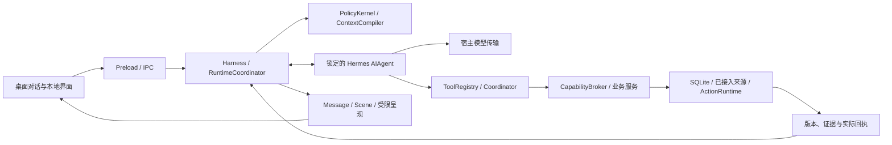

# 运行架构

2026-10-21 全系统导读见[项目基线](PROJECT_BASELINE.md#一条对话如何工作)：按当前实现串起输入、有限IPC、ContextCompiler、Hermes、工具与原状态所有者、来源收据、Scene和动作事务。本文保留具体机制；当前可用程度和实际证据不由架构图推定。

当前继续本轮新的深度完善，较早[阶段收尾安排](source-materials/2026-10-18/stage-close-and-luna-validation-20261019.md)保留当时适用范围。以下机制说明不自动成为运行通过记录，实际结果仍回到当前状态。

本文描述当前 `src/` 的职责与运行接缝，本轮整理于2026-10-21。入口和文件归属以 [PROJECT_NAVIGATION](../PROJECT_NAVIGATION.md) 为准；功能现状见 [CURRENT_STATUS](CURRENT_STATUS.md)，学生 Harness 的历史验收、迁移和未接入范围见 [STUDENT_HARNESS](STUDENT_HARNESS.md)。本轮需求与机制对应见 [HARNESS_EVOLUTION](HARNESS_EVOLUTION.md)，个人记忆、连续性及本轮新增机制的源码取舍见 [本轮研究](research/PERSONAL_MEMORY_CONTINUITY_2026-10-18.md)，此前底座研究见 [HARNESS_RESEARCH](research/HARNESS_RESEARCH_2026-10-18.md)。源码存在、已经接入、当前授权可用和真实业务完成分别判断。

本轮对话画面沿[最新视觉要求](source-materials/2026-10-18/visual-fidelity-requirement-20261018.md)落实图稿、动效和既有OpenUI。有限Scene仍由宿主从真实owner编译，界面在同一消息里改变焦点与布局；图像素材和动画不新增事实、工具执行权或第二聊天循环。必要视觉观察不等于产品模型、外部业务或长期体验验收。

本阶段随后纳入通用生成式 OpenUI：`present_view.program` 让原主模型在同一 Message.views 编写交互作品，业务 Scene 继续归原 owner。`interactive-library.ts`、`interactive-functions.ts` 与 `interactive-program.ts` 是组件、纯函数、局部状态和接纳规则的唯一共享定义；`read_skill`的`id=interactive-program`按需从实际定义生成方法，默认上下文只给版本、读取入口和少量当前作品地址。新作品可沿同一read_skill的section=authoring一次取得实际共享库全部构作签名、严格函数元数据、核心语法与原构作指导；当前scalar／工具schema不冒充全文提供。原raw没有section时，仅本轮正式准入的当前作品或实际精确交付的read_interactive_program结果使默认页为overview，否则为authoring；显式section始终优先。这只选择指南，不签发权限。authoring整体按实际递送计量，不因估算tokens／bytes拒绝合法方法；编辑先读原作与本次条件，仅为新增或具体报错沿原小页补签名，未读整册不是使用前置。函数返回类型联结与集合长度规则由同一实际Entry元数据同时进入authoring／精确小页和原AST检查，不手写第二册，也不因未知长度假定为零或放松集合上界。它不注入另一份人物提示词或场景模板；新增来源仍须实际读取，局部点击与试改不变成偏好、采用或业务执行。

通用renderer已接在`AssistantPresentation`的同一view入口：`InteractiveProgramView`使用原OpenUI 1.0.1 renderer，`interactive-context`提供唯一受检局部状态写入，`interactive-primitives`与`interactive-graphics`渲染共享组件，`interactive-motion`执行有限、由用户启动的动效。`SourceSlot`只嵌入本次已准入的真实Scene，继续使用原Scene renderer与选择入口；不另取业务资料。局部改变或继续按钮将原程序／节点引用带到同一composer，App发送前读取该作品当前完整合法输入，保留已有草稿。手动输入可中断Motion，来源边界变化后旧文档不能继续提供状态。以上接线已落源码并启用，选定图稿、同包实际画面、正常Luna和交互证据各自记入[当前状态](CURRENT_STATUS.md#personal-memory-round7)，不由源码存在推定通过。

原程序和派生文字沿`ContextReceipt.interactiveProgramSources`保留原message／program／修订地址。普通前情、核清用途后的前情与前后台子调查的实际采用都继承同一来源门；带这些来源的协议不进入不透明跨轮缓存。目录地址不是DSL或绑定数据已读。当前引用的`currentInteractive`由同一native程序重算实际局部输入，focus-only不补当前值，求值失败不补0；`sourceContext.kind=interactive_program`只标本次所指的作品，混合的独立真实自述仍按原话逐片段判断。

`read_interactive_program`默认只读有限overview与状态预览，`states`分页给完整声明，`source`按绝对Unicode范围读原源码，全文必须显式请求。当前引用也只投递有覆盖说明的有限presentation与真实局部值，不默认复制完整target、曲线点列或SourceSlot正文。宿主完成原工具schema解析后，只有新作品且previous缺省、bindings与sceneRefs均空、整个参数仅含program／sceneRefs／layout时，按回复创作处理，不调用私人资料读取用途判断。同一主run继续完善刚交付作品时，也须上述新输入边界不变，且当前outputMessageId的live cache与本轮实际投递的presented programRef精确一致，只认最高实际已发表／投递修订，再核当前来源与scope；callbacks前暂存不算发表。跨turn旧作、任意previous、新来源或其他入口仍走原用途核验，不自动代填版本；原CAS仍独立执行。本批源码在同一program入口加入整稿dsl与previous＋patch二选一；局部稿经原生声明合并，按名替换／新增，name=null显式删除，未提及声明保留且不自动GC。stateChanges稀疏修改声明，inputChanges显式改值；原字段续用本次Enter冻结输入，没有时沿原版本document.initialState，新字段才以initial起步，Reset仍取声明默认，不偷搬后来live值或自动clamp。旧数据仅当前合法未过期live与父证明可继承，保留的SourceSlot重新经过原owner；合成整件作品仍走原CAS、全部AST与预算门，实际增量体验尚待验证。其用途投影通过`projectInteractiveProgramReadPurpose`只提供拟创建／修订、绑定与Scene边界、字段种类及已正式核准的原作身份，不复制DSL、局部值和布局。全部声明与分支的AST、Data／SourceSlot实际来源集合、来源闭包、编译、CAS、预算与取消检查仍独立执行；结构化用途判断未取得时明确报结构失败，不冒充已采用的语义拒绝。

程序失败只记录有界计量及结构位置等安全metadata，不保存失败DSL来反造原因。工具实际错误与模型wire保持同一内容，读取准入、成功请求中的实际递送和最终发表分别有记录；`includedInSuccessfulModelRequest`须在成功请求内匹配实际工具JSON后才成立，字段存在不表示已递送、理解或成功修改。上述减载与反馈机制已落源码，原触发是否恢复仍以[实际结果](CURRENT_STATUS.md#personal-memory-round7)为准。

## 2026-10-21：当前接续的共同机制

这一轮沿[新的完整目标](source-materials/2026-10-21/README.md)继续本地深度完善；较早阶段的停止扩展／暂停记录保留历史身份。没有第二套主循环、来源所有者或人物事实库。

- **角色与协作说明。** `prompt-composition.ts`保持角色卡在前。共同原则、控制理解、用途核对、记忆复核、独立写稿和完成反馈用同伴式说明表达各份材料的含义，Gemini人格与事实前提例句保留。字段、原话定位、身份、许可、版本和提交条件仍由原schema与owner核验。每条可送云端的原话均进入原控制理解，普通情况的空提案仅在实际成功解析后补默认值；缺关键词不构成放行依据，失败仍用原保守范围。
- **编辑角色与预设参考（2026-10-22）。** 原`personaGuidance`只在定义文字及按场景对应的例句仍符合原preset时补其Participation/额外排练；修改过的角色沿现有custom参与说明理解当前core，不悄悄补回旧性格。名字、昵称与形象绑定不决定这个取舍，不改保存的presetId、角色文字或版本。用户core.examples与Gemini原例句保持原样，作为参考；当前角色设定与当轮交流仍由主助手理解。没有新角色分类、提示代理或数据迁移。
- **发送前的本机限制（2026-10-22）。** 原话在任何控制模型调用之前，先由本机检查是否明确禁止远程处理或资料离机；`请勿/勿`、资料“不出本机”及发往远端的同族表达沿这一受控操作判断。限制公开搜索、讨论传输技术或引用中的限制不是同一件事。`PolicyKernel.ingress`再核当前限制与临时保存，`Harness.run`在无本机模型时不请求生成。它不替主模型理解任务，也不承诺覆盖自然语言的所有表达；显式本机设置继续是直接、确定的控制。范围和真实入口证据见[当前状态](CURRENT_STATUS.md)。
- **任务、行动与读取范围（2026-10-22）。** `scopedSourceLimits`保存本人确实提出的局部材料限制，任务对象或“只比较、先别改”的行动选择本身不签出额外读取禁令。后续`verifyReadPurpose`将前一步的范围解释作为可复核线索，回到完整原话判断具体读取是否必要、范围是否相符；逐字引用和模型解释各有身份。它的意见仍不增加宿主来源权限，真实局部/全轮限源和动作核验继续生效。本轮没有引入恢复权限工具或派生scope。
- **排练创建与当前回复的用途（2026-10-22）。** `coordinator`向原用途核验解释`manage_relationship_rehearsal.begin`实际核这一共同事项，并可能接回同事项已有排练，不能笼统称作读取私人历史。可选的`hostCurrentMatter`只从本轮真实新建且已递送的frame取得：剥离工具信封的observationId后，与当前原记录完整核同一版本；显式引用全部回到当前原话，再核原来源。普通frame沿既有`declaredFrameSourceRefs`，不为它补造sourceBinding。这个背景不跳过用途核验或原owner事务，不给旧排练补许可。`present_view`另说明实际去向是当前助手回复及当前受众，不调用邮件、联系人或站外消息；呈现需要的原内容仍按地址、版本和用途核读，不因显示而扩大来源或受众。
- **工具目录的资格与参数（2026-10-22）。** Broker完整目录用`scopeEligible`表示当前来源/权限/主体/世界/设备资格，`connection`独立表示接通状态；初始`capabilityDirectory`只列已通过discover的摘要，不再用执行布尔字段表示写能力已批准。read沿原look_up提出，写入沿各自原动作事务，仍核具体托付、参数版本及执行许可。能力详情带`contractKind=capability`及原`look_up`读取地址，inputSchema的实参放在内层arguments；写能力没有此读取执行地址。专门入口误收已登记能力名时，只沿原lookup返回同一说明，原业务参数不执行。没有新增登记表或放宽invoke。专门工具目录只在schema确有顶层required时给该摘要，分支联合不造空必填列表，完整签名仍从同一use_tool取得。
- **原话和参考材料。** 原`generationInput`与`ingress.authoredText`不变；Hermes history里的应用参考包裹为单个`referenceMaterial` JSON对象，避免相邻文本合并后把应用引导尾句抄进本人引文。实际sourceQuote仍沿原owner校验。自然更正与当前新话保存范围分别理解；CORRECT回执沿原记录提供前后版本和来源身份元数据，修订不自动归因为谁曾记错。
- **问句语境与原件交接。** `source-windows-v3`从实际event位置回读相邻助手问题；`referenceContexts`保存其消息地址、精确范围、hash及冻结来由，用于解释短答，仍不把助手话当本人事实。现行与历史理解、正文采用、遗忘和迟到提交均核这些依赖。search实际交付的原文标明精确bodyCoverage与actualReadRanges；仅同run确已递送、原scope/来源/限制仍相符的重复读取可复用用途证明，实际回读与计量仍发生。子调查交接原件短片段和续读地址，父助手实际消费后再继承来由。
- **真实图片。** 公开Figure与模型视觉可复用同一ResearchImage owner；`research.image(observe=true)`和`research.read(view=image)`经原VisualObservation、toolImages、prepareModelImages发送像素。PDF页与局部放大仍由材料owner生成。图片展示、像素进入请求、语义看懂分别记证；路径、caption或展示成功不能代替模型真的收到像素。 每次工具观察保留独立队列副本及toolCallId，不按像素hash合并不同出处/调用，也不静默只取最后两图。图像owner在入缓存后、淘汰前经宿主同步回调按父run持有待用观察及其必要原PDF记录；Broker缓存/共享/新结果的返回也沿同一交接，原LRU只淘汰未持有项。回调守父run生命周期，单次RPC取消仍由原等待者门处理，避免首等待者离开误停其它共享读取；活跃run可临时超过原缓存数，根finish幂等释放后恢复原限额，前后台子调查沿budgetOwner归同一父run。撤源、删除与原barrier仍直接清图，不受持有阻挡。公开图句柄另绑定原文件SHA，归一像素相同也不覆盖不同原版本（research.image5）。

原消息图片仍只由原user Message保存像素。新上传的EvidenceEvent记录宿主绑定的`imageSource`，包含原版本、SHA、格式与尺寸；`runtime/evidence-images.ts`按原event／session／user行重核，`read_evidence(view=image)`再经本轮用途取得整图，不从助手副本或邻近消息猜来源。局部原话许可不获得整图，旧缺绑定记录不补签。实际发送仍走原toolImages，前后复核原像素；`imageRequests`只说明该轮实际送图，已采用的`providedObjectVersions`中evidence项保留`imageSha256`作为后续来源依赖，普通再读文字不抹掉它。历史采用继续核实际原owner，像素改变只影响依赖它的内容，不复制旧送图收据冒充再次发送。
- **同一消息的发表。** host自动地图预览带`automatic`身份，显式组合覆盖其全部引用时接管该预览位置，独立显式组合保留。Scene缓存按id＋revision保留实际被各view引用的版本。正文分段保留Markdown空白；完成审阅同时看实际已发表内容，既不要求数据再抄一遍，也不把成功显示当正确或接受。原续改环路最多保留同一消息两份已被替换的末段，标记`superseded_tail`及曝光未知；当前仍在正文的稳定前段不重复复制。真正父前台核对发送前先刷新来源，再从当前Rhythm取这些材料，取消/来源失效/失败/接受沿原生命周期清理。旧末段只解释先前说过什么和为何改口，原请求的交付仍须在当前正文或保留画面里，不以旧稿补足当前缺项，也不额外给角色增加义务或台词。
- **制作中的状态。** 传输只公开真实函数调用的id/name元数据，生成参数与内部推理不出界。前台真实present_view产生`Message.presentationActivity`，公开正文先flush再确定锚点；原工具执行进入checking。失败、重试、取消、来源退出和结束均清理，Store不把它存为历史。正式内容仍经过全部编译与来源检查，多次发表／同作patch与稳定节点入场让作品逐步完整。
- **局部互动。** 通用Press、Voice、几何和Motion使用同一受检`$ui`；`Document.presentation=flow`让解释与Paper共享状态。声音由真实用户动作开启，在失焦、隐藏、离开或来源退出时停止。非transient局部值在原Message.views内按精确版本/hash与CAS保存；transient的按住、播放和发声状态复位。持续看同一作品的增量修订可保仍相同声明／初态的手调值，未改模型原初态或伪造新的引用输入。
- **主动与渠道。** 无新消息的presence创作先准备、再经一次真实send_check_in送回原会话，完整回执后原run正常收束；已显示/打开通过原NativeControls记录，未回应不连续来访。持续托付保原来源、期限、原话与channel；in_app发布不排OS通知，原local_notification另走其批准渠道。暂停保留仍合法的过去回告，不恢复后续工作。
- **传输和等待。** Luna完整响应按真实usage计量，声明输出数是advisory，取消旧host_post_completion的事后token拒收。工具JSON物理保护与既有64KB DSL契约一致，实际服务incomplete、协议类型、取消与来源门仍有效。Luna单请求最多10分钟；父模型Hermes RPC预留10秒返回余量，sidecar配对再留10秒。普通工具和child RPC仍175秒，显式缩短探针仍有效；原scope到期与用户取消可更早结束，子调查授权期限不延长。固定上游Hermes版本未升级。
- **原生上下文压缩。** 原固定48,000估算tokens门曾让保护中的对话尾段比压缩前还大，并在同一作品中反复触发。当前把provider已经声明的有效contextTokens交给锁定Hermes的原compressor，由其原生窗口、输出预留和阈值策略判断；只有上游窗口未知时才沿旧fallback。显式threshold与forceInitial保留供原检查使用，没有关闭压缩或新增摘要循环。实际窗口声明不是已经做过满窗压力验证。

## 一个主助手，宿主保有执行权

### 本轮交流链：眼前能接住，过去能深读

当前主助手可以在必要调查前先说出已有根据的实质帮助。本批`conversation-rhythm.ts`接前台主模型的onText，在原Message里临时显示可替换的正文；成功工具前段与最终接受正文分开管理，终态、成功历史与缓存仍经原终审。子调查、压缩与内部核对不从该入口发布。补充沿原停止与普通发送进入新ingress，旧运行的晚到结果不承担新方向；没有新的回复代理或聊天循环。`HermesRun.validate`支持异步owner读取，原启动、RPC和子事件均等待真实来源恢复后继续。该新接力的正常Luna与界面结果仍需独立记证。

2026-10-22的`ConversationRhythm.continuationContext`向同一个前台主助手补这条消息的实际发表状态：已提交的工具轮前段与暂时可替换的尾段分别呈现。每项只取最近2400 Unicode码点，明确范围、总长与complete/partial，不复制全量来抵消原native压缩，也不把发表说成用户已看。资料只在原两次来源复核后、liveText实际允许的main/self请求里临时附加，不写进Hermes历史，不交核对、child、compression或后台；原正文合并不变。来源变化推进摘录下界并清旧尾段，完整退出继续原清除。真实已公开话语有了现场身份，仍由主助手决定怎样接话、更新判断或交付结果，不做语义删句与统一润色。有限实际证据见[当前状态](CURRENT_STATUS.md)，它不意味着所有重复或中断状态已经验收。

完成判定也需看已经真正给出的内容。`presentation-delivery.ts`仅在当前回复的`callbacks.present`成功后登记本轮新帮助与当前作品投影，供同一个`completion_review`连同正文和工具观察判断；学习纸上的完整解释不再只有一个opaque引用。程序用原native求值器取实际初态、可读文字／公式和必要图形，缺绑定资料不补空值；原题、旧历史正文和校园UI-only行不从这里展开。登记不构成正确、已读、采用或业务成功，有限窗口的缺口仍保留，来源与取消继续由原模型边界核验。这项接缝起于实际学习纸帮助已发而后续未正常收尾；修后样本与通用程序的运行证据分别归[当前状态](CURRENT_STATUS.md#personal-memory-round7)，该发布内容登记机制本身不调整Gemini表达、资料额度或超时。

缓存接续由`protocol-history-coverage.ts`按宿主消息身份核完整正文覆盖。sidecar透传锁定Hermes原生的`turn_id/current_turn_user_idx`，宿主先校验，再从实际返回协议重组本条已接受正文；只有与保存正文完全一致，才为原消息ID登记覆盖。终审继续同一消息时，较早边界须仍有完整前缀证明；跨轮证明也只在旧协议完整前缀原样保留时继承。压缩摘要、同文或缺坐标不能代替证明。`serializeForContinuation`只省去已证实覆盖的同ID正文，原sourceContext、partial等元数据留在`historyReused`；独立同文历史仍保留。参考JSON和终审续改输入采用text-part行，避免原生纯文本相邻行合并抹掉用户坐标。证明只在宿主缓存中，不进入角色说明、存储或模型参数；原范围和来源门不变。

宿主参考包中的历史也保持原身份：只有本轮确切生成的参考JSON仍独立保留在已证用户边界前一行，才为顶层`referenceMaterial.history`完整正文登记覆盖，不搜索用户提供的JSON、摘要或嵌套结果。`historyReused.bodyLocation`区分正文仍在原角色消息中，或在原宿主历史资料中；后者仍保有原角色、来源与回复状态，不成为新的本人输入。压缩或原位置不能证明时继续提供当前合法原文。

普通笔记修订与撤源继续分开：当前前台run订阅原Notes owner事件，仅为自己或原生子调查已采用的note ID记修订元数据，经原`refreshDependencies`进入变化notice；旧版本hash/range不变，新正文仍沿原读取入口取得。主/子队列独立，父采用所选报告时才继承其真实变化元数据。用途核验和终审不会替主助手确认已见，带notice请求失败也不消费；成功主请求只确认实际发送的快照，后来变化继续保留。最终接受前再次回看，主助手尚未见过的变化沿既有两次Hermes修补处理，旧终审不能代替这一步。停止后忽略事件，finally退订；删除仍走原来源屏障，不由普通edit清历史。实际Luna与未触发分支分别见[当前状态](CURRENT_STATUS.md)。

同对话材料接续沿原 `materialReads` 留下的地址回到原文件，`ContextCompiler.restoreMaterialReading` 只投影文件名、类型、原地址和旧访问位置。待核用途时，Harness先核这一小份导航的用途，再读最近一条材料访问回复的收据元数据；不会为了判断用途先取旧回复或文件正文。文件owner继续核原resource／SHA／版本、file event、parent与原提交session；导航中的旧访问与本轮文字／像素读取分别记录。`read_evidence` 的原提交消息文字与PDF文字层也有各自准确的读取目标，不能把原消息范围误称PDF页范围。新实际访问另留源event版本、源session、父run序号、时刻和真实裁剪／renderer；旧缺顺序时保持未知。

所选文件是导入时复制并绑定SHA的不可变快照。每次使用的原Buffer先核长度／SHA，PDF worker收到该Buffer的独立序列化输入；已经核过并送入请求的页面图片不会因磁盘副本后来损坏而变成错源。可信原Buffer仍在时可沿当前许可继续读取；冷重开后磁盘重取仍须匹配原SHA。存储损坏、来源撤回与新版本分别判断，不补签新hash或把合法旧阅读追溯成未发生。

地址来历由 `ContextReceipt.materialNavigationSources` 保留原回复／收据及实际采用的中间回复，历史、选中子报告、Work和交互作品继续核同一证明；它不写入 `materialReads` 或原文字已读范围。Work初写与后续修订在原事务保留完整证明，原回复、中间回复、file event和file namespace用强失效边；parent只承担文件生命周期绑定，不为未读的父消息原话新增粗隐私边。原回复重生成或原文件退出后，旧正文不能经派生或导出绕回。带这类证明的回合不缓存不透明协议链，来源失效走原清稿／清缓存分支。写给她的导航说明只解释留下了什么、哪里仍未知，不安排她的台词或情绪。

### 角色注入、对话接力与主动相处机制（2026-10-19 架构说明）

1. **角色进入主模型与边界约束**：
   - 用户在设置中选定角色（如丰川祥子、若叶睦等），角色核心数据由 `Store.settings().persona` 持有。
   - `personaGuidance()`（`src/shared/persona.ts`）在每一轮对话中动态生成角色系统上下文，注入选定角色的姓名、关系定位（女友、伙伴、妻子「老公」、朋友等设定，以及日常亲昵称呼约定如「小灰灰」）、心理层次与语气范例（`src/shared/persona-portrayals.ts`）。
   - 当前共同说明（`prompts/system.md`）与 `personaGuidance()`介绍角色、关系和可参考的表达，方法与反馈也采用同伴式的充分说明。角色自行判断怎样亲近、认真或安静；技术记录不变成必须照念的口径。角色形象不增加工具权限，角色核心由用户保存，实际查询与动作仍沿原来源和回执判断。

2. **工具观察怎样回来，哪些正文何时发布，公开前段怎样接到最终回答**：
   - **主助手正文的临时预览与接力**：本批源码将原provider.onText接入当前Message运行态；Rhythm暂段可替换，成功工具前段与最终accepted分别管理，responseText／done／历史缓存仍经原终审。首字及后续flush沿原来源门，来源失效清本run正文；普通中断可保合法已显示但未完成的文字。接线、类型检查与正常Luna／实际呈现分别记证，不能由源码宣称等待和人物体验已通过。
   - **宿主状态与角色正文分开**：Message.hostStatus按有限原因码给简短的人话，原技术原因留在可展开的处理过程；catch保持error或cancelled，不以已有隐私回执改为done。真实成功操作、合法已发布作品与原准备记录各按原owner保存。状态不拼入角色content、复制／引用或成功记忆；恢复只聚焦同一composer并保稿，不自动重放原文、旧引用或票据。成功回复的已恢复工具过程折叠在内容后，当前未完成项仍可查看；旧失败正文不猜拆或全局迁移。
   - **同一准备只读一份主体**：主动发布的Message仅由宿主为同一份全文签出primaryHelpRef；renderer还须核精确helpRef、当前实际展开的纸面与整段content逐字一致，才隐藏重复的普通正文。收起、回读不可用或正文不一致时保留原回复；存储／模型前情、复制、来源和原owner续聊不改，也不据去重签发已看回执。旧消息没有该标记时不猜拆。
   - **收尾去重与自然顺接**：当工具执行完毕、模型产生最终答复时，`ConversationRhythmPublisher.finish()` 执行逐行与前缀重叠分析，剔除重复文本，让最终输出自然承接先行承接语，避免“复读机”式罗列。
   - **工具步骤业务命名**：`src/main/tools.ts` 中的 `formatToolStepTitle` 将生硬的“核对当前事项”等兜底文字，根据工具名称与参数重写为贴合业务的友善步骤标题（如“翻看笔记内容”“规划路线与时间”“查看天气情况”“查询课程与日程”“回顾过往相处与经历”等）。

3. **后台怎样唤醒、读取、准备、投递，用户回来如何继续**：
   - **后台机会审查**：`coordinator.ts` 的 `reviewOpportunities` 在有界授权范围内轮询合法机会。本轮已放行 `curiosity_invitation`（好奇邀请）与 `write_reflective_letter`（回顾来信）进入机会执行白名单。
   - **三层产物严格区分**：
     - **安静准备（Prepared Artifact）**：后台只读调查形成的材料以准备状态安静写入数据库 Work 表，不弹窗、不骚扰用户。
     - **聊天内呈现（In-Chat Message）**：当用户回到对话或主动交互时，由主助手根据当前上下文通过 `present_view` 投影到前台界面。
     - **系统桌面通知（System OS Notification）**：明确提醒与已获准的通知渠道由 `src/main/actions/reminders.ts` 提交；标题采用原消息作者或生成时署名，正文受当前预览隐私设置控制。`in_app`不会排入OS队列。Electron原生`show`确认后才记`submitted_to_os`；失败、原lease到期或取消前没有确认则记`unknown`，不盲目重发，也不冒充已送达或已看。
   - **三种应用生命状态**：
     - **应用运行中（窗口聚焦）**：前台交互活跃，已返回的公开正文接力呈现，已发布组件更新。
     - **应用运行中（窗口未聚焦）**：后台机会审查与安静准备正常执行；定时任务到期触发操作系统通知。
     - **桌面进程完全退出**：后台轮询彻底终止；宿主不承诺离线后台服务或移动端暗中推送，严格守护本地隐私边界与电量资源。

4. **单主循环与工具开发定位**：
   - 沿用固定 Hermes 主循环（`harness.ts` → `runtime/hermes.ts` → Python `AIAgent`）与 DeepSeek 生产模型（Luna 显式代测）。
   - Antigravity 平台内的 Gemini 仅作为开发、调试与提示词写作的 pair-programming 伙伴，产品运行时内绝不增加第二套 Gemini 润色服务或外部代理分支。

需要理解旧经历时，主模型调用`recall_experience`给出当前问题、不确定处与必要原文／事项地址。`memory-inquiry.ts`在父模型assistant wire上保留调用身份，把有效请求规范为原生`delegate`任务；`memoryInquiry` profile也可用于普通delegate。Python保留原task交给`children.open`，宿主沿原source子集、取消与共享预算创建同一Hermes只读子调查。唯一详细方法`prompts/memory-inquiry.md`引导子模型随新发现继续search／browse／read、回到原事项并比较后来变化；返回的自然报告和真实evidenceIndex交给父模型判断，宿主不以读数声称理解完成。

初始上下文由`life-continuity.ts`调用各owner的index/context提供少量话题、相处方法、共做起点和陪学地址。只有已准入的本人持久记忆范围采用它；临时、待核用途、child或不含原工作来源的范围不自动读取。共做起点是旧工作解释的短预览，陪学地址不打开PDF、题目或教学答案。ContextCompiler先按真正序列化的data计入本轮预算，准入后才登记对应records、来源bindings和学习修订；索引未列出不证明没有前情，也不创建恢复或提醒动作。

局部焦点复用原引用：StudyInteraction定位真实题目／尝试行／帮助，SemanticSelection定位方案或时段，companionReference定位共做材料，curiosityReference可附当前作品field内的Unicode片段；letterReference定位原信修订中的一个段落片段。renderer的`LocalTextFocus`只在同一field的真实选字能明确对应原字符串时给地址，`FocusContextChip`只是可拿掉的临时提示；当前新原话仍独立保存。当前owner在准入后重新读取和计量，才把精确片段及其来源送进主助手。来信保留assistant_letter身份及原Work／材料／学习依赖，选句不被当作本人新事实。选择不等于接受或长期偏好。

对已有真实行／步骤ID的内容，`ReadableFocus`让普通阅读保持安静，只有真实点到／选到或键盘聚焦才给当前一处轻入口；它不把数学DOM转成字符地址。一次只显示一处焦点动作，滚动、Escape或指向别处即退出；选定后仍接同一composer。Dock的临时referenceFocus让当前同owner／修订的真实目标保留轻标记，小引用取消或边界改变即解除，不新增存储或许可。Study在焦点准入前只读复核当前owner，稳定版本不先卸载整纸；变化／失效仍不重定旧point或补回旧正文。

共写与来信的原句回显由纯renderer的`ConversationTextFocusContext`承接当前同会话／边界的小引用，仍是已有curiosityReference／letterReference。`LocalTextFocus.activeRange`沿真实literal文本节点反向映射浏览器高亮，不改原正文DOM，不把标签中的预览当作源文。取消小引用、换源或换会话即撤下标记；它没有新的Bridge字段、持久状态或阅读许可。

`interaction-control-context.ts`在现有控制解析前，以仅可读、不可推断的当前范围调用各owner的`referenceIdentity`，只给已有解析器活动类型／作品身份的非正文语境，不先展开旧checkpoint、题面、段落、proof或材料。它不授予新来源，不硬改整轮主体／现实归属。本人真实共同创作与作品内第一人称可以同时存在；原有subject/world提案保留这种区别，明确拒绝、限源与新方向优先。随后begin／compile仍沿正式当前范围重验原引用，不复用这次元数据作为授权。

这份活动身份也需要进入原有记忆链。`creationSourceContextForIngress`在新语句的控制已生效后，按实际scope重核纯创作owner或原MapScene的作品地址；仅将作品／事项修订、可选原章地址和引用类型保存为原event的`sourceContext.kind=shared_creation`。没有旧正文、地点坐标或可恢复的授权，旧无身份事件不猜填。原`source-windows-v3`从实际event向current、priorEvents和提供的sourceWindows带入同一元数据，恢复仍重建合法原文窗口。主上下文、原extractor／reviewer、业务判断与外发投影按sourceContext的kind采用同一语义说明，排练与创作不混用。创作愿望／修改交流是真实活动，作品命题不是本人经历；不将整条原话设为infer=false，混合的独立现实自述仍走原精确片段、用途及记录许可复核，没有新增分类调用或后台循环。

| 内容 | 原状态所有者与本轮接线 |
| --- | --- |
| 没说完的话题、共同说法、表达反馈 | 原collaboration frame的companion资料；`CompanionContinuityService`按当前原话读取。明确沿用的相处方法仍归带来源的personal method，角色核心独立。 |
| 一起做到哪一步 | 原matter下的`companion_session`；当前帮法、解释、材料地址与停点按本人原话更新，离开和回读不自动继续执行。 |
| 同一道题的陪学 | 原matter下的`study_companion`；本人尝试、助手教学和真实材料地址分别保留，异步`get/read`后才编译StudyScene。帮助深度可随本轮选择改变，不生成掌握标签。 |
| 消息内共同商量 | DiscussionScene是同一frame／option的只读当前投影，合并原话、工作假设和眼前小步的可读关系；选择带回原对话。 |
| 一封回顾 | 原help opportunity的准备与cooperation／呈现；ReflectiveLetterService只采用实际投递原文、材料和学习报告，来源脚注由受限IPC回读。 |
| 安排分支 | `PlanningConversationService`把比较归回原frame／option，复用同一planner及原动作／日历；下一修改或保存仍从原Action链办理。 |
| 一件可以马上体验的新鲜事 | 当前curiosity invitation及原frame／option；创作与实际读过的公开资料分别归因，不生成兴趣评分或周期推送。 |
| 先试说，再决定怎样表达 | 原relationship rehearsal owner保留本人意图、实际试说与一种可能回应；同一主助手生成模拟，Scene与原输入携带当前引用，不另起角色代理或对外发送。 |

`life-collaboration-tools.ts`、`reflective-letter-tools.ts`、`planning-conversation-tools.ts`和`curiosity-tools.ts`把这些owner接回coordinator工具入口。renderer读取有限Scene／原准备视图；回读、临时选择和草稿继续均经过既有Bridge，不在界面直接执行模型工具。来源依赖沿实际提供的ContextReceipt、子报告采用、历史与导出传播；学习正文恢复由原材料owner异步办理。当前均为本批源码，运行与体验范围见[第七批状态](CURRENT_STATUS.md#personal-memory-round7)。

Discussion将保存时的source snapshot与当前事项投影分开：普通frame修订／暂停不等于原稿失效，历史选择给当时版本和当前matter地址；它不授予采用，不恢复暂停工作。repair／needs_review与真实来源撤回仍阻断正文。该边界不泛化到缺原proof的其他artifact历史，coWork旧checkpoint仍由其owner判定。

原 `propose_options` 保存的 ordinal、稳定 ID 与该批顺序一起回读；介绍材料说明这一对应关系，角色自行表达取舍。`resolveReference` 与 `reference_option` 成功定位后，共用 Work owner 的 `resolvedReferenceData`，只清本机制生成的精确未明标记与对应问句，保留独立检查点和开放问题。定位本身不接受方案，也不写日历。

原章共作还保留独立的`assistantWorkSources`地址：只含原message／Scene／Scene修订，不复制章节正文。历史作品目录限origin=created的原Curiosity Scene，不把所有Scene或public／mixed资料改成另一全文库；目录按同事项／owner稳定keyset续页，正文沿`read_shared_creation`按原field的Unicode范围取得。ContextCompiler在普通／经用途核实的前情、原助手历史工具和实际子报告采用后登记；新的创作Scene在预算准入后继承原章来源。每次模型边界重新核原章与其递归来源，带这些来源的协议不进入不透明跨轮缓存。历史目录可以带来源保护，但目录、标题和field长度不算章节正文已读或调查ACK。旧章选句比对chapter地址，正式编译继承该章来源；续章另核当前状态与这次原话，不拿当前seed冒旧章。

共同作品的公共地图取景也携带自身的`storySetting.noteSources`：新Scene由原Work owner返回的确切笔记证明生成，明确空数组表示独立，缺字段不等于没有依赖。独立Scene恢复、无正文入口身份、ContextReceipt采用、OpenUI SourceSlot、历史元数据与永久遗忘共用原Note proof；普通编辑保留仍合法的旧修订，删除或撤源关闭相关采用，遗忘清派生正文而保留独立作品与公共地图。旧取景没有能证明原始发表身份的来源字段时不从当前Work补签；沿原Work重新读取后生成新Scene。此链的直接API结果与尚未操作的桌面／模型范围见[本轮地图接续记录](implementation/2026-10-23/context-map.md)。

采用当前作品的Work目录／元数据也不会漏掉既有原章出处。`recordWorkSources`经`workAssistantWorkSources`仅取这份exact Work修订的已保存章地址，核原来源后并入同一receipt；不要求调用者复制owner.data，也不从当前seed替换旧章。目录来源仍只是依赖，实际章节正文继续单独回读。

同一三字段地址也保护带原证明的旧Discussion.coWork快照，正文沿`read_companion_history`回读当时字段，不能拿当前checkpoint替换原页。`recordAssistantWorkSources`先核所有实际地址，再沿原receipt和精确Scene所声明的章地址收根，不用message级依赖猜是哪一章；独立来源和同消息不同Scene仍保留，不把长期链条截成最近几项。原Scene冻结的provenance与module bindings由仅含元数据的getter继承到receipt；未形成原证明的旧页仍不恢复。该共做历史延伸已有源码，实际运行范围另记。

个人方法的原帮助另以`PersonalMethodSources`保留：原助手message的片段／内容证明与其sourceRefs，以及原共同事项或学习过程的sourceBinding。`recordPersonalMethodSources`沿当前scope核这些原依据，宿主还原assistance的来源binding；它不把旧anchor修订登记为当前Work版本，也不把地址证明称作正文已读。普通／核清用途的前情、助手历史工具、真实前后台子报告采用和每次模型边界都继承／复核；有关协议也不进入不透明跨轮缓存。合法旧回复不因方法普通修订或停用而抹掉，原帮助删除／撤源或实际依据失效则不能靠派生文字绕回。

方法还可指向当时真实Study step或原消息中已发布的Discussion.coWork字段。`method-work-help.ts`先经原owner读取，保存精确范围、内容证明、冻结sourceBinding和必要材料／助手来源，保持地址而非题答副本；`read_method_help`实际读到片段并计入预算后才登记来源。普通追加尝试或checkpoint不改写当时帮助，原材料、消息或依据退出仍不能从旧方法补回正文。

实际为当前帮助采用方法时，宿主把真实method总binding一并冻结；只有与当前引用交叠、或同事项且同当前证据的本次新产物由writer保存顶层personalMethodSources。单纯discover／read、ambient线索与只读目录不激活这段写上下文。短上下文按scope／tool隔离；saveReceipt只继承实际读到的exact修订上已经冻结的元数据，不回写或补绑独立旧Work。

试说引用的`sourceContext`是宿主记录的当前交互身份，不把整条新话锁为台词，也不把角色回应当作现实陈述。预解析只核owner元数据；正式编译才读取当前合法轮次与原依赖。原用户句保持user_statement和infer:false，既有逐片段review在当前本人／现实条件成立时处理真正退出或独立事实；模拟内容不进入本人事实，也不授予外发或行动。该语义链沿原模型调用办理，没有新分类器或后台循环。

陪学的可改条件内容也属于原Study step的`packet.exploration`，只接受有限quadratic声明与数值参数，不执行模型给出的公式程序。共享计算同时驱动曲线、值与导数；继续问经fresh owner及宿主重算形成`calculation_hypothesis`，仍回原StudyInteraction和同一composer，不另建题库、owner或模型循环。原题关系与说明例子明确区分；该组件不把用户移动探针当作知识掌握。

安排比较的本次taskPreferences可声明continuous／split与maximumChunkMinutes，仍交给原planner处理同一任务量与原可拆分条件。`workRhythms`来自实际工作段及各段准备／收尾，不是渲染端拆出的示意条；某节奏未排完就不能算完整替代版。读回option、继续商量和采用沿原Action／回执／planRef，不把本次节奏写成人格偏好。

试放条件沿time_block selection的PlanningTrial地址表达，拖动用offset ISO、时刻编辑用localTime；宿主按原Scene日期／时区、原对象与完整占用重新核对，歧义不猜。renderer的FocusContextChip只编辑HH:mm并回显原时长，不生成日历事实或写入用户草稿。Enter只结束这处编辑，不提交消息；取消条件与取消整处引用分开，原preview仍不是采用。

### 保留的辅助候选层

第五批曾在原`search_context`接本地BGE q8候选臂；当前coordinator创建默认ContextCompiler时不注入该服务，默认检索与深理解沿主模型、原文工具和真实子调查完成。候选代码仍可由明确构造参数接入，独立worker只是CPU计算器；`semantic-store.ts`在原SQLite保存可删的范围向量与hash，源码迁移为schema14。权限、来源、当前Unicode范围与版本先于相似度和分页；只读scope可查合法既存索引，只有允许新推断且持久保留的本人范围能增量写索引。固定资源及尚未运行的边界见[原批次记录](research/LOCAL_SEMANTIC_RECALL_2026-10-18.md)，不作为本轮体验成果。

增量索引在原`h_meta`保存有界地址检查点，恢复仍以当前scope和来源重新准入，不保存正文、查询或授权。词法改写先合成一路，再与语义一路保留头部并融合；普通词法深页、固定窗口内的语义排名页和较早来源候选窗口各有真实继续入口。窗口续接固定合法来源/片段集合，且不补建或修复索引；索引覆盖与窗口排名覆盖分别记录，均不证明语义条件完整。

第六批以原`restore_collaboration(type=source_related)`提供从已展示原话到既有Work的反向导航。SQL先按来源、会话、类型与真实声明关系筛选，再以固定rowid上界/keyset有界枚举；服务核当前全部来源、精确投影与原owner资格，只给候选ID/版本/关系/原读取入口。精确sourceBinding交叠和旧evidenceIds的范围未知关系分别报告，不沿失效依赖图或相似标题扩展。实际目录依赖进入原ContextReceipt，不作正文阅读或调查ACK；后续沿原事项/学习/技能/规划入口读取，导航不改变活动或接受状态。浏览与原文入口按实际展示的绝对Unicode范围给导航地址，裁剪quote由宿主坐标证明；详见[机制与未验证边界](research/SOURCE_RELATED_WORK_2026-10-18.md)。

托付投影、调查绑定与续读reader共用`source-quote.ts`：新保存的版本/起止地址逐字核对，失败不重定位；旧quote-only只有全文唯一出现时能建立精确地址。Attention新控制保存宿主解析的完整来源，后台派生保留父范围；来源定位变化进入frontier边界。重复旧引文或失效地址只限制对应托付，不能借缺少投影暴露整条原消息，也不回填旧库。其他历史quote入口未在本批全量改写或验证。

第四批新增仍归现有状态所有者：只读调查续读归原机会下的地址/覆盖账本，理解变迁归原Assertion版本，学习过程归同一共同事项的Work experience，个人方法归带精确sourceBinding的Work文字。没有保存第二份私人原文或新增后台主循环。`ContextReceipt`带实际采用的历史修订、学习记录版本及WorkSourceBinding，前台/后台子报告、跨回合正文、IPC与导出继续核当前来源；永久遗忘清相应派生，独立材料保留。源码与未运行状态见[第四批](CURRENT_STATUS.md#personal-memory-round4)。

校园规划通过原ZjuAdapter查询得到同bundle来源证明，按真实课程/考试、取消/待公布及日程展开质量构造原planner的时间约束。本地加密文件stamp仅供已授权托付在原调度链中发现保存状态变化，不解密、认证或宣称学校刚更新；模型停用时延到恢复。当前证明及组合版本只存在本次进程内，不能靠模型提供hash、重启或旧快照恢复采用。其他外源仍须各自版本解析器。

正式v2学业资料的本地阅读另外核原root/账号身份、当前账号history成员及原加密文件实际字节版本。只在同一身份和版本读前后都成立的单资源保存读取中省去live SSO；未知旧CLI、新采集、关联和非学业缺缓存路径保原连接门。authentication分别表达本地读取与本次/此前实际SSO，来源采集时间不取登录时刻；默认总览由各资源保自己的结果。忙闲投影按同版分页及原schedule_quality核已知时段，缺证明或身份变化不交旧区间，未解析规则和部分来源不能变成确定空闲。

校园分页的完整行缩页保原total和来源证明，以实际交付R行接offset+R；真正正文/嵌套截断另保事实，不生成整页Scene或完整阅读地址。无法交付一条完整记录时只返原bundle/版本/位置导航，不制造空records或前进next；query6／lookup11／overview4的收据与历史恢复均核连续坐标。考试Scene的opaque行身份区分同课程的各次返回，原sourceRecordId与examType仍独立；选中回读固定原快照，以原键＋类型查询并在Scene投影前核原结果唯一，缺类型旧行不猜另一场。

Electron 主进程持有凭据、SQLite、权限、外部连接和副作用。React renderer 通过受限 preload/IPC 请求操作，不能自行获得数据库、模型密钥或任意文件访问。`Harness` 负责前台任务生命周期、取消、预算、上下文和结果发布；`RuntimeCoordinator` 连接各业务服务。生产模型和代测模型沿同一条业务链工作。

[`runtime/hermes.ts`](../src/main/runtime/hermes.ts) 以带 run、epoch 和任务版本的 stdio 协议调用锁定 Python sidecar；[`sidecar.py`](../runtime/hermes/sidecar.py) 中真实的上游 `AIAgent` 执行模型与工具循环。模型请求回到宿主传输，工具回到宿主注册表；Hermes 没有绕过宿主访问账号、数据库或执行学校写操作的通道。上游原生工具、记忆和轨迹保存关闭，使用宿主提供的能力。锁定版本在 [`lock.json`](../runtime/hermes/lock.json)。

侧车沿原工具循环控制器的决策与观察点提供说明，保留上游决策码、计数、阈值、引用去重与停止结果。原生硬停的固定英文 `final_response` 不进入角色正文；同一退出点发出独立 `run.interrupted` 终态。TS 桥等待前序宿主操作并重新核对取消及当前来源边界，再走既有中断状态；合法已公开正文与真实业务结果沿原归属保留。此处理没有重启循环或另写停机判定，新终态的实际触发证据另归当前状态记录。

“单主循环”指主助手承担理解、选择参与方式、采用子任务结果和最终答复。控制解析、读取用途、动作委托、记忆复核、完成度检查等有界模型调用是宿主核验步骤；它们可以收缩或拒绝提案，不签发新权限，也不另建一个按生活主题路由的规划主脑。后台机会复核仍调用同一 Hermes 助手，使用独立的短期范围和预算；当前一次处理一条机会，可在原托付内分出最多两个只读调查方向，不能改日历、笔记正文或执行外部业务写入。子调查不能再次委派。获准的机会提示仍须经后述材料和投递检查。普通聊天不要求先生成计划或子代理。

## 一轮请求如何进入系统

1. [`Harness.start`](../src/main/harness.ts) 接收当前原话、附件和界面控制。显式仅本机处理与凭据拦截在云端预检前生效；当前没有离线模型，因此这类聊天不会转给云端。本地笔记等普通界面仍能独立使用。
2. [`turn-controls.ts`](../src/main/runtime/turn-controls.ts) 对用户自己提出的数据控制生成有界提案；[`PolicyKernel`](../src/main/runtime/policy.ts) 结合界面控制、设置和真实授权签发不可由工具伪造的 scope。禁止网页搜索、资料限源、禁止内容离开本机分别处理；自然语言的本地识别有语法边界，界面的传输选择直接生效。
3. [`ContextCompiler`](../src/main/runtime/context.ts) 编译获准的当前材料、必要前情、当前事项和非敏感能力目录，记录实际提供的来源与对象版本。一般知识问题不会因为库中存在人物资料就自动读取它。需要更多资料时，由模型发现并调用能力；`situation.read` 提供有界情境快照，未查询、覆盖不足、已知为空和未知精力分别表达。原`time`同时保留UTC瞬间、声明时区、本地钟面和`localDate`；收尾核对复用同份锚点，不在稍后另取一天。日期判断仍归主助手，`resolve_time`负责具体本地时刻与瞬间／DST的转换，不按相对词建立另一套路线。
4. `look_up` 等工具经 [`tools.ts`](../src/main/tools.ts)、coordinator 和 broker 到具体能力。目录中有能力、已连接、本轮可执行与已经成功读取各有自己的状态。参数或结果校验失败返回有限诊断，不能把失败改写为资料不存在。
5. 宿主计量读取、模型调用和上下文预算，复核权限及版本。最终消息只关联实际动作、场景和材料。执行回执先于“已经保存/发送”的结论，步骤完成或模型文字本身不构成业务成功。

执行scope的初签从控制核准后的`policy.ingress`起算。仅Luna代测的新主前台使用独立可信`HostIngressExecution`签发900000ms；它不进入Controls、Bridge或工具JSON，生产DeepSeek及全局hostScope默认仍为240000ms。child截止取父截止与自身新签240000ms的较早者，实际取消信号也随之缩短；不自动续签或恢复旧scope，父模型单call最长600秒、模型RPC610秒，普通工具／child RPC175秒；隐私epoch／来源／版本／停止与原scope到期各自保留。结束收据只记安全原因、初签scopeExpiresAt和endedAt，子scope提前截止不冒充root过期；该机制尚无独立自然语言执行时限解析，也不是点击发送起总15分钟的承诺。源码接入及其检查不代替新attempt的实际结果。

校园个人查询经 [`zjuAdapter.ts`](../src/main/zjuAdapter.ts) 调用用户另行安装并授权的 `ZAICHANG_ZJU_SOURCE` 进程；仓库不自带账号授权。导入快照、账号实时读取和公共参考资料分别报告来源、覆盖与时效。天气使用明确公开参考地点的预报，Windows 设备定位另有共享许可和质量信息，均不能当作手机实时位置或校园现场观测。

学业刷新沿原连接器区分资源刷新和显式总览全采。`campusAcademicAcquisition` 给原用途核验说明实际采集源，以及本机重新归一化旧完整学业快照的处理范围；窄网络采集不豁免旧敏感资料的用途门。lookup／query 复用原 quick 资源刷新，在可核同账号、同学期 latest 基线上采集对应来源，保留其他源的旧采集时间；缺基线不转为全采。固定快照／版本与刷新不能混用，新结果仍经当前账号、来源质量、head 与原快照证明校验，续页保留原查询条件。原 CLI 没有 expected-base CAS，前后校验不是跨进程原子锁。

## 按需技能是方法层

[`runtime/skills.ts`](../src/main/runtime/skills.ts) 提供有版本的内置方法：原有记忆调查、日程规划、结合情境的出行、校园体育查询、安静的主动帮助和动作恢复，以及角色表达、准备与返回、学习陪伴、选择调查与通用交互构作。`discover_skills` 按需返回目录，`read_skill` 返回方法正文、版本以及所需工具/能力当前的可用、未连接、未授权、未登记或未知状态。实际发现和读取接入 coordinator 的工具注册与范围检查。

仅`interactive-program`的components／functions／actions签名分页把limit作为条数上限：交付从原offset开始的完整条目，最终外壳及coverage一起计量；未交付区间与next明确保留，不因项目估算tokens／bytes拒绝合法签名。overview／grammar不切，私人方法与材料不套此分支，不裁字或把partial当整册已读。三个静态签名分段只回方法身份、完整签名、coverage／next和本轮真实requirements／readiness，不逐页重复总览介绍或分组说明；总览／grammar及私人方法保持原结构，最终实际返回仍完整计费。同作续改先按需要读取原作品源码片段，复用已读且适用的签名，仅新增原语或具体报错时补读。相关适配已落源码，实际能否解开原请求仍看当前状态中的正常触发。

方法说明任务怎样做、什么时候回读证据或检查回执；工具和能力负责实际执行。读取技能不安装软件、不执行脚本、不创建授权，也不证明来源覆盖完整。目录搜索只匹配文档，未命中不能被解释为现实没有该能力。模型仍可直接调用简单查询；复杂任务按实际需要读取方法，不设强制技能仪式或生活主题路由。体育分类存在也不证明已取得有效跑步计次，具体字段、学期、审核口径和分页须通过真实来源核对。

方法输出同时保留逐项 `requirements` 与 `requirementGroups`：`all` 表示这些入口都需要，`any` 仅表示同一用途的等价入口，`availablePaths` 列出当前可先走的路径。学校账号未接入时，已导入材料路径仍可读取，但它不被说成学校当前记录；定位工具与其映射到的同一个能力可以作为替代入口，不能把覆盖不同的资料合并为等价事实。readiness 说明连接和调用入口，真实数据覆盖仍由每次读取核验。

## 来源、读取、传输、留存与版本

scope 绑定 owner/workspace、资料主体、现实或假设世界、来源、用途、受众、grants、留存、推断许可、隐私 epoch、策略版本和截止时间。模型只提出请求，宿主在编译、读取、提交和结果采用处复验。子任务只能收缩父范围，不能延长授权；重试不会自动续签。

| 边界 | 当前责任 |
| --- | --- |
| 资料读取 | 来源、主体与世界、用途、当前证据和细分权限共同决定。整轮限源与一项托付/草稿的局部限源分开，相关操作另核用途。公共 `map:local` 不等于本人位置或个人地点角色，`local-agenda` 不等于学校导入快照 `campus:local`。 |
| 模型传输 | 当前输入和可发送材料受本机/云端选择约束；允许查公共地图不代表允许上传设备位置。公开网络读取另检查目标、重定向与凭据，接口类型本身不构成操作系统沙箱。 |
| 聊天留存 | 原文保留、长期提取和当前读取分开。`session_only` 不把聊天、普通派生和恢复队列当作持久历史；整段临时聊天的退出清理能在重开时恢复。关闭个性记忆不等于删除原文或独立业务对象。 |
| 独立业务保存 | 笔记保存、日历登记、外发草稿和真正发送分别核验。不留聊天时，经过独立委托核验的本地动作可保留最小业务参数和回执；没有委托就不持久化提议。 |
| 版本和失效 | 证据、work、日历、笔记和业务记录各有版本。依赖边绑定实际对象及版本；更正、删除、撤权、改期或到期使相应派生结果失效。摘要、缓存和迟到子任务不能让旧结果重新取得效力。 |

`SpatialService.relation`的普通两点与设备候选使用同一publicView，不能把本地UI的个人叠加标作公共结果。个人起点只采用真实业务对应或原生共享选择固定的profileId／pointId，另一端仍公共；同公共坐标复用原公共点路由，坐标调整才在publicView临时加入reference。MapService读取只投影该点必要名称／坐标，proof保摘要及map版本；无关点修改不使它失效，个人点移除也不回落公共点。估时明确只覆盖已记录道路，不含估算接入与楼内时间。

地点对应归h_work的窄typed owner。保存默认公共目标，明确的shared_map_selection才采用当前原生选择；同次委托看真实目标身份，返回后再核scope／请求／selection，不能因同ID换成个人覆盖。读取按bindingId／role／alias及分页给安全业务字段，不返回旧source.quote；旧原句正文与业务配置保留分别准入。只读调查通过同一manage_space的read facet，不获得写权限。依据生命周期按当时event/version/Unicode范围和原来源核，普通不读聊天／不推断不自动取消配置。

宿主在成功改绑时仅冻结旧binding元数据，不复制quote、坐标或给旧数据补profile身份。当前角色只解析最新active；历史proof仍指当时修订和依据，并给当前变更事实。只有真实冻结旧版的普通语义更正／撤回可保当时解释，最新配置／legacy不借此继续作为当前依据；授权撤回、整源停止及精确忘记仍硬挡。spatialSources贯穿ContextReceipt、请求前后／公开前、真实父子采用、历史、Work派生及interactive来源；带该族不保不透明协议链。普通改绑／取消只保仍有真实合法版本依据的独立goal状态，不能借保留状态读取不可读的point；真正遗忘仍逐版本清依赖正文。导出走同一typed安全owner，不恢复旧quote或绕开generic门。

`manage_goal.revise`沿原目标id和CAS只改title／reason，本轮委托看当前对象和拟改字段；状态、来源、提醒与日历保持原样，不新建目标或恢复活动。限定实流与未验证边界见CURRENT_STATUS的B05.3b，不由静态接线推出整体体验通过。

天气契约5保原`forecast`；`dailyAggregation`逐日记录来源固定偏移24小时区间、实际IANA日界、数值完整性及是否重合，`window.complete`只判断所问粒度。日Scene独立daily coverage，选日带原行和时区；历史/消息投影缺元数据为未知，不补签旧源区间。空气契约2只开放所选地点当地今天起五个自然日，UTC仍为传输与样本身份；起点不是整UTC小时可保之前最近样本。`environment-time.ts`按真实epoch去重样本、降水起点及查询边界，识别同一当地小时的不同时差，复用于小时卡、来源范围和输入引用，不改源时刻或业务。说明文字供理解事实，不指定角色表达；实际范围见当前状态B05.3c。

[`KernelRepository`](../src/main/storage/repository.ts) 在 SQL 范围过滤和提交事务中执行这些边界，保存证据、派生记录、依赖、处理水位、动作意图及回执。隐私屏障推进 epoch/策略版本，取消在途工作并清空可复用上下文。停用理解与遗忘来源是不同操作：前者可保留原话及历史限制；后者按已存来源定位遮除被遗忘片段，并清理同源重叠断言、旧断言版本和依赖派生，不能只删选中的一个 Assertion。精确且不相交的原话、理解和子片段继续保留；剩余原文可继续整理，提交时仍检查删除屏障，不能把遮字重新当成新证据。旧定位的版本不符或无法归因时保守清除相应来源，不猜位置。`MemoryService.forget` 同时处理同一 Assertion 历史修订的旧依据；恢复数据库必须携带当前屏障，旧备份不能恢复被遗忘内容。

记忆检索先按权限、有效时间和验证状态形成可读集合，再排名分页；原文的已索引与尚未索引内容共同排名，分页不再局限于预先截取的前 50 条。关键词和字符片段检索仍有语义召回限制，分页完整不等于能理解任意同义表达。更正使用原证据版本与 Unicode 字符范围定位：受影响原话带历史/替代标记，未受影响的同段内容仍可检索；`BasisService` 使依赖已更正片段的解释及其准备失效。旧数据缺少范围时明确未知，不能伪造精确定位。

[`memory/retrieval.ts`](../src/main/memory/retrieval.ts) 为真实 `search_context` 接入主模型提供的至多五个 `relatedQueries`：合并实际候选 ID，以排名融合排序，不生成新事实；强约束仍有独立页。每路候选窗口有 `rankingWindow` / `queryContinuations` 回执，深页通过单查询续读，不称全量召回。`mode:scan` 对当前合法、active、verified 且时间有效的断言分页，不绕过范围。prefetch 最多展开三层既有依赖及 24 个额外对象，并给出 `dependencyCoverage`；旧词命中历史原文时，`correctionFollowups` 沿精确 replacementEventId 找更正，不使旧断言复活。检索包与回执保留当前范围，受限投影不会回显范围外查询字符串。默认 ContextCompiler 不注入已有的 BGE 候选服务，保留接线不代表当前每轮激活；查询扩展的语义质量取决于主模型。

[`memory/browse.ts`](../src/main/memory/browse.ts) 增加同一工具的 `mode:browse`：原文发现不要求字面命中、已提取断言或索引完成。`evidenceBrowsePage` 先按当前 scope、用途、精确来源和收到时间过滤，再按固定上界与 keyset 读页；收到时间不冒充事实有效时间。宿主随机游标只保存位置及范围，无原文、全库序号或总数，绑定当前身份、权限与隐私 epoch；30 分钟、进程重启或范围改变后须重开。期间新增事件不挤动原页，删除和撤权立即复验。每次最多扫描本轮 `maxRows` 与 200 的较小值；空 `partial` 页仍有 `nextCursor` 时可以继续，不能解释为没有记忆。

浏览预览先应用授权片段投影，只给可见长度、`previewOnly`、来源/版本和 `read_evidence` 参数；不输出隐藏匹配、私有片段限制名或全集计数。预览不是完整条件，正文仍经当前权限读取。预算检查通过后才将预览来源及版本记入 context receipt；普通 search 不会静默忽略 browse 专属的来源/时间限制。原文浏览、断言扫描和多查询各有用途，均不证明开放世界条件已全部找齐。

提取候选的幂等身份绑定原证据、片段和候选语义，不依赖模型数组顺序。预算耗尽或可重试中断保持 `pending`，已完成候选仍保留；语义失败与需要上下文另记，不无限重试。`h_memory_recovery` 持久保存尝试时间、下次恢复时间和瞬时失败次数，公平选取待处理原文并退避；恢复前仍检查来源、留存、主体、过期和限制。恢复队列没有续签旧授权的权力，也不承诺应用退出后继续整理。

本人的现实私有关注另有最小管理范围：关闭记忆后仍能按真实名称定位和停止旧关注，但管理输出不含原始 rule/quote、旧聊天或准备正文。后台仅展开托付实际引用的授权片段；按原证据 ID 读取也受相同片段和版本限制。此管理通道不授予普通历史、人物资料或材料正文读取。

## 精确支持、来源坐标与整理恢复

`h_assertion_citations`按每次理解修订保存event/version/Unicode范围及primary/support/authorization角色，不复制引文正文；当前与历史读取各核自己的完整引用集。提案可声明最多16个支持片段，同源不相邻片段分开。宿主先逐字、范围、权限、版本核对，再由语义review核声明片段自身是否支持候选的主体、条件、时间及用途。完整正文只能发现遗漏或反驳，不能给未声明的引用补条件。旧单源review缺扩展字段保持兼容，任何显式否定和不完整的新支持声明都拒绝；这不构成自然语言完整性的形式证明。

[`storage/source-lineage.ts`](../src/main/storage/source-lineage.ts)只归一可证明的整源同文副本或host绑定精确摘录，组合多层坐标，循环／未知保留未知。全局遗忘在改正文之前展开确切祖先与既存副本的范围，durable fence可用于旧备份；无关片段和独立新陈述不合并。纠正／停用在同一坐标上限制旧依据，派生读取和新提取不能通过副本或改predicate复活。启动审计递归查旧非法重放，已清理屏障不重放成宽泛历史清理。

`h_citation_restriction_receipts`只记录宿主同事务语义提交时的来源限制元数据，绑定确切理解修订和引用地址。它让包含旧说法的合法新纠正可读，同时淘汰未复核的旧兄弟理解；普通save、历史迁移和恢复不会重签。未来限制实际生效、授权退出、隐私删除或来源变化仍使引用失效。回执不授权新提取读取被停止的旧字句，`availableInferenceRanges`为提取目录／请求清理共用的合法范围计算。

[`memory/context-windows.ts`](../src/main/memory/context-windows.ts)实际计量序列化UTF-8大小；48,000字节只安排可选预览，focus、原问句及显式请求的合法原文完整交付。sourceDirectory列出一页合法地址、gap、版本与先后关系，`contextBrowse`按before／later继续前后目录；前页由近到远，后页按收到顺序，后来澄清不冒充当时已知。`contextRequests`仅请求已获准的精确坐标，每项返回明确结果；`h_memory_context`只保存地址、目录位置、签名、覆盖与原scope绑定，不保存正文或权限。重开时取原范围与当前范围交集，合法新上下文／请求覆盖／方法变化可重新入既有公平队列，同代不空转；真正开始整理前将片段置pending，只有实际返回needs_context才ACK对应来源签名，不能把期间新到的澄清说成已看见。

记忆的模型读取与本人的管理入口分开。默认启用记忆时，Store沿既有默认授权入口补缺失的`memory:read`，尊重明确撤权；关闭时撤回并使旧scope失效，用户明确重新开启才再授。模型检索、理解与原文采用均核读取权，本人的管理页仍可查看和停止原理解。新原话的写入许可不由读取开关暗中替代。

## 持久状态的归属

| 状态 | 所有者与含义 |
| --- | --- |
| 原始证据与人物理解 | [`memory/service.ts`](../src/main/memory/service.ts)、`memory/model.ts` 和 repository：原文、带条件/时间/主体的断言、支持与更正分开。自动提取在后台队列运行，候选经语义复核；提交时重验原证据、目标修订与当前隐私状态。分页、片段限制和持久恢复共同维护可继续读取的依据。相处建议和推断不能冒作用户明确设定。 |
| 用户记事本 | [`notes/service.ts`](../src/main/notes/service.ts)、[`shared/notes.ts`](../src/shared/notes.ts)：独立原文、全文搜索、分页、CAS 编辑、历史、撤销和回收站。文档时间不自动成为正文里事情的发生时间，未知主体保持未知。保存笔记不自动生成日程或人物事实；删除笔记不连带取消独立已接受日历。 |
| 用户设定的角色 | [`shared/persona.ts`](../src/shared/persona.ts)、`interaction.ts` 与 Store 设置：角色核心、用户例句、修订/恢复和纯角色模板，与五轴交互偏好共同作用。纯角色在关闭记忆时仍生效；旧 `guidance` 的混合私人内容保留私有原文，不能整段迁成常驻角色提示。预览例句是本地示例。 |
| 事项与协作过程 | [`runtime/work.ts`](../src/main/runtime/work.ts)、`basis.ts`、`collaboration.ts`：目标、承诺、方案、对话事项、依据使用和未决条件，保留各自版本。持续规划由同一 `h_work` 的 `plan/planning_intent` 持有规格，采用证明仍归原动作、回执和日历。同一事项的决策经历关联稳定方案和来源定位；用户报告不自动成为永久偏好、已接受选择或外部结果。任务步骤不等于生活承诺，空日历不等于有精力。 |
| 日历与动作 | [`actions/calendar.ts`](../src/main/actions/calendar.ts)、`local-calendar.ts`、`runtime.ts`：日程实例、重复例外、批准、幂等意图、补偿和回执。`Store.writeAgendaProjection/deleteAction` 是本地共同写入口。 |
| 关注与已准备材料 | [`runtime/attention.ts`](../src/main/runtime/attention.ts)、`work.ts`、`cooperation.ts`：明确托付、限制、机会、材料、参与选择和真实曝光。发现机会不自动通知；沉默、点击或采纳不被解释为满意度或新人格事实。 |
| 附件与公开资源 | [`materials/service.ts`](../src/main/materials/service.ts)、`pdf.ts`、`worker.ts`、`capabilities/research.ts`：文件、分页、PDF/图像处理和带范围的继续读取句柄，不把整份大文件当作无限上下文。 |
| 陪伴外观与阅读偏好 | renderer 的 [`companion.tsx`](../src/renderer/companion.tsx) / [`appearance.ts`](../src/renderer/appearance.ts)：本机 localStorage 中的形象、自选图片、窗景和阅读外观，与主机人格和SQLite业务数据分开。`SettingsPanel` 清理成功后调用 `resetCompanion`；导出/清理不能仅凭数据库回执推定覆盖全部窗口存储，新前端完整路径仍需自己的验收。 |

角色预设现包含丰川祥子与若叶睦；[`shared/persona-portrayals.ts`](../src/shared/persona-portrayals.ts) 分开保存有限官方材料、项目演绎与出处。`selectCompanionPersona` 在明确操作下采用对应预设或保留已编辑人格，仍通过原有 expectedRevision 保存；换图不隐式更改角色。`previewPersonaCharacterCard` 将 Character Card V2 JSON 转为待审阅文字草稿，不执行系统提示覆盖、世界书、宏或脚本，不把虚构场景写成用户经历。后端函数存在与前端接线分别核对，原作忠实及长期风格仍需真实对话证据。

`update_collaboration(operation=experience)` 在既有 frame 内保留拒绝理由、尝试报告、结果报告和重评，核对事项/方案版本及精确来源。持久项只存字符定位、版本、引文 hash、报告/记录时间和条件定位，不复制私人正文；重评关联同一方案的既有经历，助手建议的复查时间不创建提醒。恢复时按当前范围回读原文及方案，hash、片段、版本或使用限制变化只给安全历史标记，未受影响片段仍可用。实际展开的报告进入上下文来源/版本收据；`restore_collaboration` 经 `recordTool(...,hostRead=true)` 计入真实读取预算，超量不能把正文送入模型。单条经历不成为整个事项的永久来源前提，失去该报告不阻止独立事项继续更新。

## 持续托付与变化发现

`manage_attention` 保存当前用户明确的规则、来源、期限、渠道和停止条件。来源范围需要支持承诺的后续准备，不能只包含最初探测变化的来源；核验不足时由主助手补齐既有许可内的来源或收窄承诺。`probe` 是可选的具体读取方案，广义托付不依赖预填主题关键词或固定探查。

业务快照的 upsert/tombstone、记事本同事务的 `note_attention`、本地日历同事务的 `agenda_attention`，共用 [`storage/domains.ts`](../src/main/storage/domains.ts) 的 journal、连续 ack 水位和轮转读游标。笔记事件只带文档 ID/修订等元数据；日历事件不复制 title、detail 或自定义地点文字，正文按当前许可从真实对象回读。日历删除和恢复延续同一对象的版本高水位，同值写入不重复出事件，回滚不留下事件。没有关注消费者的本地日历写只保留结构业务账本；新托付通过初始发现读取当前状态。暂时不可读或暂停的消费者保持可恢复，不阻挡同源可读关注。

宿主按范围、版本、重复、时效和预算筛选。既有依赖变化、来源内尚未关联的有效变化、托付初始发现、用户指定时间节点，都可生成待主模型复核的机会。旧版本事件保留审计但跳过当前应用；材料绑定具体 agenda/work/domain 版本、真实来源和期限，读取正文前再检查来源与细分权限。

模型可等待、安静准备、询问、提示或不介入。材料过期和等待材料到期有独立唤醒节点，来源业务值不变也能刷新；旧证据不会因此延长有效期，重复扫描不会不断造相同候选。暂停、停止、单次限制和对象级拒绝继续约束新信号；撤回后迟到材料不能复活旧机会。

[`opportunity-scheduler.ts`](../src/main/runtime/opportunity-scheduler.ts) 只调度既有 `Harness.reviewOpportunities`，不创建第二条 agent 循环。`AttentionService.nextReviewAt` 从持久的复评时间、时间节点、材料到期、探测时间和定时暂停终点重建最近唤醒；单 timer 合并变化并避免并发，仍每 60 秒对账。队列满时也在材料到期处唤醒释放容量，避免遮住下一短窗口。一般机会按托付最近复评时间轮转，接近材料过期的机会优先；材料期限不被说成所有业务的最终截止。

`settleReview` 对新候选和已有等待机会都保存复评结果：未作决定时延后，失败从 30 秒指数退避到最多 15 分钟。提交前比较机会修订及当前托付/暂停规则，迟到失败不能覆盖新决定或撤销。`quiet` 和 `followup=on_request` 同时阻止扫描与已有机会的后台选取；明确独立提醒仍有自己的调度。前台繁忙或模型不可用时等待恢复，不刷模型；进程退出、操作系统睡眠及模型耗时仍限制实际及时性。

`inspect_help` 先返回有界轻索引，精确 ID 才读取材料与依据。前台 `decide_help.presentInConversation` 将真实准备绑定到消息的精确机会/材料修订；`Message.helpRefs` 复用既有资料组件。只有正文实际可见才写 `displayed` 并抑制同一修订的重复通知，单纯生成、发现或读取不算展示。

`discoverHelp` 支持在当前可读机会中按查询词、精确 `relatedTo` 关联、状态和最近判断时间筛选，匹配后再分页，较早准备不会先被最新三项挤掉。文字查询仍是检索手段，未命中可去掉 query 浏览；不会按生活关键词决定工具权限。后台发现先沿原 `attention.pending` 的到期集合与公平顺序，再收窄筛选，不扩成其他机会的后台访问；发现过期/暂停项不恢复采用或通知权。

[`runtime/continuity.ts`](../src/main/runtime/continuity.ts) 在初始 `ContextCompiler.compile` 中提供最多各三项 `preparedMaterials` 与 `openThreads`，附 `continuityCoverage`。跨会话仅在相关、本人、现实、私有且获准的 work/evidence 范围中出现；session_only 限当前会话，未核清用途、第三人、假设世界、群体或子代理不获得此索引。目录只含必要标题、ID、版本、时效和已有 nextStep，正文仍经 `inspect_help` / `restore_collaboration` 读取。构建前调用真实 `AttentionService.expire`；依赖变化、暂停、停止或到期后的旧准备不会通过标题进入上下文，实际来源并入回执。已 displayed/opened/seen 的同一 fingerprint 不重复主动候选，系统提交或送达不等于已看；材料仍可显式读取。

后台决策中的 `materialWakes` 自身更新以同事务返回的前后版本回执衔接；此前或此后的独立托付编辑仍使旧运行失效。正常不介入使用真实 `declined` 完成状态。已有 `question_ready` 或 `notification_queued` 内容可经明确 reuseArtifact + presentInConversation 回到当前聊天：问题仍是问题，先复核原证据；排队提示取消对应可选通知，独立明确提醒保留，不因此重复调查或写日历。

## 规划、批准和投递恢复

[`builtin.ts`](../src/main/capabilities/builtin.ts) 注册 `situation.read`、`planning.preview`、`planning.draft` 及只读 `planning.recover/replan`。`planning.preview` 复用 [`actions/planning.ts`](../src/main/actions/planning.ts) 计算当前状态、来源覆盖、冲突、可行时间、未知条件和版本绑定的提案。邀请、愿望、未接受方案与已接受承诺分开；只有 accepted 的适用日程占用承诺时间，未接受项不建提醒。未知结束不补造，时间值保留 UTC 并带声明时区的本地表达。预览只读；接受修改时通过原有动作链，对同一对象的 expectedRevision 做 CAS，撤销恢复原内容并产生新修订。

新增 [`actions/planning-draft.ts`](../src/main/actions/planning-draft.ts) 是多任务草案构造器：处理时长区间、依赖、可用窗口、连续块、保护时间、准备/收拾、休息和有方向的交通成本，保留没排入的任务及原因。按声明时长上界留位，未知估时不填默认一小时；可移动但已接受的安排仍占位。规划覆盖及未知条件同样只由已接受且占时间的承诺决定，未接受邀请或愿望的展开问题不阻挡新方案；预览仍保留这些待定项及其可查信息，整份日历指纹继续包含它们。输出包含日历及方案指纹、来源版本、条件、逐项动作参数和 `applied:false`，不宣称全局最优或现实全部可行。

任务可显式提供 `maximumChunkMinutes`，配合可拆分许可、最小工作块和休息安排；未提供时不强制打断长时间思考。不能拆分却超过上限时保留全量未排工作，不擅自缩短。每段准备/收尾和段间休息都有真实占用；最多 256 个工作段，超过时留下明确余量，不宣称全局无解。

可选 `dailyBudgets` 只约束本次指定本地日期，与全窗口工作上限/留白同时生效。每日 `maxScheduledMinutes` 仅计本次新增净工作，`reserveMinutes` 按原承诺、保护、新工作完整占用及最终共享转场/休息的区间并集扣除；不把日占用都称为工作，也不推断全天精力。跨午夜工作按真实分钟拆账，未授权拆段的工作仍是一块。已有承诺本身使留白不足时保留原对象、剩余工作及 shortfall，不能自动搬走承诺或制造次日追赶债。

可选`scheduleWindows`再区分本次整体安排域与查询horizon／任务自己的allowedWindows：省略保持旧horizon语义，[]为空，最多64窗经合并／裁切。所有新增reservation、转换／休息和保护采用在同一连通窗口内；域外不造free／睡眠／保护事件。`scheduleCoverage`及日账eligibleWindows/eligibleMinutes/outsideScopeMinutes同源输出，free+occupied=eligible；外部承诺仍是真实背景，预算仅计本次净工作。恢复seed保留原窗，当前采用仍核完整单位与最新条件。

[`planning-days.ts`](../src/main/actions/planning-days.ts) 给日历实例展开、规划预览、草案、日账与 Scene 共用真实自然日边界：午夜不存在时找该日第一实际瞬间、重复午夜取最早边界、被跳过日期为空，不假设固定 24 小时。日期覆盖与具体事件时刻分别处理；定时重复事件仍由原 `resolveLocalTime` 判断其自身时刻的歧义或不存在，相关问题逐实例保留，其他合法实例可以继续展开和导出 ICS。整天不存在时保留日期问题，不生成虚假全天实例；全天 ICS 仍使用原日期与排他结束日期。`daySummaries` 保留窗口交集、净工作、真实占用和留白。未知结束的安排在核算中保守占到窗口末尾，但 `unknownEnd`／issue 保留到输出，不将数字占位冒充已知结束。

`RuntimeCoordinator.planning` 持有 [`PlanningApplicationService`](../src/main/actions/planning-application.ts)，`planning.draft` 已接到该服务。服务把草案转为带 `planRef` 的有序保存单位：工作占用包含准备和收尾，转场/休息及显式保护窗口另有真实占用。它只签发短期校验票据，不授予保存权限；票据最长 15 分钟，若原 scope 更早到期则同时缩短。票据只在当前进程内存中，最多保留 50 份；重启、过期或淘汰后须回读真实日历重新规划，不能据票据消失推断此前没有保存。

采用走既有 `prepare_action` 与授权链。准备动作前及 `LocalCalendarService.apply` 的实际 SQLite 保存事务内均调用 `validateSave`，核对完整参数、下一保存单位、整份日历指纹、身份/世界、隐私策略、来源范围、时效和条件。`ActionRuntime` 成功提交事务后才通过 `afterCommit` 推进计划进度；事务回滚不推进。进度记账失败不能把已经提交的真实动作改报失败，后续采用停止并要求重新核查。各步骤独立提交，结果可为部分完成，不是整批原子事务；已有单对象修改继续保留原 ID/revision。

`cancel_action` 的语义核验绑定当时动作的 revision、digest 与 status，取消入口及实际本地 writer 再核同一份快照，避免等待期间的修改或成功保存被旧判断撤销。日历 `update` 对应整体对象，单次日期与取消标记归 `change_occurrence`，不再静默忽略单次地址。运行时接受建议的 `localArgs` 保留原 reminderMessage 与 planRef；后续同对象编辑不将旧 planRef 当作新的修改字段。

普通直接登记的幂等判断先取得完整同标题、同开始／全天日期候选，再沿原规范化按类型区分，不在类型筛选前截断。单一候选按完整 `localActionInput` 保存字段比较，排除宿主元数据及 `createNew` 控制，保留例外、重复、时区、规划状态、提醒正文、目标和 `planRef` 等含义；有差异返回原 ID/revision 与冲突，既不静默改原对象，也不报已保存。明确副本继续走原委托核验，不同类型的独立对象保持各自身份。

待确认日程可以在原同一次 `checkLocalDelegation` 中提供内部可选 `agendaParameterProof`，说明完整提案身份、独立参数理解及逐字段来源。宿主核字段覆盖、原话逐字位置、本次实际读到的版本、所选真实观察与对象、当前来源资格，证明完整才缩小依赖；缺证明继续原保守路径。参数来自旧观察时，建议态仍承接那份来源，证明本身不批准保存。逐字且唯一可定位的来源别名同时归一到 basis、parameterBasis 和字段引用，冲突或未知不猜；证明中的原话不写入动作记录。

直接登记和待确认提案共用原 Work 参数来源校验。`declaredFrameSourceRefs` 只识别 frame 已存完整坐标且逐字现版可核、完整覆盖原依据的声明，不给 quote-only 旧记录补坐标或新 binding。遗忘仍在 repository 原交叠门判断 owner 是否受影响：已证实不相交的片段保留；真正受影响 Work 沿原 `invalidate` 和 preserved 规则传到消费者。这样既能清除实际采用被忘来源的安排，也不因顺带读过旧事项或忘同消息另一段而误删独立安排。

本地日历参数同时核对原工具观察、读取回执、原范围下的日历投影与当前 owner 修订，不将旧观察换签为当前版本。可选证明缺省或不完整时，原保守路径仍检查实际投递的日历观察；完整证明才可排除无关观察。`planning.draft/replan/recover` 沿原宿主票据、完整下一保存单位和 `validateSave` 核验，并从原票据实际本地来源与已保存步骤建立依赖；它们不被当作原始日历列表，也不凭一个 `planRef` 豁免另行采用的旧观察。重启不恢复旧票据。

确认本地保存事务回滚时，原派发通过同一个 `record` 路径落为 `failed_confirmed` 并保存 `confirmed_failure` 回执；先回读同派发已提交的成功回执，提交后的异常不会改报回滚。补偿仅恢复事务前已有值。派发前取消的 `nonDispatchProof` 则在原动作 writer 内核对没有派发、回执、已用批准或相关日历对象，绑定动作 ID、修订、摘要和观察时间；自动取消保留具体原因，修订清除旧证明，旧取消记录不补填。

经受控动作链的普通本地保存也执行 `assertNoDetachedProposal`，拒绝移除 `planRef` 后仍匹配近期方案的常见复制。该检测限当前进程最近 50 份方案、同一 owner/设备/主体/世界/受众，以及标题、开始时刻、类型的参数摘要；它不是普遍的语义识别，不能保证识别改写标题或改动时刻的脱离方案，也不跨重启。带 `planRef` 的路径则要求完整保存参数与已核查单位一致，不能剥掉准备、休息或保护占用后仍声称按该方案采用。

`planning.recover({planId})` 只读当前日历中的持久 planRef。完整票据、范围、版本和时效都仍成立时给出精确下一保存单位；发现删除、修改、重复或账本外同方案行则要求核查。重启后只报告当前观察到的行，总步数与遗漏保持未知，不重放旧写入。可精确核对的部分采用可以生成 remainingRequest：扣除工作分钟而非准备/休息，把已安排前置项转成时间约束，不当作实际完成；仍欠休息/转场或分段保存不完整时不生成会丢占用的简化请求。来源、时间和当前日历须重新核查后再生成草案。

`remainingRequest` 还按同一自然日边界扣减已保存净工作的每日额度，不能恢复总预算时重置每日上限；已保存时段继续由真实日历占位。跨重开的持续规格由下述规划意图恢复，内存票据不持久化。

商量方案的 `continue_planning` 续排按宿主当前时刻之后的第一个完整分钟裁切原下界，保留原终点、整体安排窗、工作量和仍在范围内的逐日预算；原窗口已过时保留未排任务与原商量，不自动平移日期。该入口签发的内存票据带宿主 `futureOnly` 标记，采用前与恢复下一步时再核对是否已经开始；迟到采用停止，恢复不再给旧下一步提案。这个标记没有进入模型输入 schema，也不改变普通历史试算或回填日程的语义。

持久意图的 `materializePlanningIntent`／`planning.replan` 也从严格下一完整分钟与原下界的较晚处重排，整分钟调用不会先生成本分钟、随后仅过数毫秒就已过时的单位。仍守原终点、安排窗、未完工作和剩余额度；时间超过新单位开始后，原过去占用门照常阻断，原窗到期返回 no_future_domain。

### 跨重开的规划意图

[`PlanningIntentService`](../src/main/runtime/planning-intents.ts) 经 `manage_planning_intent` 核验当前原话、精确来源和 CAS，在现有 WorkService 保存、修订、暂停、恢复或停止 `planning_intent`；`planning.draft/replan` 本身只读。规格是带方法默认值的模型解释，不证明每个参数均为用户明说，也不成为人物偏好、接受或执行授权。`sourceBinding` 保留来源版本、Unicode 范围和所需权限；动态忙碌、资源、精力、交通及完成事实不复制成当前真相，未满足条件与 `requiredRefresh` 保留。

修订和恢复保留旧单会话字段、既有成员与当前会话的完整去重关系；达到内容预算时明确拒绝，不截掉较早会话。关系只用于同一对象的发现和定位，实际读取仍须通过当前来源和范围门，不扩大`current_conversation`。

[`planning-intent-contract.ts`](../src/main/actions/planning-intent-contract.ts) 定义宿主清单与采用单位；首次真实动作准备的同一 SQLite 事务才写 `h_planning_intent_attempts` 与 `h_planning_intent_action_links`，只读试算不写清单。schema11 让每份 attempt 自带 `source_binding/redacted`，先过自身当前来源门再读正文；当前父规格不能替旧 attempt 证明来源。旧 schema10 证明不回填来源，清空 manifest 并留下不可读证明的存在，不能据此当作零成功。

[`planning-intent-ledger.ts`](../src/main/actions/planning-intent-ledger.ts) 只从真实动作修订与参数摘要、派发、成功本地回执及当前日历对象／高水位核对采用。工作组的全部 parts 完整才计净工作；准备、收尾、休息及转场不算净工作。修改、删除、done、重复、部分保存、已经开始／过去或证明不可读均要求复核；已安排不等于已完成。

未采用也有确定依据：原宿主派发前取消标记／精确版本证明，或同一本地保存的每次派发都有唯一、同源且明确未提交的失败回执，并重新确认没有对应业务对象及补偿。一般失败、外部失败、未知、缺失或不可读证明仍需复核；真实成功后再删除的对象保留成功历史与 deleted 状态，不改记为从未采用。

新票据的宿主`attemptBasis`冻结本次实际读取的旧证明：plan／intent身份、spec／manifest摘要与原sourceBinding。在prepare、批准、派发及既有票据边界重新核验，父规格换源不能使旧证明继续有效；同票据后续prepare新增的记录不反向加入这个集合。共享`PlanningMaterialProvenance`把同一来源关系带入Scene、准备正文、cooperation和ContextReceipt。工作记录在标题／分页前核验，历史正文／导出与实际读取的前情继续传递证明，前台和后台子调查采用也沿父receipt继承。历史解释仅核原来源仍合法，不因后来的普通规格修订或暂停被误抹；准备和可交互Scene另要求当前意图修订。永久遗忘同时清这些派生正文和证明，独立安排／材料仍归自己的来源。

`planning.replan` 从原规格扣已核工作一次，保持总／逐日预算、依赖和原时间窗，不滚动日期或再扣上次余量。未来已保存工作是不可改锚点，原休息／转场提供真实覆盖；同一规划器补缺失边界，也支持只补边界而没有新增工作。新增完整准备／工作／收尾及共享边界仍守 `scheduleWindows`、留白与未来范围。新写下界向上对齐分钟，已核未来占用仍按真实相邻端点保留秒级原范围；采用前重核已存边界是否开始，放不下时明确拒绝，不省略占用。重开只签新短票据，旧票据、scope 与批准不复活。

规格、attempt、动作私文和 continuation Scene 的发现、回读、历史 IPC 与导出各过当前来源门；不可读采用证明返回未知而非零工作量。永久遗忘按每份 attempt 自身来源清私文，父规格换源不能洗白历史。仅删除非执行 typed 意图时，可按原精确业务证明保留独立已接受日历和回执；普通原话／来源／span 删除仍清同源派生，明确业务删除也不获此例外。

本轮持久规划已沿现有Planning Scene加入安静续接关系；后端、GPT Image比较与真实Electron操作的证据分别见[第三批状态](CURRENT_STATUS.md#personal-memory-round3)及[实现研究](research/PERSISTENT_PLANNING_INTENT_2026-10-18.md)。最终审查修正的复核以该状态为准，本节不宣称新版发布或真实模型效果。

外部 `sourceVersion` 的当前版本解析器尚未接入。带外部具体来源引用的方案可以构造，但只要版本无法复验，采用状态为 `blocked`；未知条件或不完整覆盖也不能伪装已核实。当前明确自述与外部来源覆盖分开处理，不能把外部记录改标为自述来宣称可用。接线存在与类型检查通过不等于真实模型、真实外部来源或逐项采用所有故障路径已经验收，最终证据以当前状态文档为准。

[`ActionRuntime`](../src/main/actions/runtime.ts) 将准备、批准、dispatch 意图、实际尝试、核查、取消和补偿分开。当前原话的明确本地委托可经独立核验直接保存；需要批准的提议先接受。外部写入还要求连接器声明可执行能力、授权与幂等/核查能力；起草外发内容、请求发送和真正发送成功分别记录。未接通的邮件、钉钉或学校写入不会因模型生成了文字就成为成功。

[`ReminderRuntime`](../src/main/actions/reminders.ts) 使用持久调度、lease、fence 和投递意图；明确设定的提醒不被可选主动性预算吞掉。机会准备与业务提醒分别检查状态。`unknown` 先核查，不能盲重发；迟到回执只补证据，不重开已取消工作。`submitted_to_os`、来源送达和用户 seen 分别记录，桌面系统通知目前只提供前者。退出进程后轮询停止，重开时按账本恢复和复验，不能据此承诺关机或手机后台送达。

失效的到期队首在同次派发内退出；多条真正同时到点的明确提醒逐条走各自lease与回执，可选告知和迟到补送仍各守自己的节奏。提醒正文的`reminderSpeaker`由实际前台回合绑定messageId、当时署名与正文SHA；改标题或时间保留原稿身份，改正文重新核说话回合，renderer不能指定作者。通知的`preparationRef`只带原材料地址，主进程与PresentationService重新回原owner投影，客户端展开同版卡并沿原动作记opened，真实可见再记displayed。

可选帮助的单次约定在原attention_rule保留最小`onceUse`接触事实，不携私人准备正文。原提交意图事务先记`submission_started`，只说明进入发送边界；unknown、系统提交、显示及已看各依实际回执解释。私人帮助被遗忘不抹掉仍独立合法的一次约定；新规则以`onceContractVersion=1`说明跟踪起点，旧规则丢失回执时覆盖保持未知，不从空历史认定尚未使用。已尝试通知的原ID在来源退出后可请求原端口撤除，端口接受请求不证明Windows实际撤回或用户未看。

[`actions/calendar-export.ts`](../src/main/actions/calendar-export.ts) 通过现有 `expandAgenda` 导出有限时间窗内已接受、未完成、非演示的本地安排快照为 ICS；实例 UID 稳定，实际时间用 UTC，全天结束日期排他，不占用时间的条目保留透明性。默认不带详情，不加邀请、网络订阅或提醒；时间不完整条目明确省略。`calendar:export` IPC 在原生保存框返回后复核隐私 epoch、策略版本与私人视图，再读取当前日历写文件。它不创建新的日历业务对象，也不是手机同步服务；系统日历真实导入与界面入口的验收分别记录。

### 动作能力契约

新动作另绑定broker宿主生成的`CapabilityContractRef`：provider／能力版本、schema、来源、权限、效果／出站、主体／世界、预算和恢复声明纳入摘要；批准、派发及inspect/cancel键都复验。函数与闭包本身未被哈希，语义改变仍须提升声明版本。旧无ref动作可读但不能自动补绑定新派发；旧成功回执和本地补偿保留，未知执行后果不因新契约可调用而改成可重发。

## 缓存、在途共享与子代理

[`CapabilityBroker`](../src/main/capabilities/broker.ts) 的已完成读取缓存最多 64 条，检查 TTL、能力/来源版本、owner/workspace、主体/世界、sources、grants、用途、受众、留存、推断和策略/数据版本。`session_only` 不保留已完成读取结果。缓存或共享复用仍复验当前调用者，计入其读取预算并生成回执；强制刷新丢弃对应旧项。

每位在途等待者分别取消，最后一位离开才中断物理读取。只有显式声明 `cacheScope: 'equivalent'` 的纯数据能力允许跨等价 scope 共享；默认绑定同一 handle，研究/PDF/图像继续读取句柄保留自身范围、最终 URL 和内容版本。隐私屏障清除缓存。供应商提示前缀缓存、宿主工具缓存、上下文复用和在途共享分别计量；usage 未报告缓存 token 时记未知，不能把一次本地命中换算成供应商节省。

只读子任务通过 Hermes 的委派接口获得实际按收缩范围编译的上下文、工具目录、相关原话、对象/权限版本、共享预算和取消条件。父助手采用并整合结果；子代理不能写日程、扩大来源或继续委派。结果交付与父任务消费时重新复验，撤权或对象变化后的迟到结果不进入有效父上下文。简单查询可直接读取或并发，委派不是固定前置阶段。

子任务在 ContextCompiler 编译前保存 `sourceRestrictionSnapshot`。该基线只在宿主 Worker 内持有经 scope 筛选的限制元数据和版本，不含正文，不进入 prompt、模型 receipt 或持久存储，也不会在后续读取后重新基准化。已存在且未变化的局部历史限制不再使整个调查失败；只对实际提供给子模型的原文 ID 比较变化，新增/改变限制、未来限制开始生效或整源停止会拒绝旧报告。前台真实模型传输前后核对当前 actor 及实际引用的已产出/采用子报告，成稿复用时再次检查；后台沿 `validateBoundary`、交付和 `consume` 同样复核。原权限、对象依赖、取消及机会版本检查继续保留，失败只给安全失败信息，不把摘要当新证据。

后台沿 [`background-delegation.ts`](../src/main/runtime/background-delegation.ts) 使用同一个锁定 Hermes 子任务协议。最多两个方向共享父任务预算，只读取原托付实际允许的片段与来源子集；每次模型/工具边界及父任务消费前检查机会、托付、权限和对象版本。子结果经过采用后，真实工具观察和证据回执才合并回父任务，子代理摘要本身不构成“已准备”的依据。暂停、纠正或停止可使在途报告失效，不因生成完成而自动获得发布权。此实现支持有界记忆深挖，不证明真实模型能在每次复杂调查中找齐证据。

## 对话 Scene 与公共地图

完整契约见 [CONVERSATION_SCENES](CONVERSATION_SCENES.md)。[`shared/scenes.ts`](../src/shared/scenes.ts) 与 [`runtime/scenes.ts`](../src/main/runtime/scenes.ts) 管理带来源及版本的地图/天气快照；`Message.scenes/views` 交给 [`AssistantPresentation`](../src/renderer/presentation/AssistantPresentation.tsx) 的受限 OpenUI 组件库。模型不能注入任意 JavaScript、改写来源事实或凭展示动作取得业务授权。选中地点、日期或路线段通过 `ChatInput.selection` 返回精确语义引用，宿主复验场景版本后才进入后续上下文。后台查询快照标记 `preparationOnly`，单纯查询不取得前台展示权。

正常发现仍属于主模型的语义选择：工具目录说明如何取得真实结果，`presentationLibrary`说明现有有限组件，实际查询返回的SceneRef才供`present_view`引用。原记录ID不是画面ID，没取得引用时不能猜造。单一来源的原资料可直达其owner，例如校园课程沿原campus.lookup／campus.query；Context中的情境覆盖信息不要求先综合读取。`situation.read`只为实际需要的跨源安排／承诺／目标汇合，单次最多31天，规划工具也不是原资料查询的前置。日历直读通过`agenda-scene.ts`复用PlanningScene的`mode=agenda`，不调用planner或制造空闲／新方案；同一run的同一精确查询复用Scene身份，原消息按该身份更新。已成功发布的画面与正文共同参与原completion review，数据UI不要求正文整表复抄；作品、帮助与明确全文请求仍需实际可读内容，失败或未呈现的目录不冒充交付。

笔记正文继续归NotesService。`NoteScene`只从实际已交付的read页恢复，`NoteSourceProof`保存note ID、原修订、内容证明及绝对Unicode范围；list／history的零长范围只作元数据依赖，不算正文已读。普通编辑保留合法原版本，删除／撤回阻止画面和派生正文回流。实际采用的证明沿ContextReceipt、历史、前后台子报告与模型边界继承；`note_reference`只保原消息的回读地址，不缓存旧页许可。当前选句已编译准入时，原读取用途核验另取得仅含当前合法对象／选区／已展示页范围的宿主元数据，用来理解“这句／这些想法”；不自动许可回读或把原页算成本轮全文已读，具体内容仍经原工具实际读取。成绩／GPA仍是CampusScene，敏感读取另以本轮真实用途的`campusSensitiveReads`约束模型前情；本机私有历史显示不自动授予下一轮模型读取。

笔记范围按原Unicode码点合同核查，repository的确定性 `note_codepoint_length` 计完整原文，避免SQLite文本length在U+0000处停止而误拒合法尾页；不清洗正文或改变原版本／权限。`manage_note` 的参数物理边界从同一正文、标题与引用schema推导，覆盖JSON最坏转义长度；原工具入口、两种provider的参数累积及SSE待处理边界共用该值。其他工具与文本／不透明内容边界保留，200000码点正文上限仍由原schema核查。

未发送附件由原MaterialService持有。只有Harness跨异步准入期间按本次userEventId持有准备占用，同步Runtime.begin准备不另留占用；成功绑定或本尝试finally结束后释放。明确移除与普通发送失败分开：移除遇到仍在准备的原件时记待释放，最后占用结束且无绑定／独立草稿才沿原remove清字节和文件。普通取消仍能重试，已提交来源与其他草稿各自保留。

`ConversationMap`、独立 `MapSheet` 与 review-web 共用 `MapSurface`、`CampusMapAdapter`、`WalkingGraph.shortest`、MapLibre 引擎和已有平面 fallback。地面地理/通行图与展示几何分开，`CameraOwnership` 取消被用户手势接管的旧异步视图。独立地图拥有本机定位轮询；公共地图本身不提供个人位置。模型路线副本由 [`map-model-view.ts`](../src/main/runtime/map-model-view.ts) 保留距离、入口、条件、警告和来源，去除重复绘图几何；完整路线仍供原地图绘制。原始读取字节与模型可见 token 分别计量。天气能力可返回小时窗口，当前 WeatherScene 仍是日级展示。

[`scene-projections.ts`](../src/main/runtime/scene-projections.ts) 从宿主规划结果投影 PlanningScene；按已核完整连续的 `daySummaries` 将有限结束的显示块分到各日，拆开的部分携带 `originalRange` 与完整 `planRefs`。点选仅引用同一宿主方案，不因显示拆块生成保存参数或拆分现实工作。日账缺项、重复、范围不连贯或边界不符时保留原完整块并说明缺口；未知结束保持 null，不按日界伪造终点。renderer 使用宿主日账显示工作、占用与留白，不自行计出另一套事实。小时天气和空气另经 EnvironmentScene 保留各自来源、单位与覆盖。

重算结果的可选 `PlanningScene.continuation` 绑定 intent 修订和精确来源，只在采用证明 ready、覆盖满足且分钟为有效数字时投影；`allocatedMinutes` 是已核已安排净工作，`scheduledMinutes` 是本次新试算，均不证明完成或接受。SceneService 在读取、点选与恢复时重核 active 规格及来源；历史消息 IPC、准备材料和导出应用同一门，旧画面不能成为绕过当前限制的副本。

renderer复用`LifeSceneViews.tsx`的原连续时间线，用“接着上次的安排”及“已在日历／这次续排”轻量表达两者关系，保留真实日历背景与原日期条；没有独立完成进度或新采用入口。日期、时段选择仍只生成当前Scene的精确引用，输入草稿沿原会话保存与恢复。

公共 [`air-quality.ts`](../src/main/capabilities/air-quality.ts) 经 `air_quality.lookup` 接入既有天气适配器与 `weather:read`，只接受明确公开参考点，不接受设备定位观测。返回 Open-Meteo/CAMS 小时网格预报、PM2.5/PM10、US/European AQI、单位、覆盖和取回时间；缺测保持 null，制式或时间列异常拒绝当作可用结果。发布时间未知，参考点不是用户位置，US/EU AQI 不能写成中国官方 AQI。EnvironmentScene 是有限结果投影，不能据此保证某人适宜运动。

review-web 仅替换公共地图存储边界，读取构建明确选定且校验哈希的公共文件；没有桌面 IPC、账号、助手状态、模型请求、私有文件、数据库或 profile 持久化。公共白名单以外的读取会拒绝。对话与网页预览共用现有地图实现。

公开搜索的Bing RSS响应由锁定生产依赖`@xmldom/xmldom`按XML模式读取，先确认无namespace的rss根和唯一直接channel，再取直接item；真空channel不当格式错。非RSS/畸形XML窄转failed并保HTTP元数据，取消和未知异常不吞，空候选仍非不存在证据；旧合法网页缓存不因一次搜索格式失败清空。HTML原文及解析器原异常不作为可信宿主说明送回模型。

公开search/read的HTTP实体字节经`capabilities/public-text.ts`按BOM、HTTP charset及相应HTML有界meta/XML声明或签名解码，缺省UTF8；原生TextDecoder严格拒绝不支持声明和非法字节，不猜编码或以替代字符冒充成功。这是静态资料读取的有界处理，不是完整浏览器嗅探。旧`sha256`仍是解码后完整原文的UTF8指纹，`textDecoding`另给解压实体字节指纹、大小、编码、选择来由及版本。新resourceId同时绑定实体指纹和解码版本/编码，Unicode分页/定位属于实际提取文字；search为5、read为7。网络安全、压缩、PDF及图片像素仍沿原owner处理。

## 生产传输、代测和部署边界

普通启动使用 [`provider.ts`](../src/main/provider.ts) 的 DeepSeek 协议与 [`shared/types.ts`](../src/shared/types.ts) 的 `deepseek-flash` 默认。显式 `dev:luna:test` / `start:luna:test` 经 [`model-selection.ts`](../src/main/model-selection.ts) 选择 [`luna-provider.ts`](../src/main/luna-provider.ts) 的 GPT-6 Luna Max 代测；Luna 标识来自 [`model-contract.json`](../src/shared/model-contract.json)。选择仅在宿主启动时生效，renderer 和保存设置不能切换。

Luna 接现有 Codex 账号的单次 completion 传输，Hermes 继续运行主循环，工具仍在原宿主执行；它不是产品自己的 ChatGPT 登录集成。请求与返回模型需一致，完整响应按真实 usage 计量，项目声明的输出数采用 advisory，不再作为完成后的 token 拒收门；实际服务不完整、协议、取消与来源检查仍各自生效。Node 网络沿用显式代理环境或 Windows 已开启的手动代理，不执行 PAC，不更改系统设置。

普通网络`TypeError(terminated/fetch failed)`在两provider原重试决策终点共享归类为`ProviderError/transport`，取消仍保留原错误；尝试次数与已有usage继续传递，未知usage不填零。Harness沿原失败路径保留合法公开内容及error/partial身份，来源失效仍走独立屏障。

实际型号由`luna-provider.ts`从返回事件的`response.model`取得，经`Completion.responseModel`写入本次`modelUsage[].responseModel`与`provider.observedResponseModels`；配置中的model名称不替代这份证据。阶段状态分别记录正常主流程、实际工具、Scene／renderer与点选续问，不把合成资料或校园只读结果混作业务写入成功。

常规构建生成 Electron、renderer、stdio 地图桥和隔离公共预览；Windows 打包另暂存锁定 Hermes/Python 与有许可的原生 PDF 运行时。依赖安装、编译、合成宿主检查、真实模型调用和业务成功各自验收。当前桌面不含 Android 工程、手机同步接口或已部署持续宿主；`ClockPort`、`DeliveryPort`、SQLite 与模型/工具回调是后续接入点。生产 DeepSeek、校园外部服务和手机生命周期仍需各自验收。

本轮按用户最新补充执行后端 → GPT Image → 前端：先完成本轮可实施的后端机制与对应核查，再开始图像先行的页面工作；Luna 通道不可用或个别远期连接缺失不作为全面停止前端的门禁。类型、机制与合成宿主证据不能代替真实模型、真实来源或长期体验；未接外源复验、手机生命周期等只限制对应能力，界面不得把它们包装成已完成。最新需求与历史要求的关系见[本轮补充](source-materials/2026-10-18/continuation-requirements.md)。
