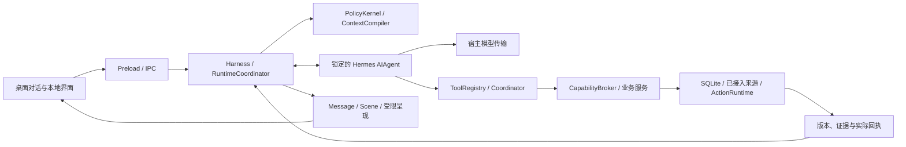

# 运行架构

本文描述 2026-10-18 当前 `src/` 的职责与运行接缝。入口和文件归属以 [PROJECT_NAVIGATION](../PROJECT_NAVIGATION.md) 为准；功能现状见 [CURRENT_STATUS](CURRENT_STATUS.md)，学生 Harness 的历史验收、迁移和未接入范围见 [STUDENT_HARNESS](STUDENT_HARNESS.md)。本轮需求与机制对应见 [HARNESS_EVOLUTION](HARNESS_EVOLUTION.md)，公开源码、论文与取舍见 [研究记录](research/HARNESS_RESEARCH_2026-10-18.md)。源码存在、已经接入、当前授权可用和真实业务完成分别判断。

## 一个主助手，宿主保有执行权

Electron 主进程持有凭据、SQLite、权限、外部连接和副作用。React renderer 通过受限 preload/IPC 请求操作，不能自行获得数据库、模型密钥或任意文件访问。`Harness` 负责前台任务生命周期、取消、预算、上下文和结果发布；`RuntimeCoordinator` 连接各业务服务。生产模型和代测模型沿同一条业务链工作。

[`runtime/hermes.ts`](../src/main/runtime/hermes.ts) 以带 run、epoch 和任务版本的 stdio 协议调用锁定 Python sidecar；[`sidecar.py`](../runtime/hermes/sidecar.py) 中真实的上游 `AIAgent` 执行模型与工具循环。模型请求回到宿主传输，工具回到宿主注册表；Hermes 没有绕过宿主访问账号、数据库或执行学校写操作的通道。上游原生工具、记忆和轨迹保存关闭，使用宿主提供的能力。锁定版本在 [`lock.json`](../runtime/hermes/lock.json)。

“单主循环”指主助手承担理解、选择参与方式、采用子任务结果和最终答复。控制解析、读取用途、动作委托、记忆复核、完成度检查等有界模型调用是宿主核验步骤；它们可以收缩或拒绝提案，不签发新权限，也不另建一个按生活主题路由的规划主脑。后台机会复核仍调用同一 Hermes 助手，使用独立的短期范围和预算；当前一次处理一条机会，可在原托付内分出最多两个只读调查方向，不能改日历、笔记正文或执行外部业务写入。子调查不能再次委派。获准的机会提示仍须经后述材料和投递检查。普通聊天不要求先生成计划或子代理。

## 一轮请求如何进入系统

1. [`Harness.start`](../src/main/harness.ts) 接收当前原话、附件和界面控制。显式仅本机处理与凭据拦截在云端预检前生效；当前没有离线模型，因此这类聊天不会转给云端。本地笔记等普通界面仍能独立使用。
2. [`turn-controls.ts`](../src/main/runtime/turn-controls.ts) 对用户自己提出的数据控制生成有界提案；[`PolicyKernel`](../src/main/runtime/policy.ts) 结合界面控制、设置和真实授权签发不可由工具伪造的 scope。禁止网页搜索、资料限源、禁止内容离开本机分别处理；自然语言的本地识别有语法边界，界面的传输选择直接生效。
3. [`ContextCompiler`](../src/main/runtime/context.ts) 编译获准的当前材料、必要前情、当前事项和非敏感能力目录，记录实际提供的来源与对象版本。一般知识问题不会因为库中存在人物资料就自动读取它。需要更多资料时，由模型发现并调用能力；`situation.read` 提供有界情境快照，未查询、覆盖不足、已知为空和未知精力分别表达。
4. `look_up` 等工具经 [`tools.ts`](../src/main/tools.ts)、coordinator 和 broker 到具体能力。目录中有能力、已连接、本轮可执行与已经成功读取各有自己的状态。参数或结果校验失败返回有限诊断，不能把失败改写为资料不存在。
5. 宿主计量读取、模型调用和上下文预算，复核权限及版本。最终消息只关联实际动作、场景和材料。执行回执先于“已经保存/发送”的结论，步骤完成或模型文字本身不构成业务成功。

校园个人查询经 [`zjuAdapter.ts`](../src/main/zjuAdapter.ts) 调用用户另行安装并授权的 `ZAICHANG_ZJU_SOURCE` 进程；仓库不自带账号授权。导入快照、账号实时读取和公共参考资料分别报告来源、覆盖与时效。天气使用明确公开参考地点的预报，Windows 设备定位另有共享许可和质量信息，均不能当作手机实时位置或校园现场观测。

## 按需技能是方法层

[`runtime/skills.ts`](../src/main/runtime/skills.ts) 提供六份经审核的内置方法：记忆调查、日程规划、结合情境的出行、校园体育查询、安静的主动帮助和动作恢复。`discover_skills` 按需返回目录，`read_skill` 返回方法正文、版本以及所需工具/能力当前的可用、未连接、未授权、未登记或未知状态。实际发现和读取接入 coordinator 的工具注册与范围检查。

方法说明任务怎样做、什么时候回读证据或检查回执；工具和能力负责实际执行。读取技能不安装软件、不执行脚本、不创建授权，也不证明来源覆盖完整。目录搜索只匹配文档，未命中不能被解释为现实没有该能力。模型仍可直接调用简单查询；复杂任务按实际需要读取方法，不设强制技能仪式或生活主题路由。体育分类存在也不证明已取得有效跑步计次，具体字段、学期、审核口径和分页须通过真实来源核对。

## 来源、读取、传输、留存与版本

scope 绑定 owner/workspace、资料主体、现实或假设世界、来源、用途、受众、grants、留存、推断许可、隐私 epoch、策略版本和截止时间。模型只提出请求，宿主在编译、读取、提交和结果采用处复验。子任务只能收缩父范围，不能延长授权；重试不会自动续签。

| 边界 | 当前责任 |
| --- | --- |
| 资料读取 | 来源、主体与世界、用途、当前证据和细分权限共同决定。整轮限源与一项托付/草稿的局部限源分开，相关操作另核用途。公共 `map:local` 不等于本人位置或个人地点角色，`local-agenda` 不等于学校导入快照 `campus:local`。 |
| 模型传输 | 当前输入和可发送材料受本机/云端选择约束；允许查公共地图不代表允许上传设备位置。公开网络读取另检查目标、重定向与凭据，接口类型本身不构成操作系统沙箱。 |
| 聊天留存 | 原文保留、长期提取和当前读取分开。`session_only` 不把聊天、普通派生和恢复队列当作持久历史；整段临时聊天的退出清理能在重开时恢复。关闭个性记忆不等于删除原文或独立业务对象。 |
| 独立业务保存 | 笔记保存、日历登记、外发草稿和真正发送分别核验。不留聊天时，经过独立委托核验的本地动作可保留最小业务参数和回执；没有委托就不持久化提议。 |
| 版本和失效 | 证据、work、日历、笔记和业务记录各有版本。依赖边绑定实际对象及版本；更正、删除、撤权、改期或到期使相应派生结果失效。摘要、缓存和迟到子任务不能让旧结果重新取得效力。 |

[`KernelRepository`](../src/main/storage/repository.ts) 在 SQL 范围过滤和提交事务中执行这些边界，保存证据、派生记录、依赖、处理水位、动作意图及回执。隐私屏障推进 epoch/策略版本，取消在途工作并清空可复用上下文。遗忘沿依赖传播；明确只忘一条推断时保留原文，并防止按同一依据再次提取。恢复数据库必须携带当前隐私/权限屏障，旧备份不能恢复被撤回的用途。

记忆检索先按权限、有效时间和验证状态形成可读集合，再排名分页；原文的已索引与尚未索引内容共同排名，分页不再局限于预先截取的前 50 条。关键词和字符片段检索仍有语义召回限制，分页完整不等于能理解任意同义表达。更正使用原证据版本与 Unicode 字符范围定位：受影响原话带历史/替代标记，未受影响的同段内容仍可检索；`BasisService` 使依赖已更正片段的解释及其准备失效。旧数据缺少范围时明确未知，不能伪造精确定位。

提取候选的幂等身份绑定原证据、片段和候选语义，不依赖模型数组顺序。预算耗尽或可重试中断保持 `pending`，已完成候选仍保留；语义失败与需要上下文另记，不无限重试。`h_memory_recovery` 持久保存尝试时间、下次恢复时间和瞬时失败次数，公平选取待处理原文并退避；恢复前仍检查来源、留存、主体、过期和限制。恢复队列没有续签旧授权的权力，也不承诺应用退出后继续整理。

本人的现实私有关注另有最小管理范围：关闭记忆后仍能按真实名称定位和停止旧关注，但管理输出不含原始 rule/quote、旧聊天或准备正文。后台仅展开托付实际引用的授权片段；按原证据 ID 读取也受相同片段和版本限制。此管理通道不授予普通历史、人物资料或材料正文读取。

## 持久状态的归属

| 状态 | 所有者与含义 |
| --- | --- |
| 原始证据与人物理解 | [`memory/service.ts`](../src/main/memory/service.ts)、`memory/model.ts` 和 repository：原文、带条件/时间/主体的断言、支持与更正分开。自动提取在后台队列运行，候选经语义复核；提交时重验原证据、目标修订与当前隐私状态。分页、片段限制和持久恢复共同维护可继续读取的依据。相处建议和推断不能冒作用户明确设定。 |
| 用户记事本 | [`notes/service.ts`](../src/main/notes/service.ts)、[`shared/notes.ts`](../src/shared/notes.ts)：独立原文、全文搜索、分页、CAS 编辑、历史、撤销和回收站。文档时间不自动成为正文里事情的发生时间，未知主体保持未知。保存笔记不自动生成日程或人物事实；删除笔记不连带取消独立已接受日历。 |
| 用户设定的角色 | [`shared/persona.ts`](../src/shared/persona.ts)、`interaction.ts` 与 Store 设置：角色核心、用户例句、修订/恢复和纯角色模板，与五轴交互偏好共同作用。纯角色在关闭记忆时仍生效；旧 `guidance` 的混合私人内容保留私有原文，不能整段迁成常驻角色提示。预览例句是本地示例。 |
| 事项与协作过程 | [`runtime/work.ts`](../src/main/runtime/work.ts)、`basis.ts`、`collaboration.ts`：目标、承诺、方案、对话事项、依据使用和未决条件，保留各自版本。任务步骤不等于生活承诺，空日历不等于有精力。 |
| 日历与动作 | [`actions/calendar.ts`](../src/main/actions/calendar.ts)、`local-calendar.ts`、`runtime.ts`：日程实例、重复例外、批准、幂等意图、补偿和回执。`Store.writeAgendaProjection/deleteAction` 是本地共同写入口。 |
| 关注与已准备材料 | [`runtime/attention.ts`](../src/main/runtime/attention.ts)、`work.ts`、`cooperation.ts`：明确托付、限制、机会、材料、参与选择和真实曝光。发现机会不自动通知；沉默、点击或采纳不被解释为满意度或新人格事实。 |
| 附件与公开资源 | [`materials/service.ts`](../src/main/materials/service.ts)、`pdf.ts`、`worker.ts`、`capabilities/research.ts`：文件、分页、PDF/图像处理和带范围的继续读取句柄，不把整份大文件当作无限上下文。 |
| 陪伴外观与阅读偏好 | renderer 的 [`companion.tsx`](../src/renderer/companion.tsx) / [`appearance.ts`](../src/renderer/appearance.ts)：本机 localStorage 中的形象、自选图片、窗景和阅读外观，与主机人格和SQLite业务数据分开。`SettingsPanel` 清理成功后调用 `resetCompanion`；导出/清理不能仅凭数据库回执推定覆盖全部窗口存储，新前端完整路径仍需自己的验收。 |

## 持续托付与变化发现

`manage_attention` 保存当前用户明确的规则、来源、期限、渠道和停止条件。来源范围需要支持承诺的后续准备，不能只包含最初探测变化的来源；核验不足时由主助手补齐既有许可内的来源或收窄承诺。`probe` 是可选的具体读取方案，广义托付不依赖预填主题关键词或固定探查。

业务快照的 upsert/tombstone、记事本同事务的 `note_attention`、本地日历同事务的 `agenda_attention`，共用 [`storage/domains.ts`](../src/main/storage/domains.ts) 的 journal、连续 ack 水位和轮转读游标。笔记事件只带文档 ID/修订等元数据；日历事件不复制 title、detail 或自定义地点文字，正文按当前许可从真实对象回读。日历删除和恢复延续同一对象的版本高水位，同值写入不重复出事件，回滚不留下事件。没有关注消费者的本地日历写只保留结构业务账本；新托付通过初始发现读取当前状态。暂时不可读或暂停的消费者保持可恢复，不阻挡同源可读关注。

宿主按范围、版本、重复、时效和预算筛选。既有依赖变化、来源内尚未关联的有效变化、托付初始发现、用户指定时间节点，都可生成待主模型复核的机会。旧版本事件保留审计但跳过当前应用；材料绑定具体 agenda/work/domain 版本、真实来源和期限，读取正文前再检查来源与细分权限。

模型可等待、安静准备、询问、提示或不介入。材料过期和等待材料到期有独立唤醒节点，来源业务值不变也能刷新；旧证据不会因此延长有效期，重复扫描不会不断造相同候选。暂停、停止、单次限制和对象级拒绝继续约束新信号；撤回后迟到材料不能复活旧机会。

[`opportunity-scheduler.ts`](../src/main/runtime/opportunity-scheduler.ts) 只调度既有 `Harness.reviewOpportunities`，不创建第二条 agent 循环。`AttentionService.nextReviewAt` 从持久的复评时间、时间节点、材料到期、探测时间和定时暂停终点重建最近唤醒；单 timer 合并变化并避免并发，仍每 60 秒对账。队列满时也在材料到期处唤醒释放容量，避免遮住下一短窗口。一般机会按托付最近复评时间轮转，接近材料过期的机会优先；材料期限不被说成所有业务的最终截止。

`settleReview` 对新候选和已有等待机会都保存复评结果：未作决定时延后，失败从 30 秒指数退避到最多 15 分钟。提交前比较机会修订及当前托付/暂停规则，迟到失败不能覆盖新决定或撤销。`quiet` 和 `followup=on_request` 同时阻止扫描与已有机会的后台选取；明确独立提醒仍有自己的调度。前台繁忙或模型不可用时等待恢复，不刷模型；进程退出、操作系统睡眠及模型耗时仍限制实际及时性。

`inspect_help` 先返回有界轻索引，精确 ID 才读取材料与依据。前台 `decide_help.presentInConversation` 将真实准备绑定到消息的精确机会/材料修订；`Message.helpRefs` 复用既有资料组件。只有正文实际可见才写 `displayed` 并抑制同一修订的重复通知，单纯生成、发现或读取不算展示。

## 规划、批准和投递恢复

[`builtin.ts`](../src/main/capabilities/builtin.ts) 注册 `situation.read`、`planning.preview` 与 `planning.draft`。`planning.preview` 复用 [`actions/planning.ts`](../src/main/actions/planning.ts) 计算当前状态、来源覆盖、冲突、可行时间、未知条件和版本绑定的提案。邀请、愿望、未接受方案与已接受承诺分开；只有 accepted 的适用日程占用承诺时间，未接受项不建提醒。未知结束不补造，时间值保留 UTC 并带声明时区的本地表达。预览只读；接受修改时通过原有动作链，对同一对象的 expectedRevision 做 CAS，撤销恢复原内容并产生新修订。

新增 [`actions/planning-draft.ts`](../src/main/actions/planning-draft.ts) 是多任务草案构造器：处理时长区间、依赖、可用窗口、连续块、保护时间、准备/收拾、休息和有方向的交通成本，保留没排入的任务及原因。按声明时长上界留位，未知估时不填默认一小时；可移动但已接受的安排仍占位。输出包含日历及方案指纹、来源版本、条件、逐项动作参数和 `applied:false`，不宣称全局最优或现实全部可行。

`RuntimeCoordinator.planning` 持有 [`PlanningApplicationService`](../src/main/actions/planning-application.ts)，`planning.draft` 已接到该服务。服务把草案转为带 `planRef` 的有序保存单位：工作占用包含准备和收尾，转场/休息及显式保护窗口另有真实占用。它只签发短期校验票据，不授予保存权限；票据最长 15 分钟，若原 scope 更早到期则同时缩短。票据只在当前进程内存中，最多保留 50 份；重启、过期或淘汰后须回读真实日历重新规划，不能据票据消失推断此前没有保存。

采用走既有 `prepare_action` 与授权链。准备动作前及 `LocalCalendarService.apply` 的实际 SQLite 保存事务内均调用 `validateSave`，核对完整参数、下一保存单位、整份日历指纹、身份/世界、隐私策略、来源范围、时效和条件。`ActionRuntime` 成功提交事务后才通过 `afterCommit` 推进计划进度；事务回滚不推进。进度记账失败不能把已经提交的真实动作改报失败，后续采用停止并要求重新核查。各步骤独立提交，结果可为部分完成，不是整批原子事务；已有单对象修改继续保留原 ID/revision。

经受控动作链的普通本地保存也执行 `assertNoDetachedProposal`，拒绝移除 `planRef` 后仍匹配近期方案的常见复制。该检测限当前进程最近 50 份方案、同一 owner/设备/主体/世界/受众，以及标题、开始时刻、类型的参数摘要；它不是普遍的语义识别，不能保证识别改写标题或改动时刻的脱离方案，也不跨重启。带 `planRef` 的路径则要求完整保存参数与已核查单位一致，不能剥掉准备、休息或保护占用后仍声称按该方案采用。

外部 `sourceVersion` 的当前版本解析器尚未接入。带外部具体来源引用的方案可以构造，但只要版本无法复验，采用状态为 `blocked`；未知条件或不完整覆盖也不能伪装已核实。当前明确自述与外部来源覆盖分开处理，不能把外部记录改标为自述来宣称可用。接线存在与类型检查通过不等于真实模型、真实外部来源或逐项采用所有故障路径已经验收，最终证据以当前状态文档为准。

[`ActionRuntime`](../src/main/actions/runtime.ts) 将准备、批准、dispatch 意图、实际尝试、核查、取消和补偿分开。当前原话的明确本地委托可经独立核验直接保存；需要批准的提议先接受。外部写入还要求连接器声明可执行能力、授权与幂等/核查能力；起草外发内容、请求发送和真正发送成功分别记录。未接通的邮件、钉钉或学校写入不会因模型生成了文字就成为成功。

[`ReminderRuntime`](../src/main/actions/reminders.ts) 使用持久调度、lease、fence 和投递意图；明确设定的提醒不被可选主动性预算吞掉。机会准备与业务提醒分别检查状态。`unknown` 先核查，不能盲重发；迟到回执只补证据，不重开已取消工作。`submitted_to_os`、来源送达和用户 seen 分别记录，桌面系统通知目前只提供前者。退出进程后轮询停止，重开时按账本恢复和复验，不能据此承诺关机或手机后台送达。

## 缓存、在途共享与子代理

[`CapabilityBroker`](../src/main/capabilities/broker.ts) 的已完成读取缓存最多 64 条，检查 TTL、能力/来源版本、owner/workspace、主体/世界、sources、grants、用途、受众、留存、推断和策略/数据版本。`session_only` 不保留已完成读取结果。缓存或共享复用仍复验当前调用者，计入其读取预算并生成回执；强制刷新丢弃对应旧项。

每位在途等待者分别取消，最后一位离开才中断物理读取。只有显式声明 `cacheScope: 'equivalent'` 的纯数据能力允许跨等价 scope 共享；默认绑定同一 handle，研究/PDF/图像继续读取句柄保留自身范围、最终 URL 和内容版本。隐私屏障清除缓存。供应商提示前缀缓存、宿主工具缓存、上下文复用和在途共享分别计量；usage 未报告缓存 token 时记未知，不能把一次本地命中换算成供应商节省。

只读子任务通过 Hermes 的委派接口获得实际按收缩范围编译的上下文、工具目录、相关原话、对象/权限版本、共享预算和取消条件。父助手采用并整合结果；子代理不能写日程、扩大来源或继续委派。结果交付与父任务消费时重新复验，撤权或对象变化后的迟到结果不进入有效父上下文。简单查询可直接读取或并发，委派不是固定前置阶段。

后台沿 [`background-delegation.ts`](../src/main/runtime/background-delegation.ts) 使用同一个锁定 Hermes 子任务协议。最多两个方向共享父任务预算，只读取原托付实际允许的片段与来源子集；每次模型/工具边界及父任务消费前检查机会、托付、权限和对象版本。子结果经过采用后，真实工具观察和证据回执才合并回父任务，子代理摘要本身不构成“已准备”的依据。暂停、纠正或停止可使在途报告失效，不因生成完成而自动获得发布权。此实现支持有界记忆深挖，不证明真实模型能在每次复杂调查中找齐证据。

## 对话 Scene 与公共地图

完整契约见 [CONVERSATION_SCENES](CONVERSATION_SCENES.md)。[`shared/scenes.ts`](../src/shared/scenes.ts) 与 [`runtime/scenes.ts`](../src/main/runtime/scenes.ts) 管理带来源及版本的地图/天气快照；`Message.scenes/views` 交给 [`AssistantPresentation`](../src/renderer/presentation/AssistantPresentation.tsx) 的受限 OpenUI 组件库。模型不能注入任意 JavaScript、改写来源事实或凭展示动作取得业务授权。选中地点、日期或路线段通过 `ChatInput.selection` 返回精确语义引用，宿主复验场景版本后才进入后续上下文。后台查询快照标记 `preparationOnly`，单纯查询不取得前台展示权。

`ConversationMap`、独立 `MapSheet` 与 review-web 共用 `MapSurface`、`CampusMapAdapter`、`WalkingGraph.shortest`、MapLibre 引擎和已有平面 fallback。地面地理/通行图与展示几何分开，`CameraOwnership` 取消被用户手势接管的旧异步视图。独立地图拥有本机定位轮询；公共地图本身不提供个人位置。模型路线副本由 [`map-model-view.ts`](../src/main/runtime/map-model-view.ts) 保留距离、入口、条件、警告和来源，去除重复绘图几何；完整路线仍供原地图绘制。原始读取字节与模型可见 token 分别计量。天气能力可返回小时窗口，当前 WeatherScene 仍是日级展示。

公共 [`air-quality.ts`](../src/main/capabilities/air-quality.ts) 经 `air_quality.lookup` 接入既有天气适配器与 `weather:read`，只接受明确公开参考点，不接受设备定位观测。返回 Open-Meteo/CAMS 小时网格预报、PM2.5/PM10、US/European AQI、单位、覆盖和取回时间；缺测保持 null，制式或时间列异常拒绝当作可用结果。发布时间未知，参考点不是用户位置，US/EU AQI 不能写成中国官方 AQI。这是后端能力，没有新增空气页面或 Scene，也不能据此保证某人适宜运动。

review-web 仅替换公共地图存储边界，读取构建明确选定且校验哈希的公共文件；没有桌面 IPC、账号、助手状态、模型请求、私有文件、数据库或 profile 持久化。公共白名单以外的读取会拒绝。对话与网页预览共用现有地图实现。

## 生产传输、代测和部署边界

普通启动使用 [`provider.ts`](../src/main/provider.ts) 的 DeepSeek 协议与 [`shared/types.ts`](../src/shared/types.ts) 的 `deepseek-flash` 默认。显式 `dev:luna:test` / `start:luna:test` 经 [`model-selection.ts`](../src/main/model-selection.ts) 选择 [`luna-provider.ts`](../src/main/luna-provider.ts) 的 GPT-6 Luna Max 代测；Luna 标识来自 [`model-contract.json`](../src/shared/model-contract.json)。选择仅在宿主启动时生效，renderer 和保存设置不能切换。

Luna 接现有 Codex 账号的单次 completion 传输，Hermes 继续运行主循环，工具仍在原宿主执行；它不是产品自己的 ChatGPT 登录集成。请求与返回模型需一致，账号通道的输出上限在完成后由宿主核验，不能提前限制供应商消耗。Node 网络沿用显式代理环境或 Windows 已开启的手动代理，不执行 PAC，不更改系统设置。

常规构建生成 Electron、renderer、stdio 地图桥和隔离公共预览；Windows 打包另暂存锁定 Hermes/Python 与有许可的原生 PDF 运行时。依赖安装、编译、合成宿主检查、真实模型调用和业务成功各自验收。当前桌面不含 Android 工程、手机同步接口或已部署持续宿主；`ClockPort`、`DeliveryPort`、SQLite 与模型/工具回调是后续接入点。生产 DeepSeek、校园外部服务和手机生命周期仍需各自验收。

本轮遵守后端先行：类型与机制检查只能证明相应边界，不能取代真实 Luna/生产模型、真实来源、长期记忆与人格质量验证。尚未接入的外部版本复验和未完成的实际模型验收不得被新界面包装成可用。当前不进入新增前端；后端相关链路与失败恢复验收后，新页面仍须先依项目设计理念用 GPT Image 生成方案，再实现并检查。既有桌面页面和旧验收记录不为本轮或未来手机/平板页面自动背书。
