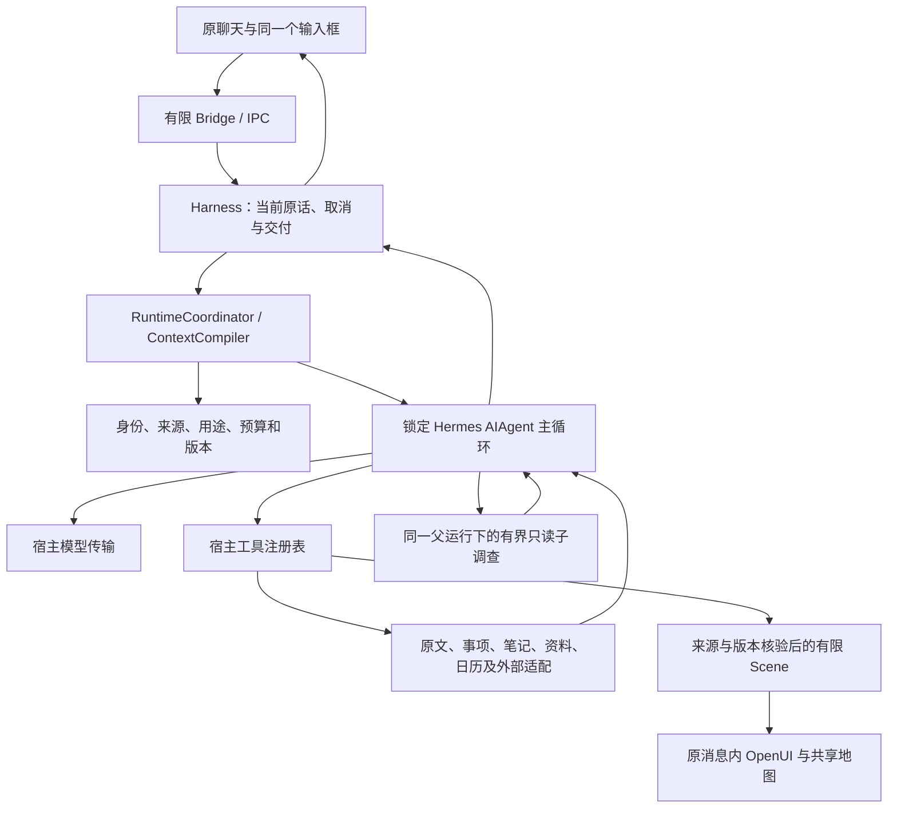

# 项目全貌与源码基线

整理日期：**2026-10-19**。本页按本次即时同步时的实际源码和已有记录说明项目全貌；提交身份以包含本页的 Git 提交为准。同步起点为 `e4254aa`，工作分支为 `codex/personal-memory-continuity-20261018`。这次保存正在演进的实现和文档，不把同步提交命名为最终验收或新版本发布。

## 项目为什么存在

在场是面向大学生日常生活的个人助手。用户可以带着还没说清的事情进来，先得到有内容的回应，再一起理解、查找、比较或实际做事；离开不被追催，回来不用重讲。学习、生活、朋友、兴趣和休息都有自己的价值，不默认以成绩、效率或完成率衡量人。

温暖来自记得事情的理由、给出合适的帮助、尊重今天的新选择；主动包括安静准备、等待和不介入。复杂的记忆与队列由系统承担，用户不必维护人物标签、调查目录或工具清单。角色演绎、陪伴外观和表达方式服务这种关系，不增加读取或行动权限。

[产品契约](PRODUCT_CONTRACT.md)维护长期原则，[完整目标与补充来源](source-materials/2026-10-18/README.md)保留需求背景。当前阶段停止新功能外延，沿已授权的真实 Luna 对话与校园只读收尾，完成后按用户要求暂停。本次即时同步不替代另一条正在进行的实际验证，也不宣告原持续目标全部完成。

## 四条基线分别看

| 对象 | 本次可以确定的状态 | 不能由此推定的状态 |
| --- | --- | --- |
| Git 源码 | 本次保存第四至第七批的后续源码、必要方法文本、资产来源和说明；前三批提交从 `4edd922` 经 `01afdc4`、`30dcd8e` 到 `e4254aa` 可追溯 | 全部功能已运行、所有场景已验收 |
| 产品版本与下载 | `package.json` 仍为 `0.3.0`；README 记录的便携 EXE 为源码 `74e099a` 的历史发布 | 本次提交已进入该 EXE，或生成了新版安装包 |
| 公共地图 | `apps/review-web` 复用同一地图实现，历史发布信息在 [CLOUD_REVIEW](CLOUD_REVIEW.md) | 本次推送已部署 Sites，或公共网页具备私人助手能力 |
| 运行证据 | [CURRENT_STATUS](CURRENT_STATUS.md)按批次记录类型、宿主机制、Hermes、模型、外部来源与画面观察 | 旧通过数字、设计图或某一条真实对话覆盖当前所有能力 |

声明工具链为 Node `24.18.0`、npm `11.16.0`，本次本机读取得到相同版本。桌面目标为 Windows x64；公共地图有独立浏览器入口。Hermes 锁为 `0.21.2` / `d595e636c83aa0b9606d4e914e1140ae9c796897`，Python `3.13`，沿上游冻结 `uv.lock`；不得以同步文档为由升级引擎。

## 一条对话如何工作

Electron main 持有 SQLite、凭据、来源与实际副作用；renderer 显示内容、保存当前草稿并提出有限操作，不能任意读取本机文件或执行模型工具。`harness.ts → runtime/hermes.ts → runtime/hermes/sidecar.py`使用真实上游 `AIAgent`；模型请求和工具执行都回到宿主。没有第二套聊天引擎、事实记忆或后台代理循环。

`runtime/coordinator.ts`连接能力与状态所有者；`context.ts`编译当前合法上下文并登记实际提供的来源收据；`policy.ts`及各 owner 负责当前准入，`completion-review.ts`参与交付核对。模型理解语义、选择调查、比较理由和作出当前判断；宿主核身份、用途、时间、权限、预算、取消、对象修订与提交边界。不能靠生活场景关键词提前裁掉合法能力，也不能由模型自行签发权限。

生产默认仍是 DeepSeek，真实配置与传输分别归 `src/shared/types.ts`、`src/main/model-selection.ts`和`src/main/provider.ts`。Luna 是经现有 Codex 账号的临时代测传输，同一 Hermes 和工具链继续工作；`src/shared/model-contract.json`不是生产模型切换开关。测试禁止调用 DeepSeek。实际 Luna 身份看返回的 `modelUsage[].responseModel` 和 `provider.observedResponseModels`，不能只看配置名。

## 记忆、持续工作和行动的原理

原始证据、带条件与时间的理解、笔记原文、角色设定、事项和日历分别存储。人物理解声明精确来源与 Unicode 范围，经原文核对和独立语义复核后提交；纠正、停止使用与永久遗忘有不同语义。可证明的副本或摘录经 `storage/source-lineage.ts`统一坐标，遗忘沿实际依赖清理，独立片段保留。原文可浏览和分页，不以“已经提取成记忆”作为可发现的前提。

`recall_experience`把当前问题、疑点和起点交给原生 delegate 的 `memoryInquiry` profile。真实子调查在父来源子集与共享预算内搜索、浏览、读经历并追查后来变化，主助手判断怎样用于眼前问题。唯一详细方法是 `prompts/memory-inquiry.md`，`read_skill`复用同一文本。报告不是新人物事实。`memory/history.ts`读取同一理解的变迁；`source-related.ts`只提供声明来源关联的导航，目录不能代替正文阅读或语义判断。

本地 BGE 辅助候选代码、固定模型清单与安装脚本保留在 `memory/semantic-*`、`memory/embedding-*`和`runtime/embedding/lock.json`。当前默认 ContextCompiler 不注入 BGE 候选计算；它不是当前理解主链，也没有长期检索质量证明。模型资源不提交进 Git，安装与打包按脚本处理，运行时不临时下载模型。

持续关注由 `attention.ts`、机会调度、原 Work 与持久队列协作：真实变化或明确时间节点唤醒同一 Harness，模型可以准备、等待、询问、提示或不介入。只读子调查有版本、取消和来源复核；持久调查断点只保存地址、覆盖和 ACK，不复制私人正文或恢复旧授权。明确提醒独立调度；OS 提交、送达和已看分开。桌面进程退出后后台轮询停止。

安排从 `planning.preview/draft/compare`进入同一 planner，考虑依赖、真实时区自然日、整体与单项时窗、净工作预算、准备收尾、转场休息及留白。持久规划意图归原 `h_work`，跨重开回读真实动作、回执和日历后重算；未知采用量保持未知。试算、点选、保存规格均不等于采用。实际写入沿 prepare、当前授权、同对象版本和原动作事务逐项办理，可部分成功，不宣称整组原子完成；旧票据和批准不能跨重启复活。

项目自带的按需技能是有版本的方法文本，入口与依赖由 `runtime/skills.ts`维护；它不是开发本仓库时的 Codex 个人技能，也不会自行安装任意代码或扩大权限。

## 功能实现与能力边界

下表是源码职责概览。各项当前实际观察和未完范围以 [CURRENT_STATUS](CURRENT_STATUS.md) 为准。

| 领域 | 当前实现 | 边界与仍未完成的部分 |
| --- | --- | --- |
| 聊天、草稿与中断 | 原对话、附件、控制解析、有限引用；已有根据的主助手前段可先呈现，“补一句”停止旧 run 后发送新原话 | 新交互与不同输入法需各自观察；停止当前 run 不取消独立已接受安排 |
| 记忆与经历 | 原文浏览、条件理解、精确支持、更正遗忘、经历调查、理解历史、来源关联导航 | 第四至第七批若干链仅有源码；长期理解、自然调用时机和角色效果尚未整体验证 |
| 资料与笔记 | TXT/MD/PDF、图像、分页检索、数学排版；独立笔记编辑、版本、冲突、撤销和回收站 | 扫描件 OCR 未接通；记笔记不自动建日程或人物事实 |
| 日程与规划 | 本地事件、待办、截止、提醒、重复例外；完整规划、恢复、比较、有限 ICS 导出 | 外源版本与条件不足时阻断采用；导出不是外部同步，安排不证明已经完成 |
| 校园 | `zjuAdapter.ts`及能力适配支持账号／本地导入来源；日历快照、课程／考试／成绩等有限场景与命名 GPA 呈现已接源码 | 当前账号只读已获授权，具体资源和画面仍逐项看真实回执；未实现预约、付款等学校写入闭环 |
| 公开研究与环境 | 公开搜索／网页、公共参考点天气和小时空气预报；保留单位、覆盖、时效及缺测 | 公共参考位置不是设备位置；缺测、过期或覆盖外不能补成确定事实 |
| 共同商量与共做 | 原 frame／option 投影 Discussion；原事项下的 companion session 保留帮法、停点和历史地址 | 点选不接受方案，暂停不是欠进度；新历史恢复链仍有未运行范围 |
| 陪学与可改条件图 | 原题、本人尝试、助手帮助分开；原 composer 停靠纸内；有限 quadratic 声明重算 | 不评定掌握；不是任意公式执行器；新图整合与拖动体验尚未收口 |
| 相处、来信与新鲜事 | 原 owner 下的相处方法、生活来信、具体好奇邀请与可继续的共同作品 | 不凭点击推偏好，不形成周期信件或订阅；旧章采用和方法依赖传播还有未运行范围 |
| 关系表达排练 | 同一主助手、原输入与有限 Scene 保留试说和一种可能回应 | 模拟不成为对方态度、真实经历或外发许可；模型与画面效果未整体确认 |
| 角色与外观 | 可编辑人格、预设演绎、角色卡文字草稿、显式形象绑定；本机窗景与阅读外观 | 有限原作资料不等于完整角色知识；角色、图片和用户事实分别归属 |
| 地图 | 公共地理快照、稳定身份、步行候选、真实平移缩放旋转、空间／平面共享 surface | 建筑显示代理不证明实测高度；估计接入和待核通路保留条件，预览不是到达 |
| 作品地图取景 | 保留后端契约、来源与取舍研究 | renderer 未交付，正常 `present_view.storySetting`入口已冻结；不能列为可用新体验 |
| 手机、平板与跨设备 | 有设计与研究输入，窄窗适配服务现有桌面 | 尚无独立原生宿主、完整同步、手机 GPS／健康或关机后持续运行闭环 |

## OpenUI、动态呈现与地图怎样衔接

工具先取得真实结果，`runtime/scenes.ts`核当前对话、用途、来源与精确版本，形成 `SceneSnapshot/SceneRef`。`present_view`引用已有事实或经原 owner 核验的内容，编译有限 OpenUI Lang；消息保存 `scenes`、`views`及当时 DSL，renderer 的 `AssistantPresentation.tsx`用固定组件库渲染。OpenUI `1.0.1`负责呈现，没有客户端任意工具、脚本或另一套 agent 循环。

地图、天气、校园、日程、笔记、商量、陪学、比较、好奇和排练都有明确来源与 owner；来信与共做也沿原消息／准备入口呈现。场景选择只说明“此刻说这里”，原行、段落、方案或 Unicode 地址随同一输入的小引用继续，草稿不被机器条件句改写。历史回读重新核来源，目录和缓存不代替准入。动效解释真实焦点、展开、版本与方案变化；设计图不是预填数据、截图式 UI 或已通过的效果证明。

桌面地图、对话地图和 `apps/review-web`共用 `src/renderer/map`、`src/main/mapService.ts`、`src/shared/map-routing.ts`与`assets/map-v2`。地理事实、显示几何、路线和观看状态分开：MapLibre 空间相机绘制地面、建筑和标签；OpenLayers 兼容分支使用同源平面视图，GPU 初始化失败再走现有 Canvas 路径。无 WebGL 不提供假的斜视体块。

路线由实际道路图、有向路段、入口与通行条件计算；参考点到道路的估计接入、待核通路和已知道路分别显示。相机可被手势或新原话中断，内嵌与聚焦复用同一 surface，历史不自动重播旧观看请求。地图保留暖灰、克制金色、透明空间、俯视与斜视；官方参考点、显示代理和实测事实不能互相冒充。

## 当前证据与接续入口

第七批已记录一条真实 Luna 日程路径：从正常 composer 经 Hermes 读取隔离的合成本地日历、发布一份 `mode=agenda`时间带、点原时段后续问；实际响应型号有 `gpt-6-luna`字段。早先 `scene_unavailable`和重复时间带已分别修复并按记录范围复看。该证据不是本人校园数据，也不覆盖成绩、笔记、地图、所有新场景或长期记忆／角色效果。精确行为与剩余问题见[第七批记录](CURRENT_STATUS.md#personal-memory-round7)。

本次同步已直接运行 `npm run check`并通过；完整构建等同步检查结果另记[即时同步记录](CURRENT_STATUS.md#repository-sync-20261019)。这次不调用 DeepSeek，不新增测试工程，不重复另一操作者的真实模型会话，不把文档整理改成新一轮产品扩展。

| 要了解什么 | 阅读入口 |
| --- | --- |
| 快速认识、安装与运行命令 | [README](../README.md)、[部署与 Windows 发布](DEPLOYMENT.md) |
| 文件、工具与实际调用链 | [PROJECT_NAVIGATION](../PROJECT_NAVIGATION.md) |
| 产品理念与用户决定权 | [PRODUCT_CONTRACT](PRODUCT_CONTRACT.md) |
| 状态归属、来源与执行边界 | [ARCHITECTURE](ARCHITECTURE.md) |
| Harness 方法与各批研究取舍 | [HARNESS_EVOLUTION](HARNESS_EVOLUTION.md) |
| OpenUI、Scene、焦点与历史 | [CONVERSATION_SCENES](CONVERSATION_SCENES.md) |
| 当前证据、未完项和历史范围 | [CURRENT_STATUS](CURRENT_STATUS.md) |
| 当前接续与协作规则 | [CONTINUE_FROM_HERE](CONTINUE_FROM_HERE.md)、[AGENTS](../AGENTS.md) |
| 图稿、实现覆盖与资产来源 | [FRONTEND_DESIGN](../FRONTEND_DESIGN.md)、[DESIGN_IMAGE_COVERAGE](DESIGN_IMAGE_COVERAGE.md)、[ASSET_PROVENANCE](ASSET_PROVENANCE.md) |
| 公共地图与私人桌面的发布边界 | [CLOUD_REVIEW](CLOUD_REVIEW.md)、[DEPLOYMENT](DEPLOYMENT.md) |

真实校园正文、成绩、凭据、个人数据库、profile、坐标、日志和运行截图不随此次提交。来源归档仅按用户已授权的私人目录保留；设计资产按原许可和用途记录进入相应范围，不因 Git 同步扩大公开部署许可。
