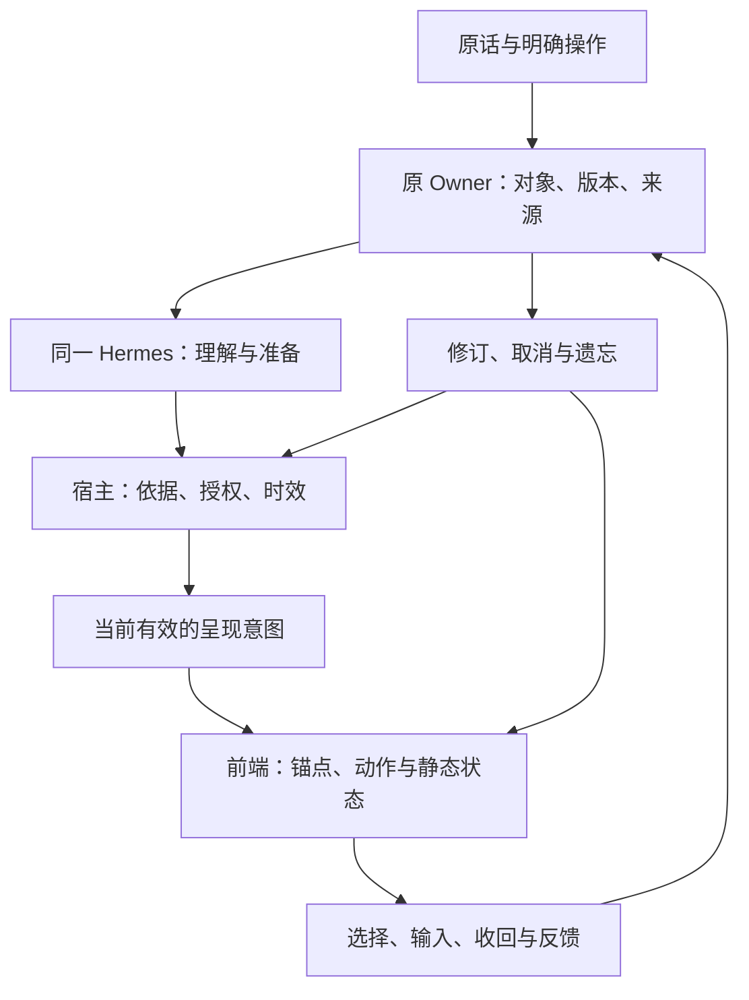

# 在场：同一位伙伴、同一件事、连续的回应

版本：2026-10-25。本文是前后端共同实施的设计契约，不是新增能力已经运行通过的报告。与[十二阶段路线图](../REFACTOR_ROADMAP_2026-10-22.md)、[角色与动态制作规范](CHARACTER_MOTION_PIPELINE_2026-10-25.md)共同使用；源码中的已有对象优先，下面的新类型名均是待映射的协议草案。

## 1. 从原话推导出的产品公理

用户写过“你想打开，就像拥入了温柔乡一样”“一个是工具调用，一个是记忆”，也追问“难道两百多种场景，难道要编码两百多种吗？”，并在本轮明确要求前后端共同完成“心智—状态—动效—在场”。这些要求应成为以下可判断的产品行为。原话和旧助手提案的区分、历史安排的适用性见[阅读与设计决策](../reading/2026-10-25/READING_AND_DESIGN_DECISIONS.md)。

| 公理 | 具体含义 | 能观察到的兑现 |
| --- | --- | --- |
| 亲近有具体内容 | 可以倾诉、亲昵、兴奋、顽皮、认真做事；不把所有用户都当成需要安抚的人 | 她记得正在聊的那一句，提出有用且有自己审美的想法；没有任务也可以相处 |
| 理解允许修订 | 原话、条件与当前纠正比归纳标签重要 | “不是这行”之后，文字、指向、待办和在途工作一起改；不只补一句道歉 |
| 主动承担准备 | 在已授范围里自己发现工具、查证、做出东西、选择时机 | 提起一条路线时路线能打开，递来一张草稿时草稿能接着写；不靠更多推送显示热情 |
| 人格进入判断与手艺 | 不同角色如何发现美、如何参与共同作品可以不同 | 同一题有人先指出被忽略的条件，有人主动造出漂亮的解释；不限于不同昵称和语速 |
| 连续性属于共同对象 | 换页、换设备、隔天回来，仍能接住同一件事 | 同一份原文、同一条辅助线、同一次日程试排，有来源、有版本、有停点 |
| 灵动是有来有回 | 输入、改选、靠近、收回、翻页，都会改变伙伴的参与方式 | 角色不播完才响应，不抢回镜头，不补播已经失去意义的笑点 |
| 安静也有完整关系 | 安静时仍保留对象和恢复入口 | 不是每隔几秒动一下；也不因用户沉默撤掉明确提醒、删除工作或猜测情绪 |
| 美感与真相一起成立 | 图片、光影、声音不能承诺不存在的结果 | 保存成功才“收好”；待确认就留在试放位置；物理演示由计算驱动，视频不充当证据 |

“在场感”在这里是一种体验目标：用户觉得这位伙伴确实接住了眼前的事。角色的虚构表演可以鲜明，但现实服务、感知和行动只能据实际能力表达。工程边界写给宿主与实施者，角色提示应以短而正面的参与指南组织，不把本文整篇灌进每轮 system prompt。

## 2. 一条贯穿所有页面的合作线

让共同对象成为画面的组织中心。PDF 中选中的一句，到了草稿纸是旁边的原文纸签，进入日历是用户选出的阅读材料，出去散步时是可以留待回来的停点。视觉形态会变，对象身份与来源不变。



这不是第二条 Agent 主循环。`src/main/harness.ts → src/main/runtime/hermes.ts → runtime/hermes/sidecar.py` 继续承担现有主链。`MemoryService` 继续拥有记忆；`memoryInquiry/recall_experience` 是找回入口，不能成为新的记忆库。`NotesService`、`MaterialService`、日历与陪学等原 Owner 保持各自写入责任。

### 2.1 共同对象的五种关系

1. **正在共看**：当前明确选择的原文、图形、地点或日程实例。选择发生在当前窗口，不要求其它设备跟着滚动。
2. **手里带着**：用户主动交给伙伴、希望跨页使用的一件对象引用。一次清楚承载一件，额外内容放回可找回的托盘；不让入口变成红点收件箱。
3. **正在一起改**：已有对象上的提案和操作组。用户笔画与助手试笔分开，接受可以只接受一部分。
4. **暂时放下**：停点、问题、草稿与可选下一步。无下一步也有效，不把它变成欠账。
5. **共同留下**：用户确实采用的说法、标记或版本关系。助手自己提出的昵称、笑话、结论不自动成为共同记忆。

已有 `SourceBookmarkReference`、`SceneSnapshot`、`CompanionThreadCue`、Work、ProgramLocalState 各自有用途。实施前画出映射，优先引用这些对象；不要再建“全域对象表”复制其正文。组合层只保存必要的关联和恢复信息。

### 2.2 三种时间不可混成一条动画时间线

| 时间 | 谁决定 | 例子 |
| --- | --- | --- |
| 事实时间 | 业务来源与用户明确记录 | 课程何时生效、结果何时保存、取消何时提交 |
| 交互时间 | 当前设备操作与视图状态 | 手指正在拖动、用户开始输入、目标离开视口 |
| 表演时间 | 前端动作编排与实际资产 | 目光先行、手部随后、纸张落稳、停住 |

结果到达即允许读取和操作，不等角色“递完”。业务提交不放进 `onAnimationComplete`；动画取消不取消已经提交的业务。明确的停止工作由原工具取消入口处理，不能只把角色藏起来。

三种时间还要分别选择技术时钟：同一进程内的动作间隔与手势速度用单调时钟；预约、提醒与来源时效用明确时区的事实时间。进程重启后不能把旧单调时钟值接到新进程。定位、天气、日历、当前意愿各自有取得时间和适用范围，不用一个全局 `now/fresh=true` 把所有资料一起刷新成“此刻”。

### 2.3 人格、关系与私人历史分别延续

用户主动保存的角色核心、相处方式与称呼是明确配置；“暂停使用聊天记忆”不自动把它们清空，也不把角色降成无名客服。相反，仅从已受限的旧聊天推断出的昵称、亲密约定或共同笑话不能借配置之名继续使用。记录每项关系设定的来源与版本，换装只改外观，切换角色只影响之后的表达；过去的消息保留当时的演员与人格版本。

当前角色修改以后，尚未发布的回复、排队语音、通知预览和演出 cue 重新核验。声音不能还在叫旧称呼，文字却已经换成新角色。对既有消息的回看也不能整体重署名，把过去都改成“现在这个人说过”。真正影响本轮语言的是**实际组装并送入模型的人格上下文**；设置页看起来正确，不证明提示词中没有被默认 `humor:none` 或另一段安抚规则覆盖。追查优先级与来源，不再增加一个“温柔改写模型”事后抹平个性。

## 3. 语义意图与可执行动作之间的薄契约

模型自由理解人的话；只在确实需要呈现动作时，给出少量有对象的意图。宿主完成版本与来源检查，前端按能力表编排。避免新增“情绪分类 Agent → 姿态分类 Agent → 动画 Agent”的串行链。

以下是设计示例，不能照抄后声称现有 IPC 已支持：

```ts
interface PresenceCue {
  schemaVersion: 1;
  cueId: string;                 // 同一意图跨重送保持稳定
  runId?: string;
  messageId?: string;
  sceneInstanceId: string;
  actorInstanceId: string;       // 实例身份，不只是角色名
  personaRevision: number;
  appearanceVersion: string;
  kind: 'attend' | 'yield' | 'offer' | 'expand' | 'release' | 'resume' | 'play';
  target?: {
    owner: string;
    objectId: string;
    revision: number;
    anchorId?: string;
  };
  basisIds: string[];            // 已有来源或真实业务回执的引用
  status: 'proposed' | 'ready' | 'committed' | 'failed' | 'unknown';
  epoch: number;
  validUntil?: string;
  invalidatesOn: string[];       // 版本变化、换目标、用户收回等
  interrupt: 'retarget' | 'release-and-yield' | 'discard';
  fallback: { text?: string; staticState: string };
}
```

宿主必须逐项检查 `actorInstanceId` 与当前角色配置、`sceneInstanceId` 与当前呈现范围、目标 Owner/版本、来源用途、epoch、到期时间以及资产能力。客户端发来的 `status`、来源、保存成功和授权不能自证为真。已经存在的 `CompanionActivityHint` 继续兼容；从九类 activity 扩展到有对象的 cue，不能反过来读取自然语言关键词决定“她现在难过”。

`attend / yield / offer / expand / release / resume / play` 分别对应前端 Skill 的“看向、让位、递出、摊开、收回、回来、同乐”。它们是可复用的舞台语法，不是生活意图分类器，不决定工具可见性，也不构成只有七种人格反应。“指错后改指”是 release → attend，“完成后放下笔”是 release → settled，由原事实和原因区分，不另造彼此冲突的情绪枚举。没有 cue 的普通回答仍自然可用。

### 3.1 一个 cue 怎样结束

`eligible → preparing-view → entering → holding → releasing → settled` 描述呈现过程。任何一步可因来源失效进入 `discarded`，因用户操作转到 `yielding`，因资源不足进入 `static`。这不是业务动作的成功状态机。

- 新选择：同一目标类型可从当前位姿与速度重定向；跨接触拓扑先安全释放道具，再换姿态。
- 开始输入：撤回遮挡正文的手，抑制非必要邀请，原结果保持可用。
- 滚动：撤下失去可靠定位的指向，不追逐快速移动文字；停稳并且同一选择仍有效时才重新解析。
- 来源撤回、隐私范围改变：立即隐藏受限文字、图像、缩略图、语音与动作目标，取消待播队列；不能为了优雅收手多展示受限内容。
- 后台与恢复：离屏停止装饰播放；返回从最新有效状态进入，不回放离开期间积攒的问候和庆祝。
- 资产缺失：保持同角色的合格静态姿态或用户选择的无角色模式；不拿另一角色顶替、不用错图硬接。

## 4. 身体、视线、手、纸与声音怎样共同工作

### 4.1 通道所有权

| 通道 | 当前写入者 | 合成规则 |
| --- | --- | --- |
| 身体根节点与支撑 | 姿态/接触求解器 | 场景锚点决定支撑；禁止整个人上下漂浮冒充呼吸 |
| 眼睛与头部 | 注意控制器 | 共看对象优先，头部可滞后；不默认追踪鼠标、不把停留当困惑 |
| 左右手与道具 | 当前一次动作 | 抓握期间只有一个驱动方向；无法释放的资产不承担可中断交接 |
| 眉眼与表情 | 角色表现适配器 | 在合格强度范围内变化；不将动作表情写为用户情绪事实 |
| 嘴与语音 | 实际播放状态 | 真实音频进度驱动口型；没有音频不假装听见或说出一句话 |
| 纸张与内容布局 | 对象视图/直接操纵 | 手势即时优先；数据位置与装饰变形分离，数字和正文保持清楚 |
| 光影与环境 | 场景主题 | 不随着每个 token 闪烁；用户选夜雨只代表氛围，不代表天气实测 |
| 音效与提示 | 声音协调器 | 默认克制，可单独关闭；同一事件不在多设备同时响 |

通道优先顺序：来源撤回与明确取消 → 当前直接操作 → 必需信息与用户约定提醒 → 当前会话有对象的表现 → 可选玩笑与环境循环。优先级解决资源争用，不替模型判断人的生活价值。一个通道被占用不应让其它无冲突的语义丢失。

### 4.2 第一组必须做好的动作

下列时长为首轮调校区间，不是心理学定律、模型响应 SLA 或生成器参数。以实际设备与打断体验调整；结果不得等待这些时长才显示。

| 动作 | 起因与空间 | 首轮动作设计 | 用户打断后的落点 |
| --- | --- | --- | --- |
| 共看一句 | 真实选区与边注锚点 | 约 120–220ms 眼神转向，随后约 180–320ms 小幅偏头；手停在字外边距，不划过正文 | 新选区重定向；滚动先收手；找不到锚点就只显示所选原话 |
| 把结果放到手边 | 已可读的 artifact | 内容立即出现；约 180–300ms 将纸边引到固定结果位，再松手停住 | 用户阅读即退开，结果不消失；关闭后不追着递 |
| 你动笔，她让位 | 输入/笔尖落下 | 先收手，再降低角色视觉占比；大布局不必每次打字移动 | 当前笔画结束仍保留安静座位，主动唤起才靠近 |
| 指错后改指 | 用户纠正或引用失效 | 错误强调立即撤下，随后短促收手；正确目标确认后再指过去 | 无正确依据就停住，不挠头循环，不等道歉演完 |
| 回来递回书签 | 已核验恢复位置 | 稳定入口里露出那一页，角色目光落在书签，再看用户；不自动翻页 | 用户去做别的就安静放回，不追问离开原因 |
| 放下笔 | 用户明确结束/真实计时结束 | 结果当即确认，手轻落、肩部松开，随后留白 | 撤销完成立即改状态；继续工作不补播庆祝 |
| 接住一个小玩笑 | 明确互动且用户允许 | 围绕刚保存的书签：压平→纸角轻翘→看一眼→接受它；每个转折由相关操作或可中断时序支持 | 输入/翻页立即退开，笑点取消后不入补播队列 |

角色差异体现在动作重音和参与方式。例如祥子在纸放稳后才松开，立希动作简短利落，灯先看自己留下的小标记再抬头，乐奈可以对纸角的翘起短暂停留。它们是项目原创表演方向，须由用户的人格卡与已核实角色材料校正；不把任何人锁成一种表情或一个兴趣主题。

### 4.3 运动不是越多越好

常态应有足够长的稳定停留。眨眼、呼吸、衣发与光线不同时争取注意；可见的角色数量增加时降低环境运动密度。不要在长期阅读区让大面积渐变、呼吸阴影和漂浮颗粒一直运行。用户需要它时，反应迅速而准确，比永远在动更有生命力。

直接操作可用保留速度的弹簧；状态揭示可用短过渡；数学轨迹按计算时间；支撑与碰撞约束不能 overshoot。不能把“所有属性都 spring”当审美要求。当前 `useSpringValue` 的业务职责明确是视觉值，继续保持该界限。

声音建立纸、轻触、木质三种少量音色即可；同一物体的接收、落定、撤回有亲缘关系。不开默认打字机声，不用固定 dB 数字承诺设备实际声压。未知结果不播放成功落定声；无声模式仍完整可用。

## 5. 前端反馈如何进入心智，而不形成监视画像

前端只发送与当前协作直接有关、必要的语义观察；原始 pointermove、每一帧坐标、键击内容和整个桌面截图不作为常驻感知源。拖动的连续帧留在设备，提交/取消/稳定停点才形成有意义事件。IME 组合输入未结束不能当用户已发话。

| 观察 | 可据此知道 | 不能据此知道 |
| --- | --- | --- |
| `selection.changed` | 用户明确选了哪个对象/范围 | 已读懂、困惑、喜欢 |
| `interaction.editing` | 当前编辑区应让位 | 用户在认真学习、焦虑或疲劳 |
| `proposal.accepted/declined` | 对这次具体提案的选择 | 对该角色的永久好恶 |
| `object.changed` | 原 Owner 已提交的新版本 | 新内容全是用户观点、已经正确 |
| `presentation.visible` | 该对象在视口里呈现过 | 看过、理解、接受或执行 |
| `resume.requested` | 希望接着某个真实停点 | 所有旧目标重新生效 |
| `quiet.requested` | 当前明确安静范围 | 结束全部托付或取消固定闹钟 |
| `cue.interrupted` | 动作因具体操作中止 | 用户讨厌伙伴、拒绝内容 |

观察携带事件 ID、设备/会话、原对象版本、原因、时间和适用范围。必要事件在原主链处理；不为每次视线变化调用模型。人格适应使用有来源的反馈，不从沉默与 dwell time 训练一套隐形情绪评分。用户细微操作之所以值得响应，是因为它改变了共同活动，不是因为可以任意解释成内心。

### 5.1 真的看见多少，保留多少未知

生成、保存、投递、进入视口、音频实际播放、用户报告读过、理解、采纳、现实完成分别有证据。没有回执是 unknown，不能直接推成“还没读”并重发。长文分段呈现、语音跳播或阅读中途关闭，记录已确认的范围集合；不能用最大的字符游标推定前面每一段都读过。普通用户不会看到这份工程账本，但她下一次不能说“上回我都讲完了”，实际却只播了开头。

文本锚点用原 Owner 约定的 Unicode 码点范围和内容版本；DOM selection 常用 UTF-16 偏移，需要显式转换。相同句子在正文里出现两次时，不用第一次 `indexOf` 代替准确地址；原引用核不准就保留引用卡并重新定位，不能让角色自信地指错行。

## 6. 连续性、取消与恢复的具体规则

### 6.1 一次辅助是一组可辨认的改动

草图辅助线、对应标注与解释引用属于同一操作组，记录 base revision、修改项与作者。用户可以留下其中一笔；拒绝整组不删除自己的后续输入。若依赖顶点已被移动，旧提案停止落笔，重新计算或显示待重新放置。撤销不是恢复整个数据库快照。

旧图进入新 PDF 时，能证明数学或空间映射才叠加描线；否则并排摆放并写清“上次那张图”。视觉相似不构成概念相同。回看共同经历只读，从旧时点“另试一下”产生新草案，不偷偷回退当前共享对象。

### 6.2 稳定入口也要有完整的退出

每个常用页面都有可预测的伙伴入口位置。宽屏可位于纸边、窄屏进入现有工具栏；不强求所有断点同一个像素，也不新建遮挡正文的永久浮岛。入口携带当前对象的小片段，不同时塞满待办、消息数、情绪和运行日志。

点伙伴可以只是叫她一声。她可以回应“嗯？”并把注意留给用户；不强迫选择任务、不自动分析。用户继续写作即退回安静状态。收起角色、关闭玩笑、无图模式都保持工具、对象、恢复与关系约定可用。

### 6.3 当一条来源失效

先阻止继续消费旧来源，再清理相关检索、计划依据、待投递材料、动作 cue、字幕、音频缓存与恢复缩略图。已接受的独立日程按其自己的依据与用户范围处理，不能一刀切全删。所有已连接消费者用 epoch 拒绝迟到旧结果；离线设备须在重新连接时先核围栏再恢复，不能声称所有离线设备瞬时获知撤回。

本地可靠动作使用事务/outbox等既有机制连接变更与事件；重送按 cueId/object revision 去重。宿主尚未收到前端回执时只知道已投递意图，不知道已经呈现；前端呈现回执也不是用户理解。视觉过程日志只保存诊断必需的元数据，不能成为第二份永久行为档案。

### 6.4 通知也属于原来的那段交流

准备材料、对话消息和系统通知是同一件事的不同呈现：各自保留自己的 ID、版本及投影关系，通知点击回到准确的消息或原对象，不再新建一条无出处的“关心”。系统接受通知不等于人已看见；预览失败可以重试投影，不能重复执行业务动作。通知署名和措辞来自当时有效的角色约定，锁屏只显示允许公开的部分；切回产品后从原内容继续，不重复朗读通知全文。

“今天先静静，八点提醒照旧”是两个明确选择：可选主动邀请暂时收起，独立约好的八点提醒继续。暂停范围有自己的终止条件；时间过去仅表示需要重看条件，不证明用户已恢复精神、愿意开始学习或重新接受旧提议。

### 6.5 共同创作可以没有效率目标

一个下午只写了奇怪的小故事、拨弄了琴键、聊了窗外的云，也可以是一段完整体验。伙伴可带来此前没聊过的新兴趣，熟悉用户不应把生活封闭在已记录的偏好里。复用 `CuriosityInvitationService` 的原事项/选项与 `read_shared_creation` 的作品回读；Scene 中的完整旧章不能因为普通消息 text 为空而丢失。续写沿原章节版本，用户临时换方向可以另开分支，不强迫转成任务、日程或长期性格判断。

## 7. 静态、低性能、无障碍也必须有完整的在场

- `prefers-reduced-motion` 与应用减少动态共同生效，运行中切换立即停止非必要运动。共看仍有静态选区；递交仍有可读结果；改错仍有修订说明；恢复仍有链接。
- 方向、颜色、表情、声音不能独自表达提交结果。可读文字与真实控件承担语义；装饰角色对辅助技术隐藏，需要交互的入口有清楚名称与键盘操作。
- 焦点由用户任务决定。结果到达不抢输入焦点，拖放有点击/键盘替代，窄屏有相同语义的入口。
- 动画参数与视图几何不经模型往返；长任务先给可用内容。测量输入延迟、掉帧、解码开销、内存与省电行为，在目标设备设预算，不能凭“60fps CSS”宣称丝滑。
- 离屏、后台、系统减少动态、省电或资源紧张时，按能力降为静态图或纯内容。每个可部署视频有 poster、加载失败处理和停播策略；不因视频未加载阻塞功能。
- 多角色同场只在用户明确进入的场景中协调。每个实例独立状态机，口型、手、道具、计时不共享可变状态；一人说话不让所有人同步张嘴。

## 8. 怎样验证“她接住了我”

验证应从真实用户入口做动作中途的改变。仅看首尾截图无法证明连续性，代码包含 motion 库也不算完成。

| 连续轨迹 | 通过时能看见什么 | 必须能杀死的坏实现 |
| --- | --- | --- |
| 选原文→她共看→改选下一行 | 目标准确改向，旧强调撤下，输入还在 | 仍指旧坐标；先播完再改 |
| 结果就绪→递交中输入→切页 | 内容一直可用，角色让位，回来仍是同结果 | 结果等动作结束；切页另生成副本 |
| 试添辅助线→用户移动顶点→只留一笔 | 旧提案失效，新依赖清楚，用户线条保留 | 按过期坐标落笔；撤销擦掉全部 |
| 日历试放→外部新会议→采用 | 重新核受影响区间，真实回执后更新状态 | 动画落地就报保存；盲目全日重排 |
| 请求停止→迟到工具结果→再打开 | 停止仍有效，不出现旧邀请/声音/成功动作 | 仅隐藏UI，后台仍写；回来补播 |
| 忘记关联→旧设备上线 | 先同步围栏，相关缩略图与动作目标不复活 | 只删文字，音频/资产继续泄露 |
| 减少动态→键盘完整走同流程 | 相同对象、同样结果、同样控制权 | 关动画后失去唯一提示或操作 |

本轮交付的是这些设计和执行要求。真正验证时记录入口、事实版本、用户操作、业务回执、呈现和打断结果，少量视频证据用于观察时间连续性；不以长测试清单、模型自评或人格台词复述代替体验判断。

## 9. 研究依据与采用范围

2026-10-25 复核的一手资料见[公开研究记录](../research/PRESENCE_MOTION_RESEARCH_2026-10-25.md)。Apple 的流畅交互实践支持即时响应、可取消与中途转向；ELEGNT 提供注意、意图与功能共同编排的研究参照；W3C 提供非必要动效可关闭的要求。tldraw 与 Patchwork 提供结构化对象、操作验证与可选择采用的思路。本文的具体动作、协议和在场场景是针对本项目的设计推演，尚不构成长期陪伴效果的实证结论。
