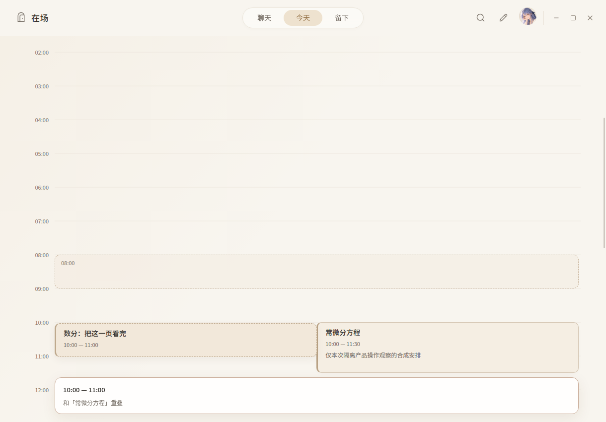
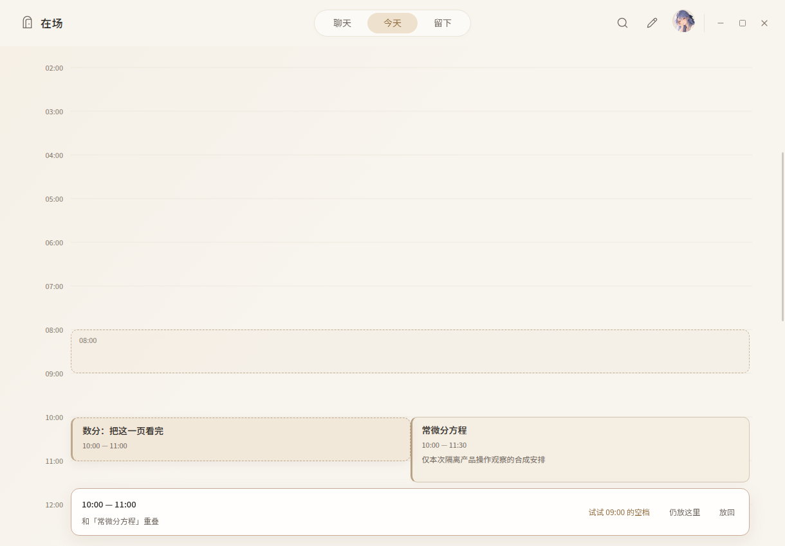
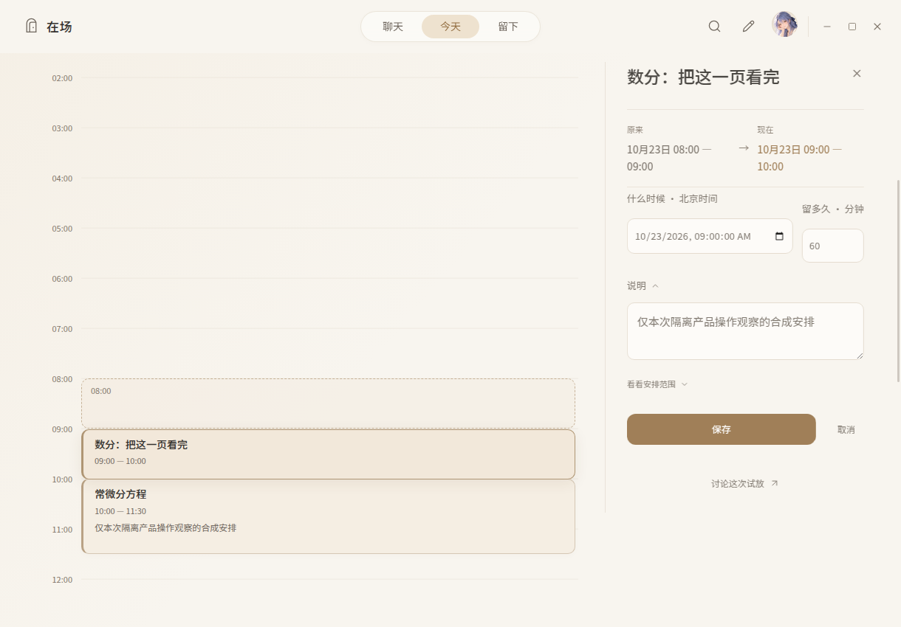
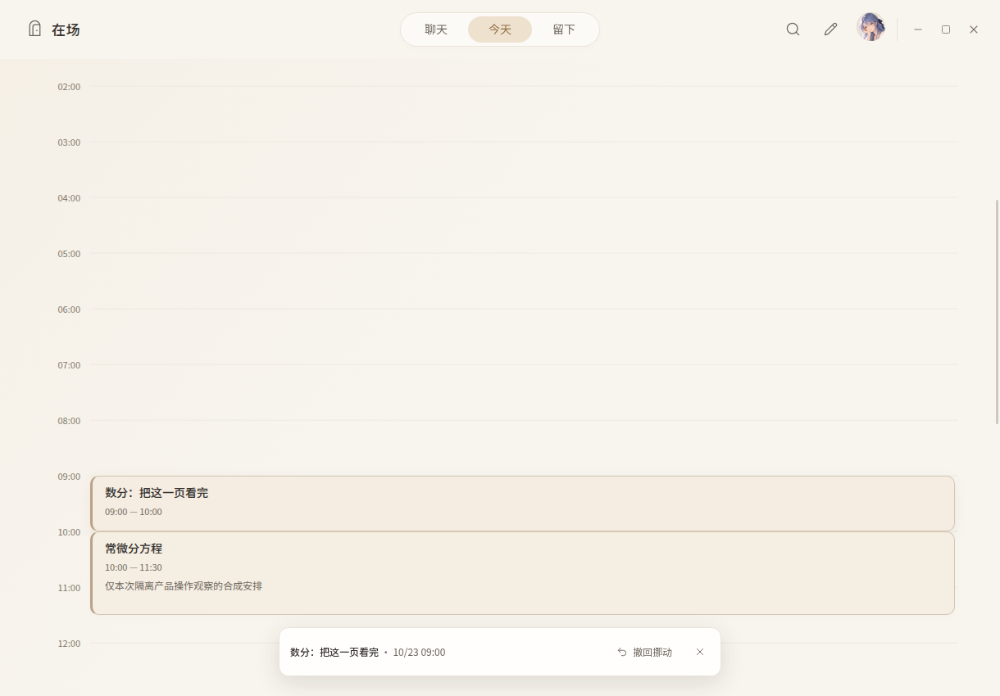
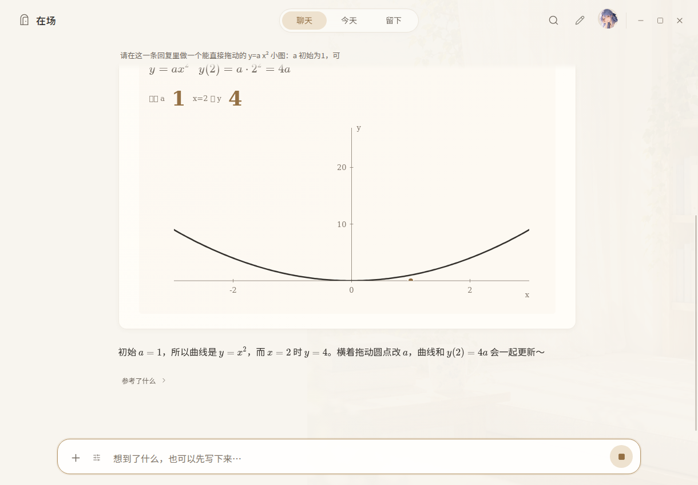
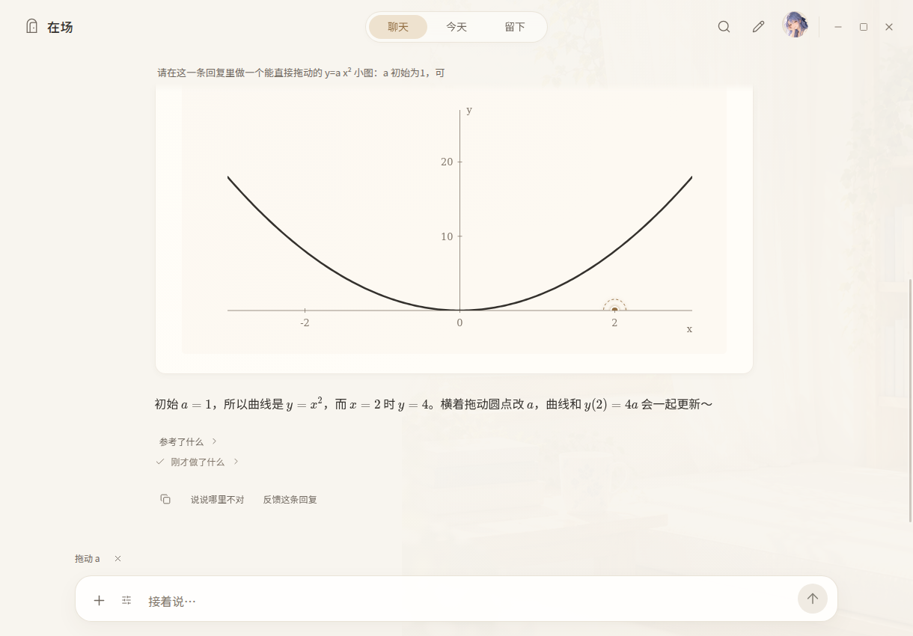
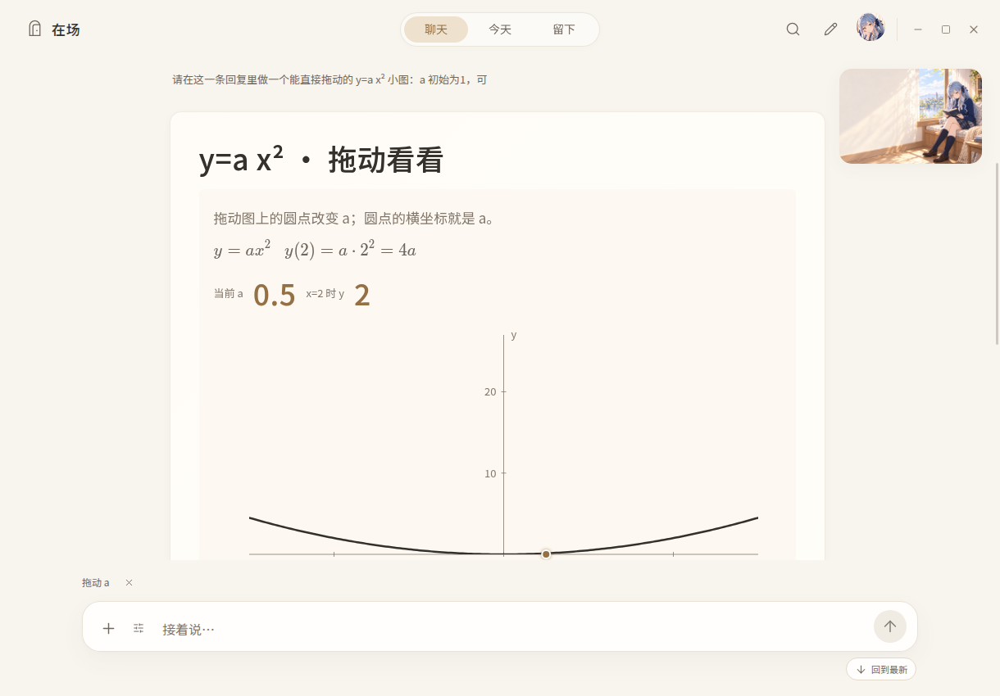
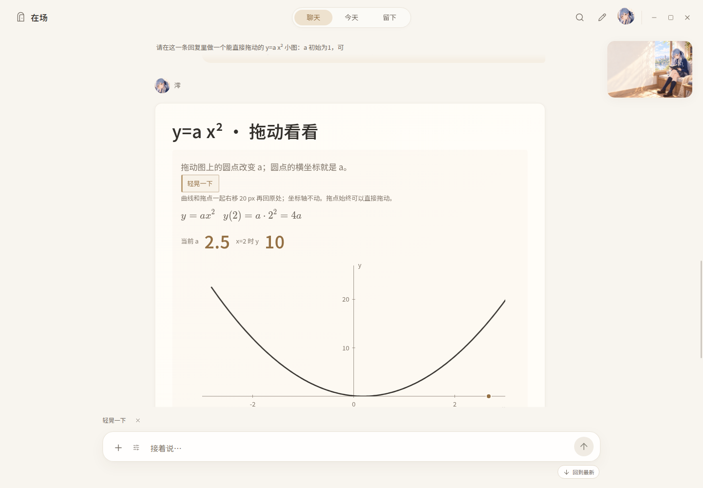
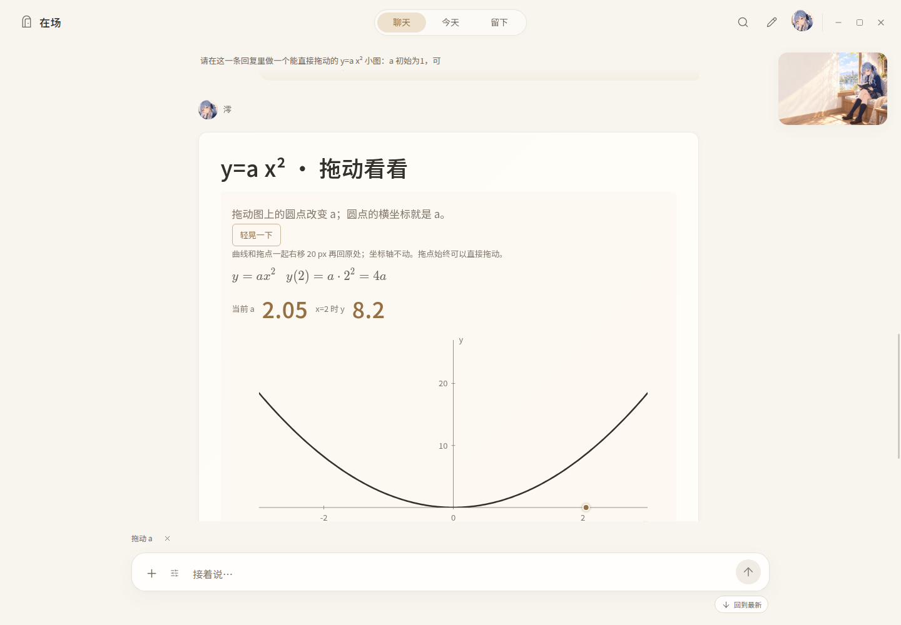

# 原生产品直接操纵观察

2026-10-23。使用当前真实 React / preload / Bridge / Store，官方锁定 Electron 44.3.0，在 Linux 独立合成资料目录内操作。没有替换 `window.zaichang`，没有新增测试 runner 或回归代码，没有使用真实校园账号数据。

## 环境与证据边界

官方 `node node_modules/electron/install.js` 安装成功；现有 `build-electron.mjs` 与 Vite 构建成功。主机禁止 AF_UNIX socket，产品首先在单实例锁处失败；按本轮主代理授权，只在生成的 `dist-electron/main.cjs` 将 `!app.requestSingleInstanceLock()` 条件临时替换为 `false`。源代码未改，下一次正常 desktop 构建覆盖此适配。Xvfb 在同一 Node 进程树内监听 TCP，Electron 通过 `DISPLAY=127.0.0.1:101` 使用它。

这里验证真实组件、IPC 和保存结果，不证明该主机能按完全未经适配的正常桌面入口启动，也不代表 Windows/触摸设备体验。图片都是实际应用窗口截图，不是设计稿。

## 日程：试放、碰撞、最近空档、保存与撤回

正常 Bridge 正确拒绝了没有原建议卡的任意新建 Action。观察输入因此通过临时编译的真实 `Store.writeAgendaProjection`，在隔离 SQLite 初始化三项明确合成的安排；这是输入准备，不作为正常 UI 新增安排的验收证据。之后全部操作使用实际页面、鼠标与既有 Bridge。

实际操作顺序与回读结果：

1. `qa-analysis` 原为08:00–09:00、revision 1；另有10:00–11:30的常微分安排及15:00的散步安排。
2. 实际指针将第一项从08:00拖到10:00。全天展开后保持指针抓取位置，原位 ghost 仍在08:00；两项相撞时实时分栏，反馈显示与“常微分方程”重叠。
3. 松手保留试放。点击“试试09:00的空档”，试放改为09:00–10:00；回读宿主仍为08:00、revision 1。
4. 点击“用这个时间”打开真实内嵌编辑器，前后时间、完整时长与宿主只读预览仍沿原对象。
5. 点击“保存”，宿主同 id 变为09:00、revision 2；agenda 数量仍为3。
6. 点击“撤回挪动”，同 id 恢复08:00、revision 3；agenda 数量仍为3。收集的 renderer `pageerror` 为空。

最近空档只根据本页有完整起止的安排寻找，不移动其它安排，也不宣称未知结束、全天事项或未取得的资料完全空闲。最终仍由原宿主预览和确认保存；重复实例、并发修订保护复用既有 occurrence/revision 链。

## 真实操作发现并修正的问题

首次拖动时，08点拖向10点却试放到03点。实际 DOM 显示 `.page-panel` 高2174px、没有滚动空间；原因是后段通用 `.today-workspace { display:grid }` 同时命中了外层保活容器。将这条网格规则精确限定为 `.today-main .today-workspace` 后，外层恢复既有 flex/min-height，实际面板高778px并可滚动，再次操作得到正确的10点。上述四张图均取自修正后的产品。

编辑器时间/时长列首个 label 被另一个样式的 `:first-child` 清除了顶部间距，已在本轮独占 CSS 精确补齐。正常前端重建后重新打开真实编辑器，两输入顶部均为238.0625px；已亲看 [修正后字段截图](../../../前端视觉创新设计/历史运行证据/2026-10-23-native-interactions/zaichang-agenda-fields-aligned-native.png)。

`npm run check` 已实际通过。手指/触摸、所有主题、重复系列和跨日全部组合没有在本记录逐一操作，不扩大本次证据范围。

## Luna：真实生成、实际拖动、保存、切页恢复与续问

同一个真实 Electron 实例启用既有 Luna 代测传输，明确设置 `/opt/codex/bin/codex`，没有调用 DeepSeek。通过实际聊天输入框发送：做一个 `y=a x²` 小图，a 初始1、范围0.5–3，拖动一个点改变a，并显示x=2时的y。

模型沿原主循环取得方法并发表真正的通用 OpenUI program；初轮完成，8次实际模型请求的 `responseModel` 都为 `gpt-6-luna`。原图初值为a=1、y(2)=4。

1. 用实际鼠标拖动SVG `DragHandle`，`aria-valuenow` 从1变为2，曲线变化，数值变为8。
2. 第一次紧接松手读取仍为 `stateRevision:0, inputs:{a:1}`，自动保存完成后回读为 `stateRevision:1, inputs:{a:2}`；没有由观察代码手动调用save。
3. 正常切到今天，再回聊天，a仍为2。这里验证切页续接；没有把它说成重启恢复。
4. 再次真实拖到a=2.5，原Bridge回读 `stateRevision:2, inputs:{a:2.5}`。
5. 正常输入“现在x=2时y是多少？按刚拖的值计算，直接回答，不改图。”模型完成回复：“刚拖到的a=2.5，所以y=2.5×2²=10呀～”。该轮 control/main/completion_review 三次实际型号均为 `gpt-6-luna`；`interactiveProgramSources` 指向原 message/program/revision1。

精确 program 地址、hash、实际型号、状态回执和续问正文见 [luna-interaction-receipt.json](luna-interaction-receipt.json)。它记录的是实际执行返回值，不是测试期望。

亲看图时发现两项视觉问题：放在坐标轴边缘的拖动圆柄被plot裁掉半边；小标签继承未打包的Noto Serif SC/Songti/SimSun，Linux上部分中文呈方框。通用渲染负责人修复后，正常Vite重建并重载原产品，从真实“历史对话”打开同一原消息，宿主持久a恢复为2.5，中文标签与完整圆柄均已亲看；再用实际指针拖到合法上下界3、0.5，后者自动保存为stateRevision3。真实键盘End/Shift方向键也能还原a=2.5，没有手动save。

## SVG内部Motion与中途拖动接管

控制层修改另外涉及SVG内部Motion祖先，因此在原真实composer继续请求：曲线和拖点同组，1秒内右移20px再回，坐标轴不动，拖动可随时接管。发送前，已用实际键盘End与五次Shift+左箭头将端点观察后的a恢复2.5；原字段step为0.01。没有把模型修订后的初值当作修订前的实际值。

该轮第一次发表参数被宿主拒绝，模型在原轮自行修订后完成；15次真实请求的型号仍为 `gpt-6-luna`。原program同id升到revision2、a保2.5，实际DSL是 `Graphic → Motion → Group[Curve, DragHandle]`，轴位于Motion之外，不是整个图框一起移动。

实际点击按钮，约250ms时，曲线左边界从413.5变为431.2888px，拖点左边界从967.75变为985.5388px，两者同移17.7888px；轴左端始终413.5px。动画结束，两者回到各自原位。原生截图见下。

再次点击，约210ms时用真实鼠标抓住正在运动的拖点向左拖60px，运动停止，a变为2.05，曲线随之改变，轴保持不动；renderer `pageerror` 仍为空。宿主新revision2自动保存状态与原始动画观察值保存在 [luna-motion-receipt.json](luna-motion-receipt.json)。没有将旧revision1的状态当成新稿回执。

这组观察覆盖这份实际程序的SVG组平移、边缘柄、实际指针与持久化接缝；不把它扩成所有嵌套变换、所有Motion形式和真机触摸均已验证。
