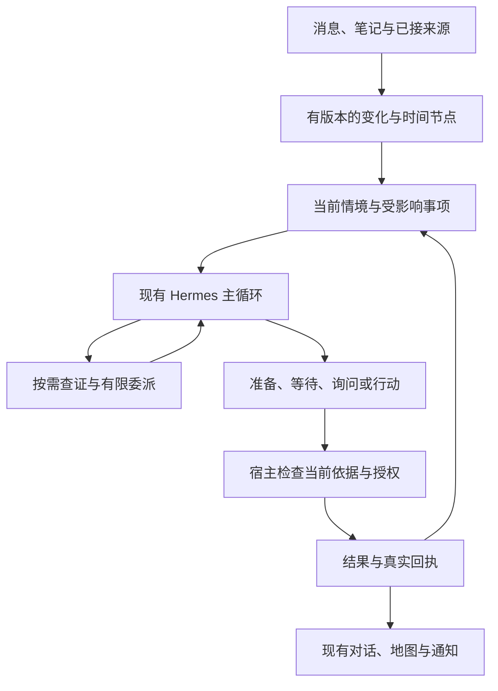

# 在场的学生生活 Harness：实施设计

版本：2026-10-18 / v1.0。本文是拟实施设计；已实现的基线见 [02 仓库审阅](02-REPOSITORY-AUDIT.md)。类型名表示职责，可并入现有类型，不要求照名字新建一套框架。

## 1. 产品判断

在场应当成为一个持续理解学生生活、能自己发现值得帮忙的事、能先做准备并在合适时机出现的伙伴。学生的学习、朋友、休息、兴趣、经济条件和当下感受共同决定“有用”。提高绩点或填满日程不能作为全局默认目标。

这次沿用真实 Hermes 主循环、宿主权限与版本控制、现有日历、提醒、记忆、地图和机会工作流。核心增量是让这些能力共享一个不断更新的情境，并把“广义托付—持续发现—准备—选择时机—行动—回读—修订”接成真实闭环。人格使参与方式自然，状态和执行机制保证说的话有依据、做的事有结果。

研究依据与采用边界见 [07，R01–R20](07-RESEARCH-DECISIONS.md)。以下是面向在场的综合设计，不能归称为 Muse、Grok Bot 或某篇论文公开的内部实现。

## 2. 沿现有架构扩展

图中是逻辑责任，第一版继续使用现有 TypeScript 宿主、SQLite 持久状态和 Python sidecar；不引入 Kafka、第二套 Agent 引擎或独立图数据库作为先决条件。

| 责任 | 现有入口 | 本轮改变 |
|---|---|---|
| 理解原话、调用工具、处理观察、继续推理 | `harness.ts`、`runtime/hermes.ts`、`runtime/hermes/sidecar.py` | 保留单主循环与真实上游 AIAgent；让实时情境可补充、可展开 |
| 事实归属、版本与派生失效 | `storage/repository.ts`、`storage/domains.ts`、`memory/*` | 统一变化信封、完整投递删除/修订、关联计划和机会的依赖 |
| 关注与主动机会 | `runtime/attention.ts`、`coordinator.ts` | 在已有 focus/probe/offer/decide 上补广义托付、派生关注、时间窗及陌生变化发现 |
| 排程与执行 | `actions/local-calendar.ts`、`availability.ts`、`reminders.ts`、`runtime.ts` | 区分方案与已接受安排，检验可行性，局部修订，单一通知执行者 |
| 能力发现与事实读取 | `capabilities/*`、`zjuAdapter.ts` | 保留动态目录和再次发现能力；准确报告连接、授权、覆盖与新鲜度 |
| 地图和定位 | 现有 map service/bridge/location 及共享地图 | 用稳定地点 ID 和路线材料接计划；不复制地图，不把电脑位置叫手机 GPS |
| 自定义相处方式 | `shared/interaction.ts`、`SettingsPanel.tsx`、`settings.guidance` | 版本化角色、独立学习偏好、主动范围与预览；保留旧设置原文 |

## 3. 先把“知道什么”接清楚

### 3.1 一个事实有几个时间

每项动态事实保留来源、主体、发生/生效时间、系统获知时间、来源版本、覆盖范围、权限用途与有效性。课堂在 14:00 开始、平台在 10:00 发布调课、应用在 10:05 同步，是不同的时间。时区以 IANA 标识保存；API 的日期含义、学期和周次由来源适配器解释。

原始观察、用户自述、学校业务记录与模型推断分别保存。用户说“已经交了”可以立即改变交互和提醒状态，但不能伪造平台的提交回执；平台稍后仍显示未提交时保留冲突与同步时差，必要时回查。助理生成的计划不是学校课表，笔记里的假设不是本人经历。

### 3.2 情境是一个有边界的视图

`SituationSnapshot` 至少投影：当前时间/时区、相关地点及位置质量、下一项承诺、进行中事项、目标、当前自述、相关环境、已有授权、关键未知、各依赖版本。它不是每轮把所有 self data 拼成系统提示词。

稳定用户背景按相关性进入；当前原话和最新纠正直接可见；需要的业务事实即时读取；检索结果可继续展开原文、条件、例外和冲突。某一层未覆盖的资料标记为未知或未查，不能用空数组宣称“你今天没有事”。

人的建模见 [03](03-HUMAN-AND-WORLD-MODEL.md)。既允许结构化时间区间、来源、状态，也保留“为什么想这样安排”的开放语言。不要把人的生活压成有限枚举表，也不要通过某一人格类型推算所有偏好。

### 3.3 统一变化入口

复用现有 domain/memory/calendar 提交出口，在同一持久事务内记业务版本和待处理事件。消费者用 cursor/ack 逐批读取，失败后从连续水位恢复。事件至少支持 upsert、取消/删除、纠正、权限变化和 deadline wake。批量大小可以限制每次处理成本，不能截去第 9 条以后的记录或漏掉 tombstone。

事件按稳定 ID/版本去重；乱序旧版本不能覆盖新版本。业务内容指纹与 `fetchedAt` 分开：仅抓取时间改变不代表新机会。来源“请求成功但无记录”“分页没完”“请求失败”“范围不覆盖”保持不同状态。

GPS 去噪只用明确的时间、精度和地点边界条件，不由每次漂移造一个“已到达”。天气以所需地点、预测时间窗、发布时间、覆盖粒度取证；当前日级杭州参考预报不能变成校园分钟级降雨承诺。

## 4. 主动性如何开始、继续和停止

### 4.1 用户不用逐条说“请调用技能”

引入可编辑的广义托付 `InitiativeMandate`，例如“这学期帮我留意课程变化和出行，能先准备就准备”“这两周适度帮我推进期中复习”。用户可直接自然表达，也可在首次启用主动能力时选择少量范围。已有托付在有效期内持续生效；不要求每一个派生 watch 再问一次。

托付包括对象/目标、可读来源、允许的帮助与动作范围、适用期限、打扰偏好和停止条件。用户明确表达的目标、已接受计划和已允许读取的来源变化，均可成为范围内的派生关注依据。人格里的“元气、热情”本身不授权读取邮箱、扩大后台采集或替人承诺聚餐。

首次默认采用“可安静准备、在有实质帮助时出现”的互动方式；用户无需完成长问卷。后台资料读取仍遵守已有来源许可。缺少托付时，当前会话已请求的任务照常完成；可以在自然节点提出一次具体可理解的持续帮助范围。

### 4.2 已知依赖与陌生机会都要覆盖

已有计划/关注登记其依赖，如课程 occurrence、目标、天气时间窗、路线起终点、预约开放节点。依赖变化可以便宜地定位需复查事项。

仅靠依赖表会漏掉系统此前不知道的需要。为新接来源、首次读到的有效变化和未关联事件提供有预算的语义发现批次，由同一主模型判断在当前托付内是否有新的关联或机会。便宜的路由只处理重复、版本、范围、时效和预算；不能用固定“考试/跑步/约饭”词表预先决定意义。保留低频全量对账以恢复漏订阅和中断，优先合并事件，避免空轮询不断调用模型。

被预算暂缓的事件保留在队列，下一批继续，不丢弃。已终止目标的历史资料不会再次悄悄建立关注。长期无反馈可降低未经承诺的新建议频率，但不能自行取消明确要求持续的提醒。

队列先处理已知且接近 `latestActionAt` 的有效机会，再处理普通依赖变化与陌生机会发现；合并重复、跳过已失效材料，防止某个高频来源长期占满预算。明确约定的硬提醒走既有独立执行路径，不被语义发现队列挤掉。因预算、离线或失败错失的窗口应持久记录原因，不能在事后补发时伪称按时完成。

### 4.3 时间流逝本身能改变决策

即使来源没更新，预约窗口开放、最后可出发时刻、用户下课、预报过期都会改变行动价值。每个机会可设置多个可行处理窗和下一复核时间。时间相关查询使用运行时可重新解析的规则或具体 occurrence；不能把创建关注时的“明天”永久冻结成一个旧日期。

当前固定轮询可保留作恢复入口，但应调度最近必要唤醒并合并来源请求。配置只规定资源和默认值；有明确临近截止的事实时，不能被一个通用 30 分钟扫描间隔悄悄错过。

### 4.4 主模型做生活判断，宿主做可核验边界

模型判断：这与谁的目标有关、现在有没有实质帮助、可否先做、是否值得打扰、是否应问一个问题、哪种取舍更合适。给它原话、事实、未知与当前工具能力；可以主动查地图、课程或笔记，不等待对应触发词。

宿主验证：事件/对象版本、来源用途、动作范围、时间与资源可行性、去重、预算、外部实际能力和回执。不把模型一句“高度确信”变成已授权，也不让固定打分表替模型判断学生生活。

允许模型在工具结果回来后改判。无需在每条输入前强制产出完整 InterpretationProposal、TaskNeeds、情绪分类、人格分类和计划表；现有控制提案只处理真实资料边界，不应接管开放任务意图。

### 4.5 六种自然结果

| 结果 | 实际做什么 | 例子 |
|---|---|---|
| 安静准备 | 查清资料，保存有依据且会失效的可用材料 | 下节课换楼，先算出路线 |
| 在当前对话中提起 | 用户已在相关语境，无需额外推送 | 聊晚饭时顺带说明仍可保留的学习块 |
| 等待 | 记录适当窗口，到时先重查 | 仍在上课，下课后处理还来得及 |
| 主动提示 | 有新的可行动帮助，错过有实际代价或值得分享 | 预约窗口将关闭，或期待的活动开放报名 |
| 必要询问 | 一个未知实质改变下一步，已先完成其它可做工作 | 朋友约饭时间不清楚，影响整块学习时长 |
| 不介入/结束 | 更新内部状态或撤销失效机会 | 已完成打卡、变化不影响计划、明确想独处 |

这些不必增加六个用户按钮。实现时可映射现有 `none/wait/prepare/ask/notify`，把“随对话提起”作为渠道和呈现时机，不必推翻现有状态机。已明确授权的可撤销本地动作可执行并回报；对外消息和不可逆承诺使用真实已授范围，材料先准备到可审阅程度。

“热情”的正向场景包括帮用户保住完整休息、记得一直想看的展览、找到与朋友相处的空档、在小目标完成后简短认可。不要把主动性缩成风险提醒，也不要把每次用户低落都转成任务清单。

### 4.6 发布前必须仍然成立

机会经过 `candidate → preparing → ready → waiting/offered → accepted/executing → resolved`，可从任一步进入 superseded/cancelled/expired；兼容现有表可映射状态。保存影响它的版本和停止条件。

准备后、展示前、写入前分别检查必要依赖仍有效；需要强一致的副作用在提交事务中比较修订号。天气或课程新版本、用户撤回目标、权限变化、已完成任务均可使材料过期。旧子代理迟到结果可保留诊断状态，但不能重新激活被取消的计划。

同一机会与修订号共用呈现记录，再选择聊天、应用内或 OS 通知渠道；已在前台自然呈现的内容，不无故再推一遍。渠道回执保留 submitted/delivered/seen 等实际证据，不能混用。有真正新的事实或新的行动价值时可以更新同一机会，不用永久去重掩盖后续重要变化。

## 5. 从下一段时间开始做可行规划

### 5.1 沿用本地日历，补足语义

现有 event/todo/deadline/reminder/time_block、重复规则、occurrence exception、revision 和 undo 是基础。新增目标和计划引用关系，明确区分学校事实、本人硬承诺、可调整计划块、邀请/草案和偏好。

课程必须按具体日期 occurrence 对齐学期、周次、节次、时区和临时例外；学校权威取消不删除聊天经历，但立即使其旧出行/提醒依据失效。先用手动导入或已连接接口；未验证的源只能显示其真实覆盖。

任务可有截止、时长范围、可分段性、地点/设备/材料依赖、最小连续时长与进度。用户不知道时长就保留范围，不偷填成一小时。记下一件事不等于把它排进某个时段。

### 5.2 模型提方案，计算器检验

模型可以提出少量真正不同的安排，解释其对学习、社交和休息的取舍。复用 availability 的区间合并、扣除和缓冲计算；验证硬承诺、可移动范围、转场、资源开放、任务依赖和已知限制。未知的开放时间或不完整课表让方案变成条件成立，而非肯定可行。

不默认优化一个固定加权总分，不凭模型小数宣称成功概率。第一版用明确约束与可解释取舍；将来有真实反馈后再评估是否需要学习排序。预算、默认缓冲、扫描批量等是可配置工程参数，不是人的价值判断。

### 5.3 变化后尽量少改

保留已经接受且未受影响的承诺；只重算受变化影响的计划范围。用户选了“饭前复习”以后，朋友改时间应修订同一安排及其依赖提醒，不能新建第二份重复安排。保留撤销和并发版本冲突处理。

变化先产生同一对象的 proposed diff；只有当前指令或既有托付已允许调整该可移动块时才提交日历及对应提醒，否则给用户选择后提交。朋友改时间是新事实，不是用户新增授权。已明确授权的自动调整继续完成，不反复确认；固定时刻提醒与可延期机会仍按各自约定处理。

“十二天还需三次体育打卡，明天可能下雨”只支持比较可行运动窗口。还需知道有效次数规则、后续天气覆盖、课程、身体自述、是否已完成。只有所有仍可行方案都依赖今天时，才有依据说今天不可错过；通常更适合“今天是较稳妥的一个窗口”。校园打卡规则由来源提供，不在 Harness 写死天数或次数。

## 6. 地图是准备和行动的组成部分

主模型判断需要地点或路线时，即可发现现有 map/location/route 能力。路线材料引用意图、稳定地点 ID、起点来源和质量、交通模式、计算时刻、版本、有效窗、估计范围以及相关日程。地图数据与个人叠加层分开；公共 review 不加入个人信息。

后台可先准备路线，但不抢用户正在操作的镜头或突然打开地图；当前用户问“怎么走”时可自然呈现路线。提示如“下节换到东边那栋，我把路线放好了”必须真的有可点开的路线材料。图形展示代理位置不应被当成路网通行事实。

当前只有校园步行图时，不生成骑车/无障碍/室内精准 ETA；未验证入口或开放时段要保留条件。定位过旧、误差跨多个建筑或来源是 Windows 时，不能说手机实时位置；可用用户提供的起点继续完成路线准备。

天气工具改为明确的地点/时间窗请求与覆盖回执；允许粗粒度地理位置满足天气查询。是否为校园参考坐标、某地点还是设备位置必须清楚，缓存也按这些语义分键。

## 7. 记事本、来源和动作怎样接入

笔记是用户可编辑的独立内容对象：标题、正文、版本、创建/修改时间、来源/所有权、附件定位和删除恢复策略。支持保存、检索、修改、撤销；可以复用现有 material/store，但不能只往长期记忆写一句摘要充当记事本。

笔记可以成为规划依据；从“下周想问老师”到提醒或日程，需要当前明确委托或既有动作授权。笔记更新使相关派生事项重新核对，删除笔记按其用途和引用关系处理，不无声删除独立已接受日程。

未来连接器共同报告：未接入、未配置、需授权、可用、部分覆盖、过期、失败；接口目录存在不等于已登录且查全。读取和写入分别描述。课表/考试/作业、体育进度、图书馆、邮件/钉钉、健康、手机日志接入时复用同一变化、证据与回执契约。

对外副作用维持 prepared/authorized/submitting/succeeded/failed/unknown 等实际状态。超时为 unknown 时先回查，不能直接重发。手机健康和情绪仅作为授权范围内的观察或本人自述，不由几条信号构造临床诊断。别人给用户发来的话不是系统指令，也不替用户授予动作范围。

## 8. 持续运行与手机路线

当前是 Electron/Windows 宿主，退出进程后现有定时器停止；OS notification submitted 不是 delivered/seen。这个事实不能靠文案变成“全天候手机助手”。

本轮先交付桌面核心闭环，并把 Clock、Store、Notification、Location、Worker、Model transport 的既有实现提成必要端口，避免新代码把 Electron 定时器散落到领域层。持久 job 有 nextRunAt、lease、attempt、幂等键、依赖版本、取消状态和结果；同一提醒 occurrence 只由一个 owner 执行，不再加一套独立 Hermes cron 与它争抢。

产品终局应能离开用户电脑工作。后续 Android 验证分两条有证据的路线：手机持有本地状态/提醒与采集，Hermes 运行在用户选择的持续宿主；或经实测证明可行的手机本地 Hermes。不能把 Electron 套壳、Python 能安装或一个网页截图当成移动链完成。部署远程私人数据之前应形成可审阅的宿主/数据方案，再沿当时授权落实；本包不授权现在上传个人资料。

Android WorkManager 的周期工作至少 15 分钟且受系统调度，不能承诺复制一分钟检查；精确用户闹钟/推送/前台服务需各自平台契约。后台恢复对过期机会应重算或丢弃，对未知外部提交先回查。跨设备同步需要 owner 与版本 fencing，不能两个设备各推一次。[07，R19]

DeepSeek 生产链与 Luna 测试代用保持标识。官方 Sign in with ChatGPT 集成可作为独立 provider 里程碑，按自己的应用注册/授权、账户状态、实际推理、续期/撤销路径验证；不能把现有测试 transport 名称改成“已支持所有 ChatGPT 账号”。[07，R20]

## 9. 成功的第一条纵向闭环

缓存、原文覆盖与子代理的具体实现约束见 [05](05-MEMORY-CONTEXT-PERSONA.md)。保持宿主 `_build_system_prompt` 与已关闭原生 memory/background review 的既有设计；稳定角色前缀、动态情境和业务状态分别更新。使用已经接入的 delegate，补齐必要的版本、预算、取消与父代理结果消费；不能把“支持缓存/子代理”写成另启一套原生记忆或另造 Agent 框架。

用合成学生资料或本人已授权的现有本地资料：保存“本周保留连续学习时间”的目标和托付；记录具体课程及朋友邀请；课程换楼时自动更新情境、准备路线；用户说“晚上想和他们吃饭”时结合邀请与天气给出少量可行调整；选定后写入同一日程；新变化只修订受影响部分；任务完成后旧提醒停止。没有发送能力就只形成可用草稿，不谎称朋友收到。

这条闭环至少包括一次应主动、一次应等待、一次应静默、一次用户纠正和一次运行中取消。它必须走真正的事件入口、主模型工具回写、持久状态和呈现路径。详见 [06 实施与验收](06-IMPLEMENTATION-AND-ACCEPTANCE.md) 及 [连续场景](scenarios/timelines.json)。
